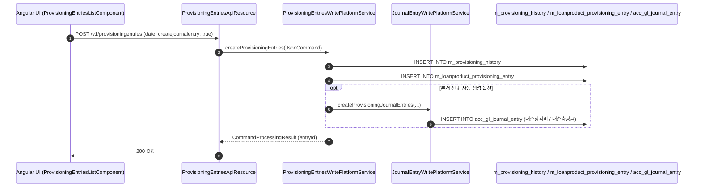

# [ACP] 콜그래프

> 화면 1개 롤업(소분류 ACP, 대분류 AC - 회계 결산 및 대손충당금).

## ACP-001 회계 결산 및 대손충당금

> 원본: `fineract-provider/src/main/java/org/apache/fineract/accounting/provisioning/`

### 대손충당금 자동 산출 및 분개 전표 기표 흐름

> 공유: ACC, PDL

## 근거
- `fineract-provider/src/main/java/org/apache/fineract/accounting/provisioning/`
