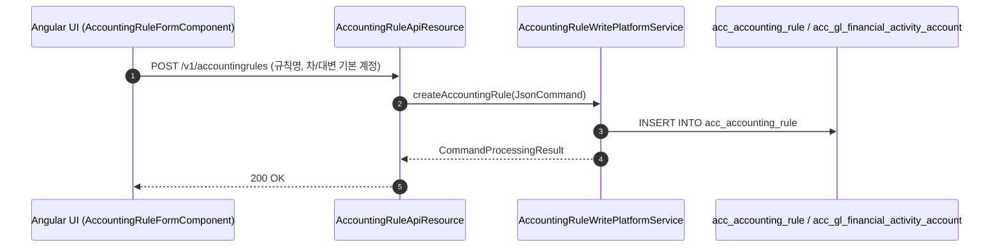

# [ACR] 콜그래프

> 화면 1개 롤업(소분류 ACR, 대분류 AC - 회계 규칙 및 매핑).

## ACR-001 회계 분개 규칙 및 매핑

> 원본: `fineract-provider/src/main/java/org/apache/fineract/accounting/rule/`

### 회계 분개 규칙 및 금융활동 매핑 흐름
> 공유: ACC, PDL, PDS

## 근거
- `fineract-provider/src/main/java/org/apache/fineract/accounting/rule/`
