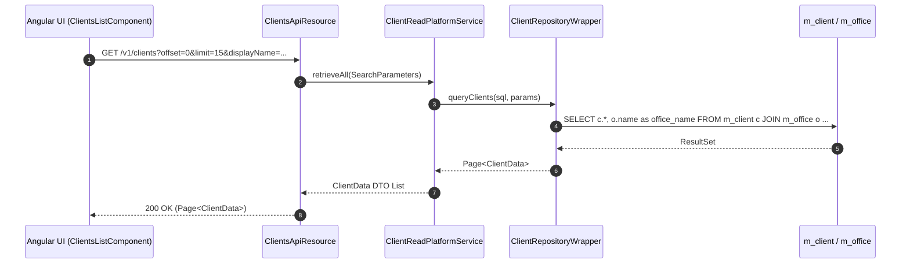
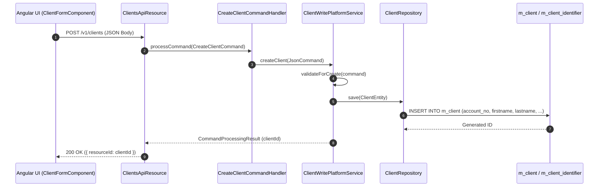

# [CLA] 콜그래프

> 화면 2개 롤업(소분류 CLA, 대분류 CL - 고객 관리).

## CLA-001 고객 목록 및 검색

> 원본: `fineract-provider/src/main/java/org/apache/fineract/portfolio/client/`

### 고객 목록 조회 및 검색 흐름
> 공유: CLG, CLS, LNA, SVA

## CLA-002 고객 등록 및 상세정보

> 원본: `fineract-provider/src/main/java/org/apache/fineract/portfolio/client/`

### 신규 고객 등록 및 유효성 검증 흐름
> 공유: CLG, SYI

## 근거
- `fineract-provider/src/main/java/org/apache/fineract/portfolio/client/`
