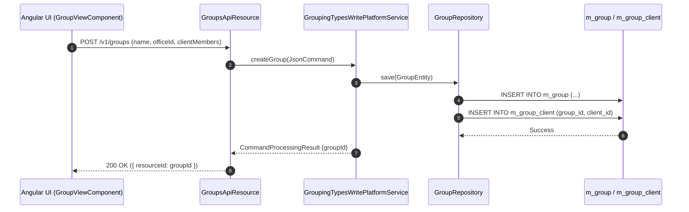

# [CLG] 콜그래프

> 화면 1개 롤업(소분류 CLG, 대분류 CL - 그룹 및 센터 관리).

## CLG-001 그룹 및 센터 관리

> 원본: `fineract-provider/src/main/java/org/apache/fineract/portfolio/group/`

### 그룹 생성 및 구성원 등록 흐름
> 공유: CLA, CLS

## 근거
- `fineract-provider/src/main/java/org/apache/fineract/portfolio/group/`
