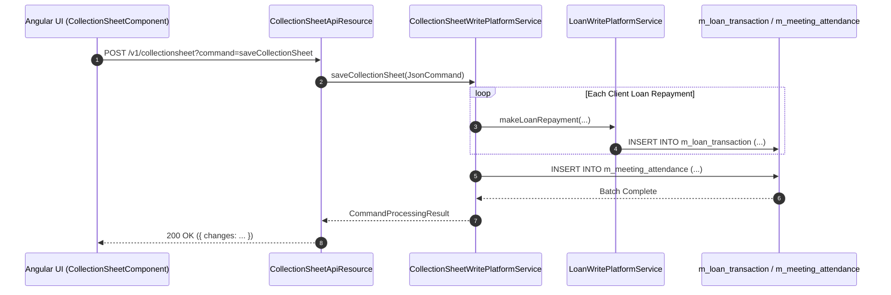

# [CLS] 콜그래프

> 화면 1개 롤업(소분류 CLS, 대분류 CL - 일괄 수납 집계표).

## CLS-001 일괄 수납 집계표

> 원본: `fineract-provider/src/main/java/org/apache/fineract/portfolio/collectionsheet/`

### 일괄 수납 데이터 생성 및 전표 처리 흐름
> 공유: CLA, CLG, LNR, SVA

## 근거
- `fineract-provider/src/main/java/org/apache/fineract/portfolio/collectionsheet/`
