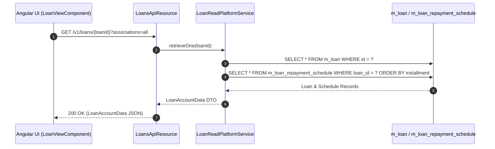
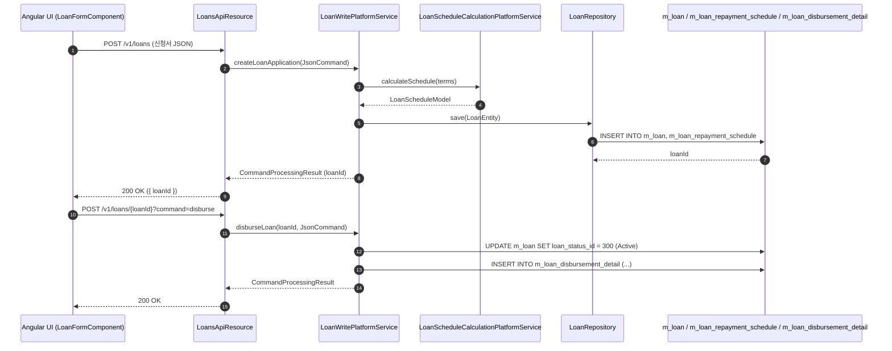

# [LNA] 콜그래프

> 화면 2개 롤업(소분류 LNA, 대분류 LN - 대출 계좌 관리).

## LNA-001 대출 계좌 목록 및 상세

> 원본: `fineract-provider/src/main/java/org/apache/fineract/portfolio/loanaccount/`

### 대출 계좌 원장 및 상환 스케줄 조회
> 공유: LNR, LNO, WCL

## LNA-002 대출 신청 및 실행

> 원본: `fineract-provider/src/main/java/org/apache/fineract/portfolio/loanaccount/`

### 대출 신청, 승인 및 지급 실행 흐름
> 공유: LNR, LNO, PDL, WCL

## 근거
- `fineract-provider/src/main/java/org/apache/fineract/portfolio/loanaccount/`
