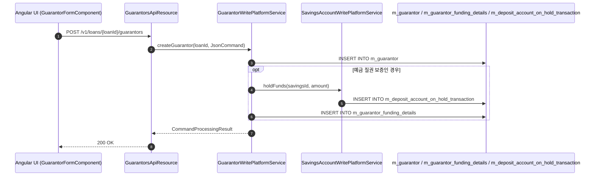
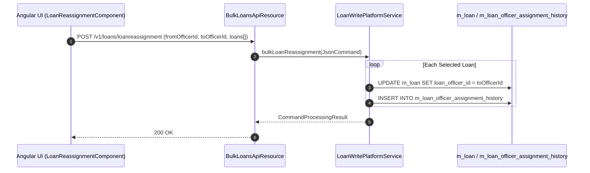

# [LNO] 콜그래프

> 화면 2개 롤업(소분류 LNO, 대분류 LN - 대출 부속 및 운영).

## LNO-001 대출 담보 및 보증인 관리

> 원본: `fineract-provider/src/main/java/org/apache/fineract/portfolio/loanaccount/guarantor/`

### 보증인 등록 및 예금 질권 설정 흐름
> 공유: LNA, SVA

## LNO-002 대출 일괄 재배정 및 시점조회

> 원본: `fineract-provider/src/main/java/org/apache/fineract/portfolio/loanaccount/`

### 대출 담당자 일괄 재배정 흐름
> 공유: LNA, OGB

## 근거
- `fineract-provider/src/main/java/org/apache/fineract/portfolio/loanaccount/`
- `fineract-provider/src/main/java/org/apache/fineract/portfolio/loanaccount/guarantor/`
