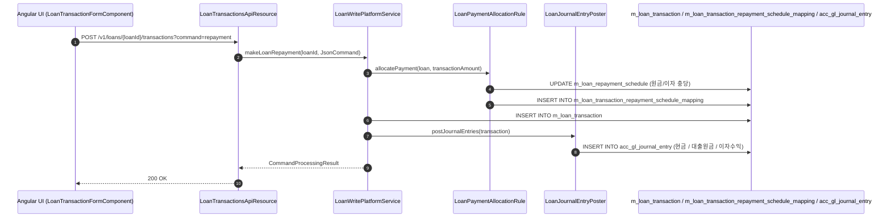
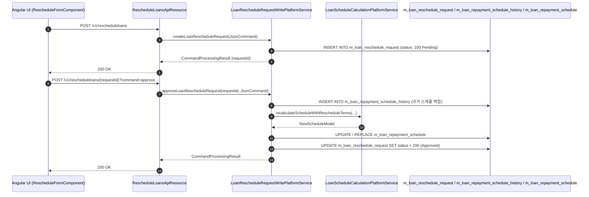

# [LNR] 콜그래프

> 화면 2개 롤업(소분류 LNR, 대분류 LN - 대출 상환 및 재조정).

## LNR-001 대출 상환 및 거래 처리

> 원본: `fineract-provider/src/main/java/org/apache/fineract/portfolio/loanaccount/`

### 대출 상환(Repayment) 및 충당 분개 흐름
> 공유: LNA, ACC, CLS

## LNR-002 대출 상환일정 재조정

> 원본: `fineract-provider/src/main/java/org/apache/fineract/portfolio/loanaccount/rescheduleloan/`

### 대출 재조정(Reschedule) 신청 및 스케줄 재계산 승인 흐름
> 공유: LNA

## 근거
- `fineract-provider/src/main/java/org/apache/fineract/portfolio/loanaccount/`
- `fineract-provider/src/main/java/org/apache/fineract/portfolio/loanaccount/rescheduleloan/`
