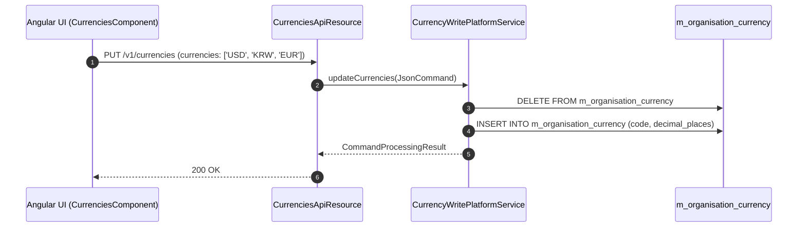

# [OGC] 콜그래프

> 화면 1개 롤업(소분류 OGC, 대분류 OG - 통화 및 조직 공통설정).

## OGC-001 통화·자금원·계좌체계

> 원본: `fineract-provider/src/main/java/org/apache/fineract/organisation/monetary/`

### 조직 통화 및 결제수단 설정 흐름

> 공유: ACC, PDL, PDS

## 근거
- `fineract-provider/src/main/java/org/apache/fineract/organisation/monetary/`
