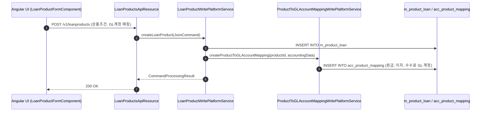
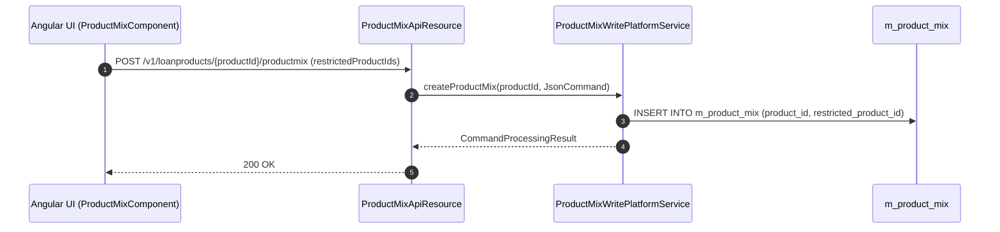

# [PDL] 콜그래프

> 화면 2개 롤업(소분류 PDL, 대분류 PD - 대출 상품 설정).

## PDL-001 대출 상품 관리

> 원본: `fineract-provider/src/main/java/org/apache/fineract/portfolio/loanproduct/`

### 대출 상품 생성 및 회계 매핑 등록 흐름
> 공유: ACR, ACC, WCP

## PDL-002 대출 상품 믹스 및 모집인

> 원본: `fineract-provider/src/main/java/org/apache/fineract/portfolio/loanproduct/productmix/`

### 대출 상품 믹스 규칙 정의 흐름
> 공유: LNA

## 근거
- `fineract-provider/src/main/java/org/apache/fineract/portfolio/loanproduct/`
- `fineract-provider/src/main/java/org/apache/fineract/portfolio/loanproduct/productmix/`
