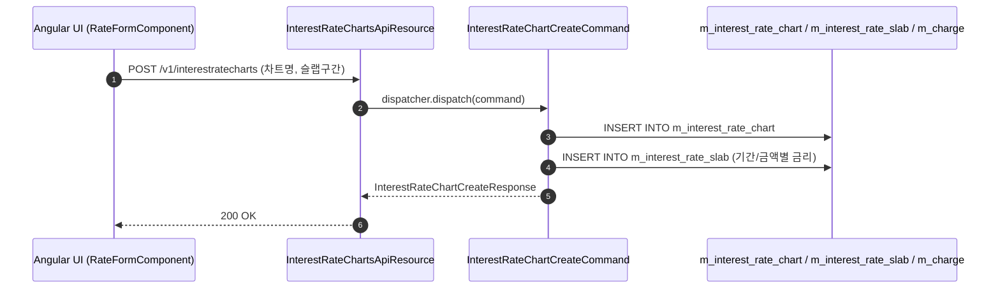

# [PDR] 콜그래프

> 화면 1개 롤업(소분류 PDR, 대분류 PD - 금리·수수료·세무 설정).

## PDR-001 금리·수수료·세무 설정

> 원본: `fineract-provider/src/main/java/org/apache/fineract/portfolio/rate/`

### 금리 차트 및 수수료 규정 등록 흐름
> 공유: PDL, PDS, LNA, SVA

## 근거
- `fineract-provider/src/main/java/org/apache/fineract/portfolio/rate/`
