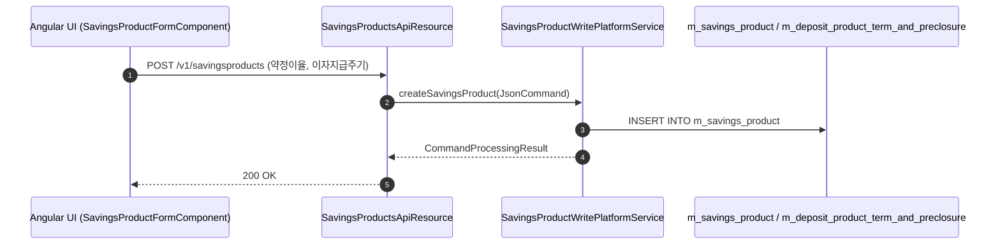
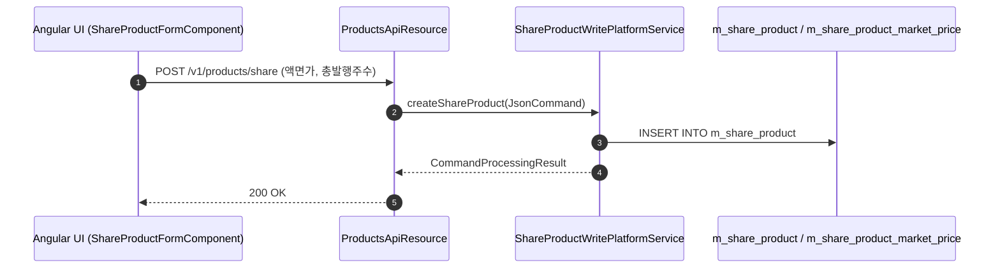

# [PDS] 콜그래프

> 화면 2개 롤업(소분류 PDS, 대분류 PD - 수신 및 주식 상품 설정).

## PDS-001 예적금 상품 관리

> 원본: `fineract-provider/src/main/java/org/apache/fineract/portfolio/savings/product/`

### 예적금 상품 생성 흐름
> 공유: SVF, SVR, PDR

## PDS-002 주식 상품 관리

> 원본: `fineract-provider/src/main/java/org/apache/fineract/portfolio/shareproducts/`

### 주식 상품 및 시가 등록 흐름
> 공유: SVS

## 근거
- `fineract-provider/src/main/java/org/apache/fineract/portfolio/savings/product/`
- `fineract-provider/src/main/java/org/apache/fineract/portfolio/shareproducts/`
