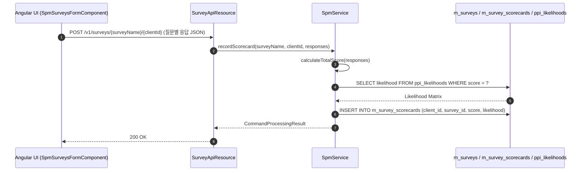

# [RPS] 콜그래프

> 화면 1개 롤업(소분류 RPS, 대분류 RP - 사회성과 관리).

## RPS-001 사회성과(SPM) 지표 관리

> 원본: `fineract-provider/src/main/java/org/apache/fineract/spm/`

### 고객 사회성과 설문조사(PPI) 응답 등록 및 빈곤확률 산출 흐름

> 공유: CLA

## 근거
- `fineract-provider/src/main/java/org/apache/fineract/spm/`
