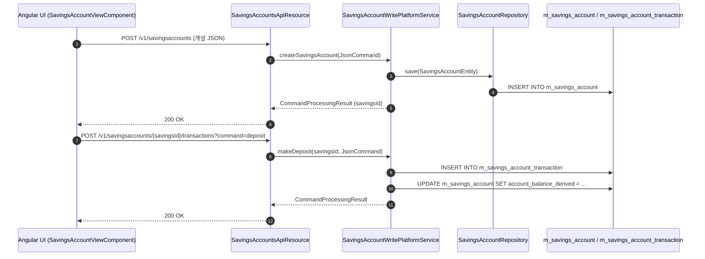
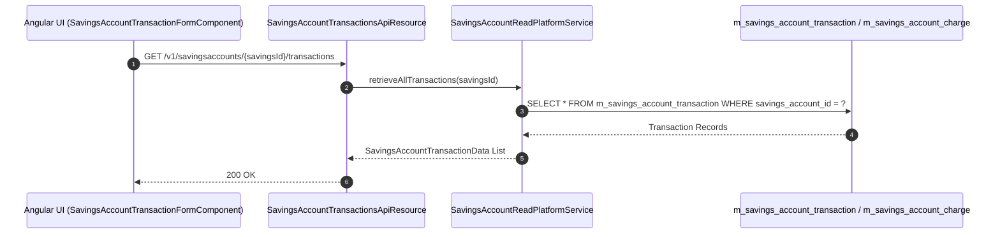

# [SVA] 콜그래프

> 화면 2개 롤업(소분류 SVA, 대분류 SV - 보통예금 계좌).

## SVA-001 보통예금 계좌 관리

> 원본: `fineract-provider/src/main/java/org/apache/fineract/portfolio/savings/`

### 보통예금 계좌 개설 및 입출금 거래 흐름
> 공유: SVF, SVR, TRA

## SVA-002 예금 수수료 및 거래 이력

> 원본: `fineract-provider/src/main/java/org/apache/fineract/portfolio/savings/`

### 예금 거래 내역 조회 및 수수료 부과 흐름
> 공유: PDR, TRA

## 근거
- `fineract-provider/src/main/java/org/apache/fineract/portfolio/savings/`
