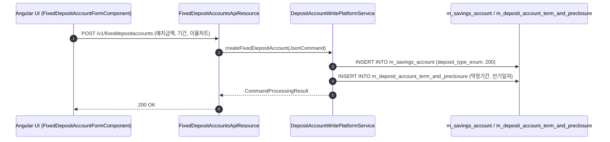

# [SVF] 콜그래프

> 화면 1개 롤업(소분류 SVF, 대분류 SV - 정기예금 계좌).

## SVF-001 정기예금 계좌 관리

> 원본: `fineract-provider/src/main/java/org/apache/fineract/portfolio/savings/`

### 정기예금 계좌 개설 및 만기 약정 처리 흐름
> 공유: SVA, PDS

## 근거
- `fineract-provider/src/main/java/org/apache/fineract/portfolio/savings/`
