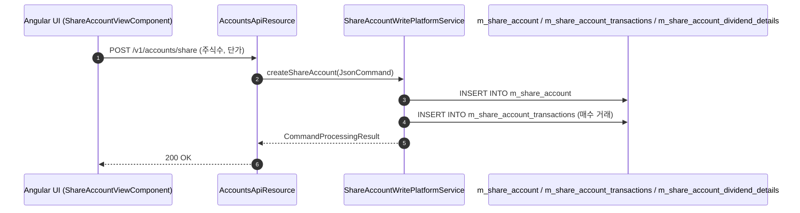

# [SVS] 콜그래프

> 화면 1개 롤업(소분류 SVS, 대분류 SV - 주식 계좌).

## SVS-001 주식 계좌 및 배당 관리

> 원본: `fineract-provider/src/main/java/org/apache/fineract/portfolio/shareaccounts/`

### 주식(출자금) 계좌 개설 및 배당금 지급 흐름
> 공유: PDS, SVA

## 근거
- `fineract-provider/src/main/java/org/apache/fineract/portfolio/shareaccounts/`
