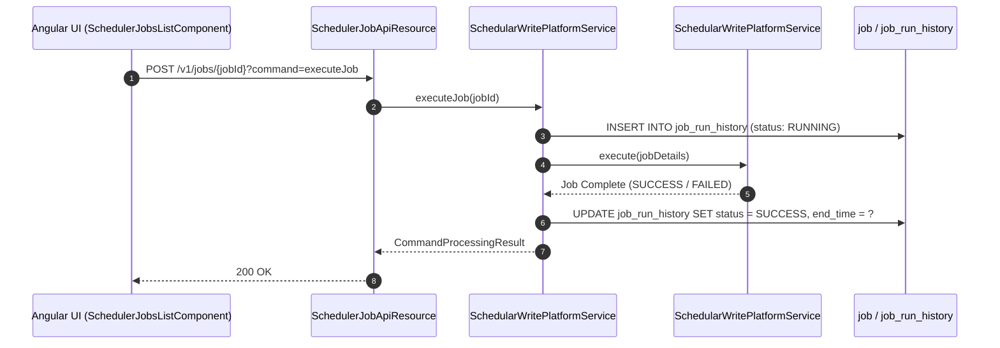

# [SYB] 콜그래프

> 화면 1개 롤업(소분류 SYB, 대분류 SY - 스케줄러 및 배치 작업).

## SYB-001 스케줄러 배치 작업 관리

> 원본: `fineract-provider/src/main/java/org/apache/fineract/infrastructure/jobs/`

### 배치 작업 즉시 실행(Run Job) 및 이력 기록 흐름

> 공유: LNA, SVA, ACP, WCO

## 근거
- `fineract-provider/src/main/java/org/apache/fineract/infrastructure/jobs/`
