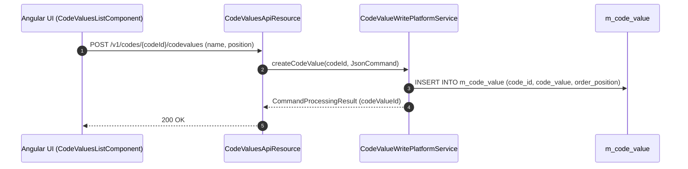

# [SYC] 콜그래프

> 화면 1개 롤업(소분류 SYC, 대분류 SY - 공통코드 및 환경설정).

## SYC-001 공통 코드 및 확장 데이터

> 원본: `fineract-provider/src/main/java/org/apache/fineract/infrastructure/codes/`

### 공통 코드값(Code Value) 추가 및 캐시 갱신 흐름

> 공유: CLA, LNA, SVA

## 근거
- `fineract-provider/src/main/java/org/apache/fineract/infrastructure/codes/`
