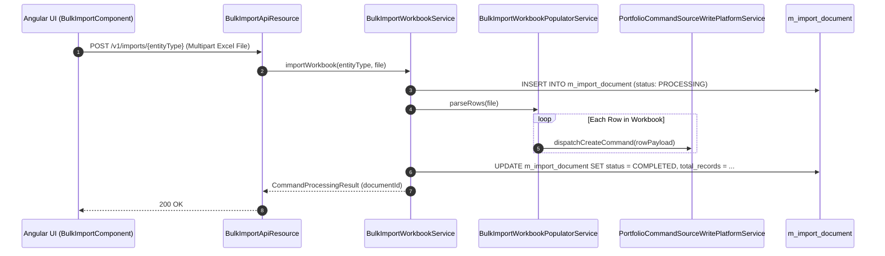

# [SYI] 콜그래프

> 화면 1개 롤업(소분류 SYI, 대분류 SY - 대외연계 및 알림/부가서비스).

## SYI-001 대외연계 및 알림 설정

> 원본: `fineract-provider/src/main/java/org/apache/fineract/infrastructure/bulkimport/`

### 엑셀 일괄 업로드(Bulk Import) 파싱 및 비동기 임포트 흐름

> 공유: CLA, LNA, SVA, ACC

## 근거
- `fineract-provider/src/main/java/org/apache/fineract/infrastructure/bulkimport/`
