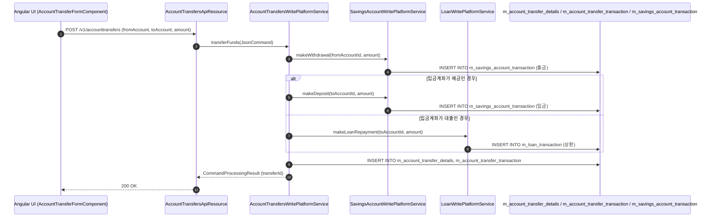
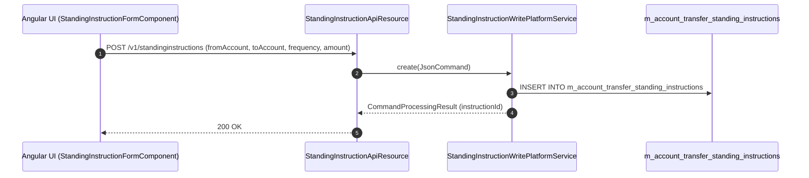

# [TRA] 콜그래프

> 화면 2개 롤업(소분류 TRA, 대분류 TR - 계좌이체 및 자동이체).

## TRA-001 계좌간 이체

> 원본: `fineract-provider/src/main/java/org/apache/fineract/portfolio/account/service/AccountTransfersWritePlatformServiceImpl.java`

### 계좌간 즉시 이체 실행 흐름

> 공유: SVA, LNA

## TRA-002 자동이체(SI) 관리

> 원본: `fineract-provider/src/main/java/org/apache/fineract/portfolio/account/service/StandingInstructionWritePlatformServiceImpl.java`

### 정기 자동이체 등록 및 스케줄러 실행 흐름

> 공유: SYB, SVA

## 근거
- `fineract-provider/src/main/java/org/apache/fineract/portfolio/account/service/AccountTransfersWritePlatformServiceImpl.java`
- `fineract-provider/src/main/java/org/apache/fineract/portfolio/account/service/StandingInstructionWritePlatformServiceImpl.java`
