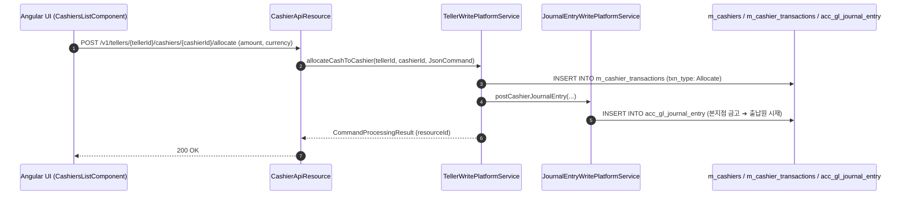

# [TRT] 콜그래프

> 화면 1개 롤업(소분류 TRT, 대분류 TR - 창구 및 출납원 운영).

## TRT-001 창구 및 출납원 운영

> 원본: `fineract-provider/src/main/java/org/apache/fineract/organisation/teller/`

### 출납원 시재 할당 및 정산 흐름

> 공유: OGB, ACC

## 근거
- `fineract-provider/src/main/java/org/apache/fineract/organisation/teller/`
