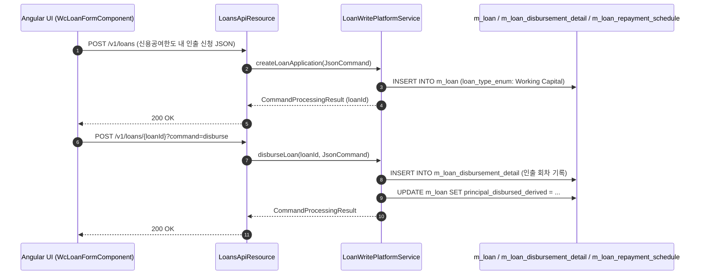

# [WCL] 콜그래프

> 화면 1개 롤업(소분류 WCL, 대분류 WC - 운전자금 대출 관리).

## WCL-001 운전자금 대출 관리

> 원본: `fineract-provider/src/main/java/org/apache/fineract/portfolio/loanaccount/`

### 운전자금 대출 신청 및 분할 인출(Drawdown) 흐름

> 공유: LNA, WCP

## 근거
- `fineract-provider/src/main/java/org/apache/fineract/portfolio/loanaccount/`
