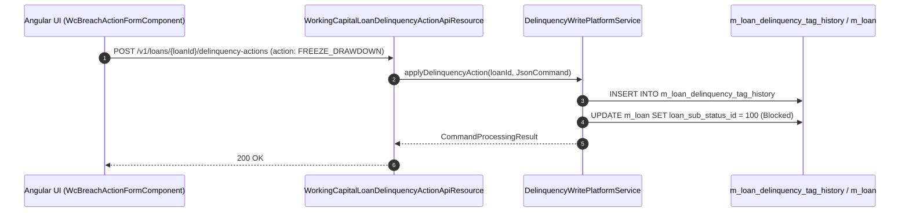
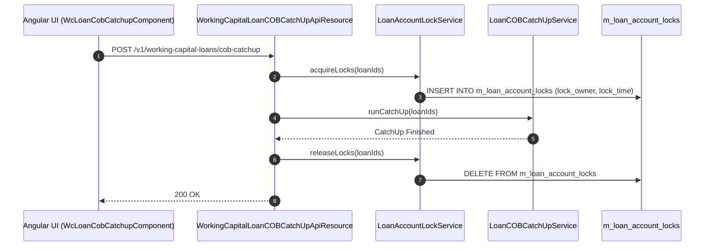

# [WCO] 콜그래프

> 화면 2개 롤업(소분류 WCO, 대분류 WC - 운전자금 사후조치 및 운영).

## WCO-001 운전자금 위반 조치 관리

> 원본: `fineract-provider/src/main/java/org/apache/fineract/portfolio/delinquency/`

### 운전자금 한도위반 계좌 사후조치 실행 흐름

> 공유: WCL, SYB

## WCO-002 운전자금 마감처리 및 계좌잠금

> 원본: `fineract-provider/src/main/java/org/apache/fineract/cob/`

### 운전자금 COB 마감 Catch-up 및 계좌 락 해제 흐름

> 공유: SYB, WCL

## 근거
- `fineract-provider/src/main/java/org/apache/fineract/cob/`
- `fineract-provider/src/main/java/org/apache/fineract/portfolio/delinquency/`
