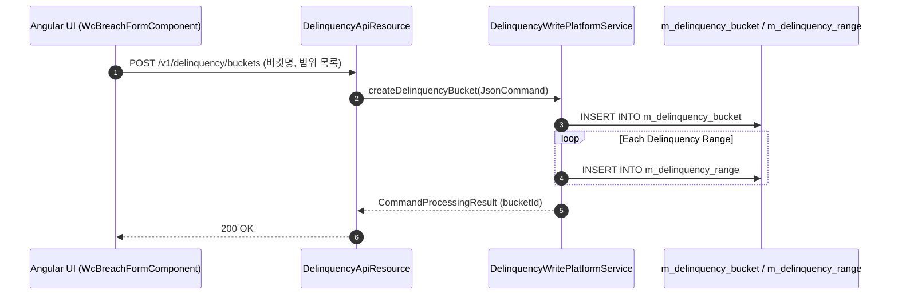

# [WCP] 콜그래프

> 화면 1개 롤업(소분류 WCP, 대분류 WC - 운전자금 상품 및 한도위반 설정).

## WCP-001 운전자금 상품 및 한도위반 설정

> 원본: `fineract-provider/src/main/java/org/apache/fineract/portfolio/delinquency/`

### 한도위반(Breach) 감지 버킷 설정 흐름

> 공유: PDL, SYB

## 근거
- `fineract-provider/src/main/java/org/apache/fineract/portfolio/delinquency/`
