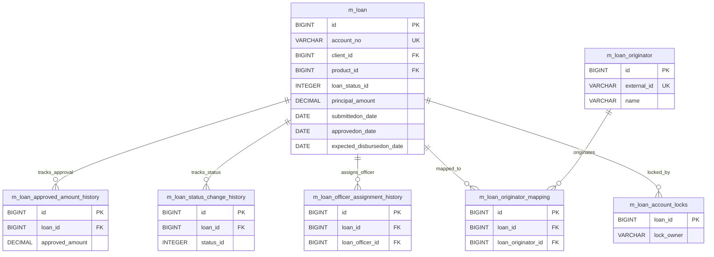
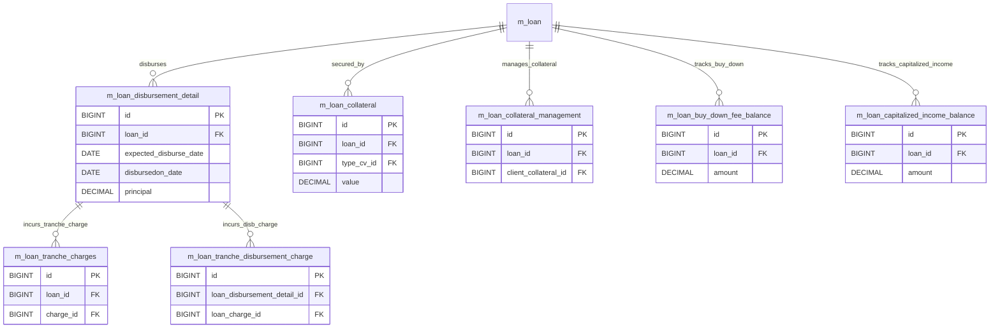
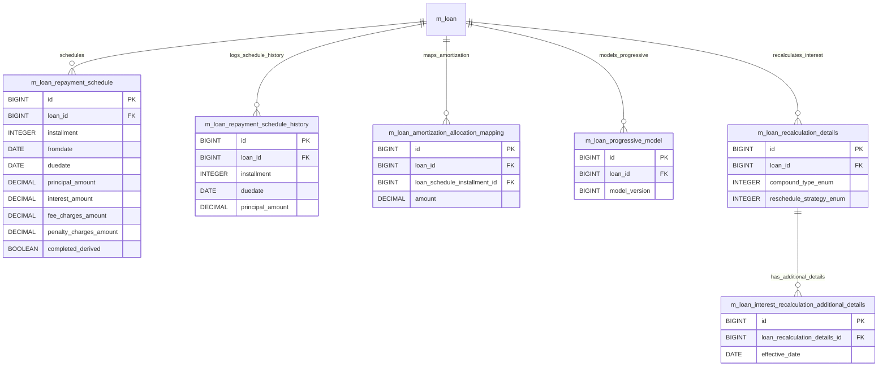
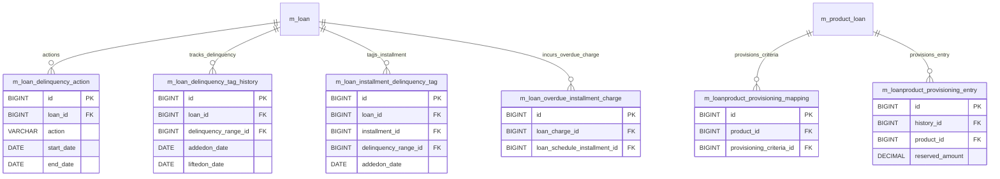

# [FN] DB명세서

> 화면 4개 롤업(중분류 FN, 대분류 FN). 화면 단위 원본은 `specs/<화면>/data-model.md`.

## FN-002 대출신청및승인

> 원본: `FN-002-대출신청및승인/data-model.md`

## [FN-002] DB 명세서

### 테이블 목록

| 테이블명 | 역할 |
| :--- | :--- |
| `m_loan` | 대출 계좌의 기본 정보 및 원장(신청, 승인, 상태 등 핵심 엔티티) |
| `m_loan_approved_amount_history` | 대출 승인 금액 변경 이력 관리 |
| `m_loan_status_change_history` | 대출 계좌의 상태 전이(신청->승인->실행->종결 등) 이력 추적 |
| `m_loan_officer_assignment_history` | 대출 담당 대출심사역(Loan Officer) 배정 및 변경 이력 |
| `m_loan_originator` | 대출 모집인/대출 중개 기관 정보 관리 |
| `m_loan_originator_mapping` | 대출 계좌와 대출 모집인 간의 매핑 관계 |
| `m_loan_account_locks` | 대출 계좌 단위의 동시성 제어 및 트랜잭션 잠금 관리 |

### `m_loan` - 대출 계좌의 기본 정보 및 원장(신청, 승인, 상태 등 핵심 엔티티)

| 컬럼명 | 타입 | 제약 | 설명 |
| :--- | :--- | :--- | :--- |
| `id` | BIGINT | AUTO_INCREMENT, PK, NOT NULL | `m_loan`의 고유 식별자 (PK) |
| `account_no` | VARCHAR(20) | NOT NULL, UNIQUE | 대출 계좌 고유 번호 |
| `external_id` | VARCHAR(100) | UNIQUE | 연계된 external 식별자 (FK) |
| `client_id` | BIGINT | DEFAULT NULL, FK -> m_client(id), RESTRICT | 연계된 client 식별자 (FK) |
| `group_id` | BIGINT | DEFAULT NULL, FK -> m_group(id), RESTRICT | 연계된 group 식별자 (FK) |
| `glim_id` | BIGINT | DEFAULT NULL, FK -> glim_accounts(id), RESTRICT | 연계된 glim 식별자 (FK) |
| `product_id` | BIGINT | DEFAULT NULL, FK -> m_product_loan(id), RESTRICT | 연계된 product 식별자 (FK) |
| `fund_id` | BIGINT | DEFAULT NULL, FK -> m_fund(id), RESTRICT | 연계된 fund 식별자 (FK) |
| `loan_officer_id` | BIGINT | DEFAULT NULL, FK -> m_staff(id), RESTRICT | 연계된 loan_officer 식별자 (FK) |
| `loanpurpose_cv_id` | INT | DEFAULT NULL, FK -> m_code_value(id), RESTRICT | 연계된 loanpurpose_cv 식별자 (FK) |
| `loan_status_id` | SMALLINT | NOT NULL | 연계된 loan_status 식별자 (FK) |
| `loan_type_enum` | SMALLINT | NOT NULL | loan_type_enum 속성값 |
| `currency_code` | VARCHAR(3) | NOT NULL | 통화 코드 |
| `currency_digits` | SMALLINT | NOT NULL | currency_digits 속성값 |
| `currency_multiplesof` | SMALLINT | DEFAULT NULL | currency_multiplesof 속성값 |
| `principal_amount_proposed` | DECIMAL(19, 6) | NOT NULL | 대출 원금 관련 금액 |
| `principal_amount` | DECIMAL(19, 6) | NOT NULL | 대출 원금 관련 금액 |
| `approved_principal` | DECIMAL(19, 6) | NOT NULL | approved_principal 속성값 |
| `net_disbursal_amount` | DECIMAL(19, 6) | NOT NULL | 해당 항목 금액/잔액 |
| `arrearstolerance_amount` | DECIMAL(19, 6) | DEFAULT NULL | 해당 항목 금액/잔액 |
| `is_floating_interest_rate` | boolean | DEFAULT false | is_floating_interest_rate 속성값 |
| `interest_rate_differential` | DECIMAL(19, 6) | DEFAULT 0.000000 | interest_rate_differential 속성값 |
| `nominal_interest_rate_per_period` | DECIMAL(19, 6) | DEFAULT NULL | nominal_interest_rate_per_period 속성값 |
| `interest_period_frequency_enum` | SMALLINT | DEFAULT NULL | interest_period_frequency_enum 속성값 |
| `annual_nominal_interest_rate` | DECIMAL(19, 6) | DEFAULT NULL | annual_nominal_interest_rate 속성값 |
| `interest_method_enum` | SMALLINT | NOT NULL | interest_method_enum 속성값 |
| `interest_calculated_in_period_enum` | SMALLINT | DEFAULT 1, NOT NULL | interest_calculated_in_period_enum 속성값 |
| `allow_partial_period_interest_calcualtion` | boolean | DEFAULT false, NOT NULL | allow_partial_period_interest_calcualtion 속성값 |
| `term_frequency` | SMALLINT | DEFAULT 0, NOT NULL | term_frequency 속성값 |
| `term_period_frequency_enum` | SMALLINT | DEFAULT 2, NOT NULL | term_period_frequency_enum 속성값 |
| `repay_every` | SMALLINT | NOT NULL | repay_every 속성값 |
| `repayment_period_frequency_enum` | SMALLINT | NOT NULL | repayment_period_frequency_enum 속성값 |
| `number_of_repayments` | SMALLINT | NOT NULL | number_of_repayments 속성값 |
| `grace_on_principal_periods` | SMALLINT | DEFAULT NULL | grace_on_principal_periods 속성값 |
| `recurring_moratorium_principal_periods` | SMALLINT | DEFAULT NULL | recurring_moratorium_principal_periods 속성값 |
| `grace_on_interest_periods` | SMALLINT | DEFAULT NULL | grace_on_interest_periods 속성값 |
| `grace_interest_free_periods` | SMALLINT | DEFAULT NULL | grace_interest_free_periods 속성값 |
| `amortization_method_enum` | SMALLINT | NOT NULL | amortization_method_enum 속성값 |
| `submittedon_date` | date | DEFAULT NULL | 신청/접수 일자 |
| `submittedon_userid` | BIGINT | DEFAULT NULL, FK -> m_appuser(id), RESTRICT | submittedon_userid 속성값 |
| `approvedon_date` | date | DEFAULT NULL | 승인 일자 |
| `approvedon_userid` | BIGINT | DEFAULT NULL, FK -> m_appuser(id), RESTRICT | approvedon_userid 속성값 |
| `expected_disbursedon_date` | date | DEFAULT NULL | 지급/실행 일자 |
| `expected_firstrepaymenton_date` | date | DEFAULT NULL | expected_firstrepaymenton_date 속성값 |
| `interest_calculated_from_date` | date | DEFAULT NULL | 시작 일자 |
| `disbursedon_date` | date | DEFAULT NULL | 지급/실행 일자 |
| `disbursedon_userid` | BIGINT | DEFAULT NULL, FK -> m_appuser(id), RESTRICT | disbursedon_userid 속성값 |
| `expected_maturedon_date` | date | DEFAULT NULL | expected_maturedon_date 속성값 |
| `maturedon_date` | date | DEFAULT NULL | maturedon_date 속성값 |
| `closedon_date` | date | DEFAULT NULL | 종결 일자 |
| `closedon_userid` | BIGINT | DEFAULT NULL, FK -> m_appuser(id), RESTRICT | closedon_userid 속성값 |
| `total_charges_due_at_disbursement_derived` | DECIMAL(19, 6) | DEFAULT NULL | total_charges_due_at_disbursement_derived 속성값 |
| `principal_disbursed_derived` | DECIMAL(19, 6) | DEFAULT 0.000000, NOT NULL | 대출 원금 관련 금액 |
| `principal_repaid_derived` | DECIMAL(19, 6) | DEFAULT 0.000000, NOT NULL | principal_repaid_derived 속성값 |
| `principal_writtenoff_derived` | DECIMAL(19, 6) | DEFAULT 0.000000, NOT NULL | principal_writtenoff_derived 속성값 |
| `principal_outstanding_derived` | DECIMAL(19, 6) | DEFAULT 0.000000, NOT NULL | principal_outstanding_derived 속성값 |
| `interest_charged_derived` | DECIMAL(19, 6) | DEFAULT 0.000000, NOT NULL | 이자 관련 금액 |
| `interest_repaid_derived` | DECIMAL(19, 6) | DEFAULT 0.000000, NOT NULL | interest_repaid_derived 속성값 |
| `interest_waived_derived` | DECIMAL(19, 6) | DEFAULT 0.000000, NOT NULL | interest_waived_derived 속성값 |
| `interest_writtenoff_derived` | DECIMAL(19, 6) | DEFAULT 0.000000, NOT NULL | interest_writtenoff_derived 속성값 |
| `interest_outstanding_derived` | DECIMAL(19, 6) | DEFAULT 0.000000, NOT NULL | interest_outstanding_derived 속성값 |
| `fee_charges_charged_derived` | DECIMAL(19, 6) | DEFAULT 0.000000, NOT NULL | 수수료 관련 금액 |
| `fee_charges_repaid_derived` | DECIMAL(19, 6) | DEFAULT 0.000000, NOT NULL | 수수료 관련 금액 |
| `fee_charges_waived_derived` | DECIMAL(19, 6) | DEFAULT 0.000000, NOT NULL | 수수료 관련 금액 |
| `fee_charges_writtenoff_derived` | DECIMAL(19, 6) | DEFAULT 0.000000, NOT NULL | 수수료 관련 금액 |
| `fee_charges_outstanding_derived` | DECIMAL(19, 6) | DEFAULT 0.000000, NOT NULL | 수수료 관련 금액 |
| `penalty_charges_charged_derived` | DECIMAL(19, 6) | DEFAULT 0.000000, NOT NULL | 연체료/과징금 금액 |
| `penalty_charges_repaid_derived` | DECIMAL(19, 6) | DEFAULT 0.000000, NOT NULL | 연체료/과징금 금액 |
| `penalty_charges_waived_derived` | DECIMAL(19, 6) | DEFAULT 0.000000, NOT NULL | 연체료/과징금 금액 |
| `penalty_charges_writtenoff_derived` | DECIMAL(19, 6) | DEFAULT 0.000000, NOT NULL | 연체료/과징금 금액 |
| `penalty_charges_outstanding_derived` | DECIMAL(19, 6) | DEFAULT 0.000000, NOT NULL | 연체료/과징금 금액 |
| `total_expected_repayment_derived` | DECIMAL(19, 6) | DEFAULT 0.000000, NOT NULL | total_expected_repayment_derived 속성값 |
| `total_repayment_derived` | DECIMAL(19, 6) | DEFAULT 0.000000, NOT NULL | total_repayment_derived 속성값 |
| `total_expected_costofloan_derived` | DECIMAL(19, 6) | DEFAULT 0.000000, NOT NULL | total_expected_costofloan_derived 속성값 |
| `total_costofloan_derived` | DECIMAL(19, 6) | DEFAULT 0.000000, NOT NULL | total_costofloan_derived 속성값 |
| `total_waived_derived` | DECIMAL(19, 6) | DEFAULT 0.000000, NOT NULL | total_waived_derived 속성값 |
| `total_writtenoff_derived` | DECIMAL(19, 6) | DEFAULT 0.000000, NOT NULL | total_writtenoff_derived 속성값 |
| `total_outstanding_derived` | DECIMAL(19, 6) | DEFAULT 0.000000, NOT NULL | total_outstanding_derived 속성값 |
| `total_overpaid_derived` | DECIMAL(19, 6) | DEFAULT NULL | total_overpaid_derived 속성값 |
| `rejectedon_date` | date | DEFAULT NULL | rejectedon_date 속성값 |
| `rejectedon_userid` | BIGINT | DEFAULT NULL, FK -> m_appuser(id), RESTRICT | rejectedon_userid 속성값 |
| `rescheduledon_date` | date | DEFAULT NULL | rescheduledon_date 속성값 |
| `rescheduledon_userid` | BIGINT | DEFAULT NULL | rescheduledon_userid 속성값 |
| `withdrawnon_date` | date | DEFAULT NULL | withdrawnon_date 속성값 |
| `withdrawnon_userid` | BIGINT | DEFAULT NULL, FK -> m_appuser(id), RESTRICT | withdrawnon_userid 속성값 |
| `writtenoffon_date` | date | DEFAULT NULL | writtenoffon_date 속성값 |
| `loan_transaction_strategy_id` | BIGINT | DEFAULT NULL, FK -> ref_loan_transaction_processing_strategy(id), RESTRICT | 연계된 loan_transaction_strategy 식별자 (FK) |
| `sync_disbursement_with_meeting` | boolean | DEFAULT NULL | sync_disbursement_with_meeting 속성값 |
| `loan_counter` | SMALLINT | DEFAULT NULL | loan_counter 속성값 |
| `loan_product_counter` | SMALLINT | DEFAULT NULL | loan_product_counter 속성값 |
| `fixed_emi_amount` | DECIMAL(19, 6) | DEFAULT NULL | 해당 항목 금액/잔액 |
| `max_outstanding_loan_balance` | DECIMAL(19, 6) | DEFAULT NULL | 해당 항목 금액/잔액 |
| `grace_on_arrears_ageing` | SMALLINT | DEFAULT NULL | grace_on_arrears_ageing 속성값 |
| `is_npa` | boolean | DEFAULT false, NOT NULL | is_npa 속성값 |
| `total_recovered_derived` | DECIMAL(19, 6) | DEFAULT NULL | total_recovered_derived 속성값 |
| `accrued_till` | date | DEFAULT NULL | accrued_till 속성값 |
| `interest_recalcualated_on` | date | DEFAULT NULL | interest_recalcualated_on 속성값 |
| `days_in_month_enum` | SMALLINT | DEFAULT 1, NOT NULL | days_in_month_enum 속성값 |
| `days_in_year_enum` | SMALLINT | DEFAULT 1, NOT NULL | days_in_year_enum 속성값 |
| `interest_recalculation_enabled` | boolean | DEFAULT false, NOT NULL | interest_recalculation_enabled 속성값 |
| `guarantee_amount_derived` | DECIMAL(19, 6) | DEFAULT NULL | 해당 항목 금액/잔액 |
| `create_standing_instruction_at_disbursement` | boolean | DEFAULT NULL | create_standing_instruction_at_disbursement 속성값 |
| `version` | INT | DEFAULT 1, NOT NULL | 낙관적 락 엔티티 버전 번호 |
| `writeoff_reason_cv_id` | INT | DEFAULT NULL, FK -> m_code_value(id), RESTRICT | 연계된 writeoff_reason_cv 식별자 (FK) |
| `loan_sub_status_id` | SMALLINT | DEFAULT NULL | 연계된 loan_sub_status 식별자 (FK) |
| `is_topup` | boolean | DEFAULT false, NOT NULL | is_topup 속성값 |
| `is_equal_amortization` | boolean | DEFAULT false, NOT NULL | is_equal_amortization 속성값 |
| `fixed_principal_percentage_per_installment` | DECIMAL(5, 2) | DEFAULT NULL | 상환 회차 번호 |
| `enable_auto_repayment_for_down_payment` | boolean | DEFAULT false, NOT NULL | enable_auto_repayment_for_down_payment 속성값 |
| `disable_schedule_extension_for_down_payment` | boolean | DEFAULT false, NOT NULL | disable_schedule_extension_for_down_payment 속성값 |
| `loan_schedule_type` | varchar(20) | DEFAULT CUMULATIVE, NOT NULL | loan_schedule_type 속성값 |
| `loan_schedule_processing_type` | varchar(20) | DEFAULT HORIZONTAL, NOT NULL | loan_schedule_processing_type 속성값 |
| `fee_adjustments_derived` | DECIMAL(19, 6) | DEFAULT 0.000000, NOT NULL | fee_adjustments_derived 속성값 |
| `penalty_adjustments_derived` | DECIMAL(19, 6) | DEFAULT 0.000000, NOT NULL | penalty_adjustments_derived 속성값 |
| `fixed_length` | SMALLINT | NULL | fixed_length 속성값 |
| `supported_interest_refund_types` | TEXT | NULL | supported_interest_refund_types 속성값 |
| `charge_off_behaviour` | varchar(20) | DEFAULT REGULAR | charge_off_behaviour 속성값 |
| `interest_recognition_on_disbursement_date` | boolean | DEFAULT false, NOT NULL | interest_recognition_on_disbursement_date 속성값 |
| `installment_amount_in_multiples_of` | DECIMAL(19, 6) | DEFAULT NULL | 해당 항목 금액/잔액 |
| `is_merchant_buy_down_fee` | boolean | DEFAULT true, NOT NULL | is_merchant_buy_down_fee 속성값 |
| `created_on_utc` | TIMESTAMP WITH TIME ZONE | NULL | 레코드 생성 일시 |
| `created_by` | BIGINT | FK -> m_appuser(id), RESTRICT | 레코드 생성자 ID |
| `last_modified_by` | BIGINT | FK -> m_appuser(id), RESTRICT | 레코드 최종 수정자 ID |
| `last_modified_on_utc` | TIMESTAMP WITH TIME ZONE | NULL | 레코드 최종 수정 일시 |
| `principal_adjustments_derived` | DECIMAL(19, 6) | DEFAULT 0.000000, NOT NULL | principal_adjustments_derived 속성값 |
| `is_fraud` | boolean | DEFAULT false, NOT NULL | is_fraud 속성값 |
| `loan_transaction_strategy_code` | VARCHAR(100) | DEFAULT -, NOT NULL | loan_transaction_strategy_code 속성값 |
| `loan_transaction_strategy_name` | VARCHAR(100) | DEFAULT -, NOT NULL | 명칭/이름 |
| `last_closed_business_date` | DATE | NULL | last_closed_business_date 속성값 |
| `overpaidon_date` | date | NULL | overpaidon_date 속성값 |
| `is_charged_off` | boolean | DEFAULT false, NOT NULL | is_charged_off 속성값 |
| `charged_off_on_date` | date | DEFAULT NULL | charged_off_on_date 속성값 |
| `charge_off_reason_cv_id` | BIGINT | DEFAULT NULL | 연계된 charge_off_reason_cv 식별자 (FK) |
| `charged_off_by_userid` | BIGINT | DEFAULT NULL | charged_off_by_userid 속성값 |
| `enable_down_payment` | boolean | DEFAULT false, NOT NULL | enable_down_payment 속성값 |
| `disbursed_amount_percentage_for_down_payment` | DECIMAL(9, 6) | DEFAULT NULL | 해당 항목 금액/잔액 |
| `enable_installment_level_delinquency` | boolean | DEFAULT false, NOT NULL | 상환 회차 번호 |
| `enable_accrual_activity_posting` | boolean | DEFAULT false, NOT NULL | enable_accrual_activity_posting 속성값 |
| `days_in_year_custom_strategy` | VARCHAR(100) | NULL | days_in_year_custom_strategy 속성값 |
| `enable_income_capitalization` | boolean | DEFAULT false, NOT NULL | enable_income_capitalization 속성값 |
| `capitalized_income_calculation_type` | VARCHAR(100) | NULL | capitalized_income_calculation_type 속성값 |
| `capitalized_income_strategy` | VARCHAR(100) | NULL | capitalized_income_strategy 속성값 |
| `capitalized_income_type` | VARCHAR(10) | NULL | capitalized_income_type 속성값 |
| `capitalized_income_derived` | DECIMAL(19, 6) | DEFAULT 0.000000, NOT NULL | capitalized_income_derived 속성값 |
| `capitalized_income_adjustment_derived` | DECIMAL(19, 6) | DEFAULT 0.000000, NOT NULL | capitalized_income_adjustment_derived 속성값 |
| `total_principal_derived` | DECIMAL(19, 6) | DEFAULT 0.000000, NOT NULL | total_principal_derived 속성값 |
| `enable_buy_down_fee` | boolean | DEFAULT false, NOT NULL | enable_buy_down_fee 속성값 |
| `buy_down_fee_calculation_type` | VARCHAR(100) | NULL | buy_down_fee_calculation_type 속성값 |
| `buy_down_fee_strategy` | VARCHAR(100) | NULL | buy_down_fee_strategy 속성값 |
| `buy_down_fee_income_type` | VARCHAR(100) | NULL | buy_down_fee_income_type 속성값 |
| `allow_full_term_for_tranche` | boolean | DEFAULT false, NOT NULL | allow_full_term_for_tranche 속성값 |
| `repayment_start_date_type_enum` | SMALLINT | NULL | repayment_start_date_type_enum 속성값 |

### `m_loan_approved_amount_history` - 대출 승인 금액 변경 이력 관리

| 컬럼명 | 타입 | 제약 | 설명 |
| :--- | :--- | :--- | :--- |
| `id` | BIGINT | AUTO_INCREMENT, PK, NOT NULL | `m_loan_approved_amount_history`의 고유 식별자 (PK) |
| `loan_id` | BIGINT | NOT NULL, FK -> m_loan(id), RESTRICT | 연계된 loan 식별자 (FK) |
| `new_approved_amount` | DECIMAL(19, 6) | NOT NULL | 해당 항목 금액/잔액 |
| `old_approved_amount` | DECIMAL(19, 6) | NOT NULL | 해당 항목 금액/잔액 |
| `created_by` | BIGINT | FK -> m_appuser(id), RESTRICT | 레코드 생성자 ID |
| `created_on_utc` | timestamp with time zone | NULL | 레코드 생성 일시 |
| `last_modified_by` | BIGINT | FK -> m_appuser(id), RESTRICT | 레코드 최종 수정자 ID |
| `last_modified_on_utc` | timestamp with time zone | NULL | 레코드 최종 수정 일시 |
| `id` | BIGINT | AUTO_INCREMENT, PK, NOT NULL | `m_loan_approved_amount_history`의 고유 식별자 (PK) |
| `loan_id` | BIGINT | NOT NULL, FK -> m_loan(id), RESTRICT | 연계된 loan 식별자 (FK) |
| `new_approved_amount` | DECIMAL(19, 6) | NOT NULL | 해당 항목 금액/잔액 |
| `old_approved_amount` | DECIMAL(19, 6) | NOT NULL | 해당 항목 금액/잔액 |
| `created_by` | BIGINT | FK -> m_appuser(id), RESTRICT | 레코드 생성자 ID |
| `created_on_utc` | DATETIME | NULL | 레코드 생성 일시 |
| `last_modified_by` | BIGINT | FK -> m_appuser(id), RESTRICT | 레코드 최종 수정자 ID |
| `last_modified_on_utc` | DATETIME | NULL | 레코드 최종 수정 일시 |

### `m_loan_status_change_history` - 대출 계좌의 상태 전이(신청->승인->실행->종결 등) 이력 추적

| 컬럼명 | 타입 | 제약 | 설명 |
| :--- | :--- | :--- | :--- |
| `id` | BIGINT | AUTO_INCREMENT, PK, NOT NULL | `m_loan_status_change_history`의 고유 식별자 (PK) |
| `loan_id` | BIGINT | NOT NULL | 연계된 loan 식별자 (FK) |
| `status_code` | VARCHAR(255) | NOT NULL | status_code 속성값 |
| `status_change_business_date` | date | NOT NULL | status_change_business_date 속성값 |
| `created_by` | BIGINT | NOT NULL, FK -> m_appuser(id), RESTRICT | 레코드 생성자 ID |
| `last_modified_by` | BIGINT | NOT NULL, FK -> m_appuser(id), RESTRICT | 레코드 최종 수정자 ID |
| `created_on_utc` | TIMESTAMP WITH TIME ZONE | NOT NULL | 레코드 생성 일시 |
| `last_modified_on_utc` | TIMESTAMP WITH TIME ZONE | NOT NULL | 레코드 최종 수정 일시 |

### `m_loan_officer_assignment_history` - 대출 담당 대출심사역(Loan Officer) 배정 및 변경 이력

| 컬럼명 | 타입 | 제약 | 설명 |
| :--- | :--- | :--- | :--- |
| `id` | BIGINT | AUTO_INCREMENT, PK, NOT NULL | `m_loan_officer_assignment_history`의 고유 식별자 (PK) |
| `loan_id` | BIGINT | NOT NULL, FK -> m_loan(id), RESTRICT | 연계된 loan 식별자 (FK) |
| `loan_officer_id` | BIGINT | DEFAULT NULL, FK -> m_staff(id), RESTRICT | 연계된 loan_officer 식별자 (FK) |
| `start_date` | date | NOT NULL | start_date 속성값 |
| `end_date` | date | DEFAULT NULL | end_date 속성값 |
| `createdby_id` | BIGINT | DEFAULT NULL | 연계된 createdby 식별자 (FK) |
| `created_date` | datetime | DEFAULT NULL | 레코드 생성 일시 |
| `lastmodified_date` | datetime | DEFAULT NULL | 레코드 최종 수정 일시 |
| `lastmodifiedby_id` | BIGINT | DEFAULT NULL | 연계된 lastmodifiedby 식별자 (FK) |

### `m_loan_originator` - 대출 모집인/대출 중개 기관 정보 관리

| 컬럼명 | 타입 | 제약 | 설명 |
| :--- | :--- | :--- | :--- |
| `id` | BIGINT | AUTO_INCREMENT, PK, NOT NULL | `m_loan_originator`의 고유 식별자 (PK) |
| `external_id` | VARCHAR(100) | NOT NULL, UNIQUE | 연계된 external 식별자 (FK) |
| `name` | VARCHAR(255) | NULL | 명칭/이름 |
| `status` | VARCHAR(20) | NOT NULL | 상태 구분 코드 |
| `originator_type_cv_id` | INT | FK -> m_code_value(id), RESTRICT | 연계된 originator_type_cv 식별자 (FK) |
| `channel_type_cv_id` | INT | FK -> m_code_value(id), RESTRICT | 연계된 channel_type_cv 식별자 (FK) |
| `created_on_utc` | DATETIME | NOT NULL | 레코드 생성 일시 |
| `created_by` | BIGINT | NOT NULL, FK -> m_appuser(id), RESTRICT | 레코드 생성자 ID |
| `last_modified_on_utc` | DATETIME | NOT NULL | 레코드 최종 수정 일시 |
| `last_modified_by` | BIGINT | NOT NULL, FK -> m_appuser(id), RESTRICT | 레코드 최종 수정자 ID |
| `id` | BIGINT | AUTO_INCREMENT, PK, NOT NULL | `m_loan_originator`의 고유 식별자 (PK) |
| `external_id` | VARCHAR(100) | NOT NULL, UNIQUE | 연계된 external 식별자 (FK) |
| `name` | VARCHAR(255) | NULL | 명칭/이름 |
| `status` | VARCHAR(20) | NOT NULL | 상태 구분 코드 |
| `originator_type_cv_id` | INT | FK -> m_code_value(id), RESTRICT | 연계된 originator_type_cv 식별자 (FK) |
| `channel_type_cv_id` | INT | FK -> m_code_value(id), RESTRICT | 연계된 channel_type_cv 식별자 (FK) |
| `created_on_utc` | TIMESTAMP WITH TIME ZONE | NOT NULL | 레코드 생성 일시 |
| `created_by` | BIGINT | NOT NULL, FK -> m_appuser(id), RESTRICT | 레코드 생성자 ID |
| `last_modified_on_utc` | TIMESTAMP WITH TIME ZONE | NOT NULL | 레코드 최종 수정 일시 |
| `last_modified_by` | BIGINT | NOT NULL, FK -> m_appuser(id), RESTRICT | 레코드 최종 수정자 ID |

### `m_loan_originator_mapping` - 대출 계좌와 대출 모집인 간의 매핑 관계

| 컬럼명 | 타입 | 제약 | 설명 |
| :--- | :--- | :--- | :--- |
| `id` | BIGINT | AUTO_INCREMENT, PK, NOT NULL | `m_loan_originator_mapping`의 고유 식별자 (PK) |
| `loan_id` | BIGINT | NOT NULL, FK -> m_loan(id), RESTRICT | 연계된 loan 식별자 (FK) |
| `originator_id` | BIGINT | NOT NULL, FK -> m_loan_originator(id), RESTRICT | 연계된 originator 식별자 (FK) |
| `created_on_utc` | DATETIME | NOT NULL | 레코드 생성 일시 |
| `created_by` | BIGINT | NOT NULL, FK -> m_appuser(id), RESTRICT | 레코드 생성자 ID |
| `last_modified_on_utc` | DATETIME | NOT NULL | 레코드 최종 수정 일시 |
| `last_modified_by` | BIGINT | NOT NULL, FK -> m_appuser(id), RESTRICT | 레코드 최종 수정자 ID |
| `id` | BIGINT | AUTO_INCREMENT, PK, NOT NULL | `m_loan_originator_mapping`의 고유 식별자 (PK) |
| `loan_id` | BIGINT | NOT NULL, FK -> m_loan(id), RESTRICT | 연계된 loan 식별자 (FK) |
| `originator_id` | BIGINT | NOT NULL, FK -> m_loan_originator(id), RESTRICT | 연계된 originator 식별자 (FK) |
| `created_on_utc` | TIMESTAMP WITH TIME ZONE | NOT NULL | 레코드 생성 일시 |
| `created_by` | BIGINT | NOT NULL, FK -> m_appuser(id), RESTRICT | 레코드 생성자 ID |
| `last_modified_on_utc` | TIMESTAMP WITH TIME ZONE | NOT NULL | 레코드 최종 수정 일시 |
| `last_modified_by` | BIGINT | NOT NULL, FK -> m_appuser(id), RESTRICT | 레코드 최종 수정자 ID |

### `m_loan_account_locks` - 대출 계좌 단위의 동시성 제어 및 트랜잭션 잠금 관리

| 컬럼명 | 타입 | 제약 | 설명 |
| :--- | :--- | :--- | :--- |
| `loan_id` | BIGINT | PK, NOT NULL, FK -> m_loan(id), RESTRICT | 연계된 loan 식별자 (FK) |
| `lock_owner` | VARCHAR(100) | NOT NULL | lock_owner 속성값 |
| `lock_placed_on` | timestamp | NOT NULL | lock_placed_on 속성값 |
| `error` | VARCHAR(255) | NULL | error 속성값 |
| `stacktrace` | VARCHAR(255) | NULL | stacktrace 속성값 |
| `version` | BIGINT | NOT NULL | 낙관적 락 엔티티 버전 번호 |
| `lock_placed_on_cob_business_date` | DATE | NULL | lock_placed_on_cob_business_date 속성값 |

### 관계도

### 근거
* `fineract-loan-origination/src/main/resources/db/changelog/tenant/module/loanorigination/parts/0001_initial_schema.xml`
* `fineract-loan/src/main/resources/db/changelog/tenant/module/loan/parts/1003_add_loan_product_auto_repayment_down_payment_configuration.xml`
* `fineract-loan/src/main/resources/db/changelog/tenant/module/loan/parts/1007_add_loan_product_schedule_extension_for_down_payment_configuration.xml`
* `fineract-loan/src/main/resources/db/changelog/tenant/module/loan/parts/1010_introduce_loan_schedule_type_configuration.xml`
* `fineract-loan/src/main/resources/db/changelog/tenant/module/loan/parts/1012_introduce_loan_schedule_processing_type_configuration.xml`
* `fineract-loan/src/main/resources/db/changelog/tenant/module/loan/parts/1017_add_fee_and_penalty_adjustments_to_loan.xml`
* `fineract-loan/src/main/resources/db/changelog/tenant/module/loan/parts/1019_add_fixed_length.xml`
* `fineract-loan/src/main/resources/db/changelog/tenant/module/loan/parts/1021_add_loan_status_change_history.xml`
* `fineract-loan/src/main/resources/db/changelog/tenant/module/loan/parts/1022_add_interest_refund_support.xml`
* `fineract-loan/src/main/resources/db/changelog/tenant/module/loan/parts/1023_add_charge_off_behaviour.xml`
* `fineract-loan/src/main/resources/db/changelog/tenant/module/loan/parts/1026_add_interest_recognition_flag.xml`
* `fineract-loan/src/main/resources/db/changelog/tenant/module/loan/parts/1029_add_installment_amount_in_multiples_of_to_loan.xml`
* `fineract-loan/src/main/resources/db/changelog/tenant/module/loan/parts/1031_loan_merchant_buy_down_fee.xml`
* `fineract-provider/src/main/resources/db/changelog/tenant/parts/0001_initial_schema.xml`
* `fineract-provider/src/main/resources/db/changelog/tenant/parts/0020_add_audit_entries.xml`
* `fineract-provider/src/main/resources/db/changelog/tenant/parts/0039_add_loan_account_locks.xml`
* `fineract-provider/src/main/resources/db/changelog/tenant/parts/0048_rework_loan_account_locks.xml`
* `fineract-provider/src/main/resources/db/changelog/tenant/parts/0057_add_principal_adjustments_to_loan.xml`
* `fineract-provider/src/main/resources/db/changelog/tenant/parts/0062_add_fraud_attribute_to_loan.xml`
* `fineract-provider/src/main/resources/db/changelog/tenant/parts/0064_refactor_loan_transaction_strategy.xml`
* `fineract-provider/src/main/resources/db/changelog/tenant/parts/0074_add_last_cob_business_date_column_to_loan.xml`
* `fineract-provider/src/main/resources/db/changelog/tenant/parts/0077_add_overpaid_date_for_loan.xml`
* `fineract-provider/src/main/resources/db/changelog/tenant/parts/0079_add_charge_off_details_to_loan.xml`
* `fineract-provider/src/main/resources/db/changelog/tenant/parts/0086_add_cob_business_date_to_loan_account_locks.xml`
* `fineract-provider/src/main/resources/db/changelog/tenant/parts/0119_add_loan_product_down_payment_configuration.xml`
* `fineract-provider/src/main/resources/db/changelog/tenant/parts/0126_add_loan_product_installment_level_delinquency.xml`
* `fineract-provider/src/main/resources/db/changelog/tenant/parts/0142_add_accrual_activity_transaction.xml`
* `fineract-provider/src/main/resources/db/changelog/tenant/parts/0170_days_in_year_custom_strategy.xml`
* `fineract-provider/src/main/resources/db/changelog/tenant/parts/0171_loan_capitalized_income.xml`
* `fineract-provider/src/main/resources/db/changelog/tenant/parts/0174_loan_product_add_capitalized_income_type.xml`
* `fineract-provider/src/main/resources/db/changelog/tenant/parts/0178_add_principal_from_capitalized_income_to_loan_summary.xml`
* `fineract-provider/src/main/resources/db/changelog/tenant/parts/0185_loan_buy_down_fee.xml`
* `fineract-provider/src/main/resources/db/changelog/tenant/parts/0192_create_loan_approved_amount_history.xml`
* `fineract-provider/src/main/resources/db/changelog/tenant/parts/0207_add_allow_full_term_for_tranche.xml`
* `fineract-provider/src/main/resources/db/changelog/tenant/parts/0232_add_repayment_start_date_to_loan.xml`
* `fineract-provider/src/main/resources/db/changelog/tenant/upgrades/0000_upgrade_to_1.6.xml`

---

## FN-003 대출실행및지급

> 원본: `FN-003-대출실행및지급/data-model.md`

## [FN-003] DB 명세서

### 테이블 목록

| 테이블명 | 역할 |
| :--- | :--- |
| `m_loan_disbursement_detail` | 대출금 분할 지급(트랜치) 및 실행 상세 정보 |
| `m_loan_tranche_charges` | 분할 실행(트랜치) 대출에 부과되는 수수료 |
| `m_loan_tranche_disbursement_charge` | 특정 트랜치 실행 시점에 발생하는 지급 수수료 |
| `m_loan_collateral` | 대출에 설정된 담보물 정보 |
| `m_loan_collateral_management` | 대출 담보 관리 및 담보 평가 연계 정보 |
| `m_loan_buy_down_fee_balance` | 금리 인하(Buy-Down) 수수료 잔액 관리 |
| `m_loan_capitalized_income_balance` | 원금에 가산(자본화)된 수익 잔액 관리 |

### `m_loan_disbursement_detail` - 대출금 분할 지급(트랜치) 및 실행 상세 정보

| 컬럼명 | 타입 | 제약 | 설명 |
| :--- | :--- | :--- | :--- |
| `id` | BIGINT | AUTO_INCREMENT, PK, NOT NULL | `m_loan_disbursement_detail`의 고유 식별자 (PK) |
| `loan_id` | BIGINT | NOT NULL, FK -> m_loan(id), RESTRICT | 연계된 loan 식별자 (FK) |
| `expected_disburse_date` | datetime | NOT NULL | 지급 예정 일자 |
| `disbursedon_date` | datetime | DEFAULT NULL | 지급/실행 일자 |
| `principal` | DECIMAL(19, 6) | NOT NULL | 대출 원금 관련 금액 |
| `net_disbursal_amount` | DECIMAL(19, 6) | DEFAULT NULL | 해당 항목 금액/잔액 |
| `is_reversed` | boolean | DEFAULT false, NOT NULL | 거래 취소(Reversal) 여부 |

### `m_loan_tranche_charges` - 분할 실행(트랜치) 대출에 부과되는 수수료

| 컬럼명 | 타입 | 제약 | 설명 |
| :--- | :--- | :--- | :--- |
| `id` | BIGINT | AUTO_INCREMENT, PK, NOT NULL | `m_loan_tranche_charges`의 고유 식별자 (PK) |
| `loan_id` | BIGINT | NOT NULL, FK -> m_loan(id), RESTRICT | 연계된 loan 식별자 (FK) |
| `charge_id` | BIGINT | NOT NULL, FK -> m_charge(id), RESTRICT | 연계된 charge 식별자 (FK) |

### `m_loan_tranche_disbursement_charge` - 특정 트랜치 실행 시점에 발생하는 지급 수수료

| 컬럼명 | 타입 | 제약 | 설명 |
| :--- | :--- | :--- | :--- |
| `id` | BIGINT | AUTO_INCREMENT, PK, NOT NULL | `m_loan_tranche_disbursement_charge`의 고유 식별자 (PK) |
| `loan_charge_id` | BIGINT | NOT NULL, FK -> m_loan_charge(id), RESTRICT | 연계된 loan_charge 식별자 (FK) |
| `disbursement_detail_id` | BIGINT | DEFAULT NULL, FK -> m_loan_disbursement_detail(id), RESTRICT | 연계된 disbursement_detail 식별자 (FK) |

### `m_loan_collateral` - 대출에 설정된 담보물 정보

| 컬럼명 | 타입 | 제약 | 설명 |
| :--- | :--- | :--- | :--- |
| `id` | BIGINT | AUTO_INCREMENT, PK, NOT NULL | `m_loan_collateral`의 고유 식별자 (PK) |
| `loan_id` | BIGINT | NOT NULL, FK -> m_loan(id), RESTRICT | 연계된 loan 식별자 (FK) |
| `type_cv_id` | INT | NOT NULL, FK -> m_code_value(id), RESTRICT | 연계된 type_cv 식별자 (FK) |
| `value` | DECIMAL(19, 6) | DEFAULT NULL | value 속성값 |
| `description` | VARCHAR(500) | NULL | 설명/비고 |

### `m_loan_collateral_management` - 대출 담보 관리 및 담보 평가 연계 정보

| 컬럼명 | 타입 | 제약 | 설명 |
| :--- | :--- | :--- | :--- |
| `id` | BIGINT | AUTO_INCREMENT, PK, NOT NULL | `m_loan_collateral_management`의 고유 식별자 (PK) |
| `quantity` | DECIMAL(20, 5) | NOT NULL | quantity 속성값 |
| `loan_id` | BIGINT | DEFAULT NULL, FK -> m_loan(id), CASCADE | 연계된 loan 식별자 (FK) |
| `client_collateral_id` | BIGINT | DEFAULT NULL, FK -> m_client_collateral_management(id), CASCADE | 연계된 client_collateral 식별자 (FK) |
| `is_released` | boolean | DEFAULT false | is_released 속성값 |
| `transaction_id` | BIGINT | DEFAULT NULL, FK -> m_loan_transaction(id), CASCADE | 연계된 transaction 식별자 (FK) |
| `id` | BIGINT | AUTO_INCREMENT, PK, NOT NULL | `m_loan_collateral_management`의 고유 식별자 (PK) |
| `quantity` | DECIMAL(20, 5) | NOT NULL | quantity 속성값 |
| `loan_id` | BIGINT | DEFAULT NULL, FK -> m_loan(id), CASCADE | 연계된 loan 식별자 (FK) |
| `client_collateral_id` | BIGINT | DEFAULT NULL, FK -> m_client_collateral_management(id), CASCADE | 연계된 client_collateral 식별자 (FK) |
| `is_released` | boolean | DEFAULT false | is_released 속성값 |
| `transaction_id` | BIGINT | DEFAULT NULL, FK -> m_loan_transaction(id), CASCADE | 연계된 transaction 식별자 (FK) |

### `m_loan_buy_down_fee_balance` - 금리 인하(Buy-Down) 수수료 잔액 관리

| 컬럼명 | 타입 | 제약 | 설명 |
| :--- | :--- | :--- | :--- |
| `id` | BIGINT | AUTO_INCREMENT, PK, NOT NULL | `m_loan_buy_down_fee_balance`의 고유 식별자 (PK) |
| `version` | BIGINT | NOT NULL | 낙관적 락 엔티티 버전 번호 |
| `loan_id` | BIGINT | NOT NULL, FK -> m_loan(id), RESTRICT | 연계된 loan 식별자 (FK) |
| `loan_transaction_id` | BIGINT | NOT NULL, FK -> m_loan_transaction(id), RESTRICT | 연계된 loan_transaction 식별자 (FK) |
| `amount` | DECIMAL(19, 6) | NOT NULL | 해당 항목 금액/잔액 |
| `date` | DATE | NOT NULL | date 속성값 |
| `unrecognized_amount` | DECIMAL(19, 6) | NOT NULL | 해당 항목 금액/잔액 |
| `charged_off_amount` | DECIMAL(19, 6) | NULL | 해당 항목 금액/잔액 |
| `amount_adjustment` | DECIMAL(19, 6) | NULL | 해당 항목 금액/잔액 |
| `created_by` | BIGINT | FK -> m_appuser(id), RESTRICT | 레코드 생성자 ID |
| `created_on_utc` | timestamp with time zone | NULL | 레코드 생성 일시 |
| `last_modified_by` | BIGINT | FK -> m_appuser(id), RESTRICT | 레코드 최종 수정자 ID |
| `last_modified_on_utc` | timestamp with time zone | NULL | 레코드 최종 수정 일시 |
| `id` | BIGINT | AUTO_INCREMENT, PK, NOT NULL | `m_loan_buy_down_fee_balance`의 고유 식별자 (PK) |
| `version` | BIGINT | NOT NULL | 낙관적 락 엔티티 버전 번호 |
| `loan_id` | BIGINT | NOT NULL, FK -> m_loan(id), RESTRICT | 연계된 loan 식별자 (FK) |
| `loan_transaction_id` | BIGINT | NOT NULL, FK -> m_loan_transaction(id), RESTRICT | 연계된 loan_transaction 식별자 (FK) |
| `amount` | DECIMAL(19, 6) | NOT NULL | 해당 항목 금액/잔액 |
| `date` | DATE | NOT NULL | date 속성값 |
| `unrecognized_amount` | DECIMAL(19, 6) | NOT NULL | 해당 항목 금액/잔액 |
| `charged_off_amount` | DECIMAL(19, 6) | NULL | 해당 항목 금액/잔액 |
| `amount_adjustment` | DECIMAL(19, 6) | NULL | 해당 항목 금액/잔액 |
| `created_by` | BIGINT | FK -> m_appuser(id), RESTRICT | 레코드 생성자 ID |
| `created_on_utc` | DATETIME | NULL | 레코드 생성 일시 |
| `last_modified_by` | BIGINT | FK -> m_appuser(id), RESTRICT | 레코드 최종 수정자 ID |
| `last_modified_on_utc` | DATETIME | NULL | 레코드 최종 수정 일시 |
| `is_deleted` | boolean | DEFAULT false, NOT NULL | 삭제 여부 플래그 |
| `is_closed` | boolean | DEFAULT false, NOT NULL | is_closed 속성값 |

### `m_loan_capitalized_income_balance` - 원금에 가산(자본화)된 수익 잔액 관리

| 컬럼명 | 타입 | 제약 | 설명 |
| :--- | :--- | :--- | :--- |
| `id` | BIGINT | AUTO_INCREMENT, PK, NOT NULL | `m_loan_capitalized_income_balance`의 고유 식별자 (PK) |
| `version` | BIGINT | NOT NULL | 낙관적 락 엔티티 버전 번호 |
| `loan_id` | BIGINT | NOT NULL, FK -> m_loan(id), RESTRICT | 연계된 loan 식별자 (FK) |
| `loan_transaction_id` | BIGINT | NOT NULL, FK -> m_loan_transaction(id), RESTRICT | 연계된 loan_transaction 식별자 (FK) |
| `amount` | DECIMAL(19, 6) | NOT NULL | 해당 항목 금액/잔액 |
| `date` | DATE | NOT NULL | date 속성값 |
| `unrecognized_amount` | DECIMAL(19, 6) | NOT NULL | 해당 항목 금액/잔액 |
| `charged_off_amount` | DECIMAL(19, 6) | NULL | 해당 항목 금액/잔액 |
| `amount_adjustment` | DECIMAL(19, 6) | NULL | 해당 항목 금액/잔액 |
| `created_by` | BIGINT | FK -> m_appuser(id), RESTRICT | 레코드 생성자 ID |
| `created_on_utc` | timestamp with time zone | NULL | 레코드 생성 일시 |
| `last_modified_by` | BIGINT | FK -> m_appuser(id), RESTRICT | 레코드 최종 수정자 ID |
| `last_modified_on_utc` | timestamp with time zone | NULL | 레코드 최종 수정 일시 |
| `id` | BIGINT | AUTO_INCREMENT, PK, NOT NULL | `m_loan_capitalized_income_balance`의 고유 식별자 (PK) |
| `version` | BIGINT | NOT NULL | 낙관적 락 엔티티 버전 번호 |
| `loan_id` | BIGINT | NOT NULL, FK -> m_loan(id), RESTRICT | 연계된 loan 식별자 (FK) |
| `loan_transaction_id` | BIGINT | NOT NULL, FK -> m_loan_transaction(id), RESTRICT | 연계된 loan_transaction 식별자 (FK) |
| `amount` | DECIMAL(19, 6) | NOT NULL | 해당 항목 금액/잔액 |
| `date` | DATE | NOT NULL | date 속성값 |
| `unrecognized_amount` | DECIMAL(19, 6) | NOT NULL | 해당 항목 금액/잔액 |
| `charged_off_amount` | DECIMAL(19, 6) | NULL | 해당 항목 금액/잔액 |
| `amount_adjustment` | DECIMAL(19, 6) | NULL | 해당 항목 금액/잔액 |
| `created_by` | BIGINT | FK -> m_appuser(id), RESTRICT | 레코드 생성자 ID |
| `created_on_utc` | DATETIME | NULL | 레코드 생성 일시 |
| `last_modified_by` | BIGINT | FK -> m_appuser(id), RESTRICT | 레코드 최종 수정자 ID |
| `last_modified_on_utc` | DATETIME | NULL | 레코드 최종 수정 일시 |
| `is_deleted` | boolean | DEFAULT false, NOT NULL | 삭제 여부 플래그 |
| `is_closed` | boolean | DEFAULT false, NOT NULL | is_closed 속성값 |

### 관계도

### 근거
* `fineract-provider/src/main/resources/db/changelog/tenant/parts/0001_initial_schema.xml`
* `fineract-provider/src/main/resources/db/changelog/tenant/parts/0050_add_reverse_flag_disbursement_details.xml`
* `fineract-provider/src/main/resources/db/changelog/tenant/parts/0172_create_loan_capitalized_income_balance.xml`
* `fineract-provider/src/main/resources/db/changelog/tenant/parts/0188_create_loan_buy_down_fee_balance.xml`
* `fineract-provider/src/main/resources/db/changelog/tenant/parts/0196_add_deleted_and_closed_to_buy_down_fee_balance.xml`
* `fineract-provider/src/main/resources/db/changelog/tenant/parts/0197_add_deleted_and_closed_to_capitalized_income_balance.xml`
* `fineract-provider/src/main/resources/db/changelog/tenant/upgrades/0000_upgrade_to_1.6.xml`

---

## FN-004 상환스케줄

> 원본: `FN-004-상환스케줄/data-model.md`

## [FN-004] DB 명세서

### 테이블 목록

| 테이블명 | 역할 |
| :--- | :--- |
| `m_loan_repayment_schedule` | 회차별 원금, 이자, 수수료 등의 상환 계획 스케줄 |
| `m_loan_repayment_schedule_history` | 스케줄 재생성/변경 전 과거 상환 스케줄 이력 보관 |
| `m_loan_amortization_allocation_mapping` | 원리금 상환/상각 방식에 따른 배분 매핑 정보 |
| `m_loan_progressive_model` | 점진적/진행형 상환 모델(Progressive Loan) 산출 데이터 |
| `m_loan_recalculation_details` | 조기상환 등에 따른 이자 재계산 정책 및 상세 설정 |
| `m_loan_interest_recalculation_additional_details` | 이자 재계산 시 추가 반영되는 상세 파라미터 |

### `m_loan_repayment_schedule` - 회차별 원금, 이자, 수수료 등의 상환 계획 스케줄

| 컬럼명 | 타입 | 제약 | 설명 |
| :--- | :--- | :--- | :--- |
| `id` | BIGINT | AUTO_INCREMENT, PK, NOT NULL | `m_loan_repayment_schedule`의 고유 식별자 (PK) |
| `loan_id` | BIGINT | NOT NULL, FK -> m_loan(id), RESTRICT | 연계된 loan 식별자 (FK) |
| `fromdate` | date | DEFAULT NULL | 시작 일자 |
| `duedate` | date | NOT NULL | 만기/납기 일자 |
| `installment` | SMALLINT | NOT NULL | 상환 회차 번호 |
| `principal_amount` | DECIMAL(19, 6) | DEFAULT NULL | 대출 원금 관련 금액 |
| `principal_completed_derived` | DECIMAL(19, 6) | DEFAULT NULL | principal_completed_derived 속성값 |
| `principal_writtenoff_derived` | DECIMAL(19, 6) | DEFAULT NULL | principal_writtenoff_derived 속성값 |
| `interest_amount` | DECIMAL(19, 6) | DEFAULT NULL | 이자 관련 금액 |
| `interest_completed_derived` | DECIMAL(19, 6) | DEFAULT NULL | interest_completed_derived 속성값 |
| `interest_writtenoff_derived` | DECIMAL(19, 6) | DEFAULT NULL | interest_writtenoff_derived 속성값 |
| `interest_waived_derived` | DECIMAL(19, 6) | DEFAULT NULL | interest_waived_derived 속성값 |
| `accrual_interest_derived` | DECIMAL(19, 6) | DEFAULT NULL | accrual_interest_derived 속성값 |
| `reschedule_interest_portion` | DECIMAL(19, 6) | DEFAULT NULL | 이자 관련 금액 |
| `fee_charges_amount` | DECIMAL(19, 6) | DEFAULT NULL | 수수료 관련 금액 |
| `fee_charges_completed_derived` | DECIMAL(19, 6) | DEFAULT NULL | 수수료 관련 금액 |
| `fee_charges_writtenoff_derived` | DECIMAL(19, 6) | DEFAULT NULL | 수수료 관련 금액 |
| `fee_charges_waived_derived` | DECIMAL(19, 6) | DEFAULT NULL | 수수료 관련 금액 |
| `accrual_fee_charges_derived` | DECIMAL(19, 6) | DEFAULT NULL | 수수료 관련 금액 |
| `penalty_charges_amount` | DECIMAL(19, 6) | DEFAULT NULL | 연체료/과징금 금액 |
| `penalty_charges_completed_derived` | DECIMAL(19, 6) | DEFAULT NULL | 연체료/과징금 금액 |
| `penalty_charges_writtenoff_derived` | DECIMAL(19, 6) | DEFAULT NULL | 연체료/과징금 금액 |
| `penalty_charges_waived_derived` | DECIMAL(19, 6) | DEFAULT NULL | 연체료/과징금 금액 |
| `accrual_penalty_charges_derived` | DECIMAL(19, 6) | DEFAULT NULL | 연체료/과징금 금액 |
| `total_paid_in_advance_derived` | DECIMAL(19, 6) | DEFAULT NULL | total_paid_in_advance_derived 속성값 |
| `total_paid_late_derived` | DECIMAL(19, 6) | DEFAULT NULL | total_paid_late_derived 속성값 |
| `completed_derived` | boolean | NOT NULL | completed_derived 속성값 |
| `obligations_met_on_date` | date | DEFAULT NULL | obligations_met_on_date 속성값 |
| `createdby_id` | BIGINT | DEFAULT NULL | 연계된 createdby 식별자 (FK) |
| `created_date` | datetime | DEFAULT NULL | 레코드 생성 일시 |
| `lastmodified_date` | datetime | DEFAULT NULL | 레코드 최종 수정 일시 |
| `lastmodifiedby_id` | BIGINT | DEFAULT NULL | 연계된 lastmodifiedby 식별자 (FK) |
| `recalculated_interest_component` | boolean | DEFAULT false, NOT NULL | recalculated_interest_component 속성값 |
| `credited_fee` | DECIMAL(19, 6) | DEFAULT NULL | credited_fee 속성값 |
| `credited_penalty` | DECIMAL(19, 6) | DEFAULT NULL | credited_penalty 속성값 |
| `is_re_aged` | boolean | DEFAULT false, NOT NULL | is_re_aged 속성값 |
| `created_on_utc` | TIMESTAMP WITH TIME ZONE | NULL | 레코드 생성 일시 |
| `last_modified_on_utc` | TIMESTAMP WITH TIME ZONE | NULL | 레코드 최종 수정 일시 |
| `is_additional` | boolean | DEFAULT false, NOT NULL | is_additional 속성값 |
| `credits_amount` | DECIMAL(19, 6) | DEFAULT NULL | 해당 항목 금액/잔액 |
| `is_down_payment` | boolean | DEFAULT false, NOT NULL | is_down_payment 속성값 |
| `credited_interest` | DECIMAL(19, 6) | NULL | credited_interest 속성값 |

### `m_loan_repayment_schedule_history` - 스케줄 재생성/변경 전 과거 상환 스케줄 이력 보관

| 컬럼명 | 타입 | 제약 | 설명 |
| :--- | :--- | :--- | :--- |
| `id` | BIGINT | AUTO_INCREMENT, PK, NOT NULL | `m_loan_repayment_schedule_history`의 고유 식별자 (PK) |
| `loan_id` | BIGINT | NOT NULL, FK -> m_loan(id), RESTRICT | 연계된 loan 식별자 (FK) |
| `loan_reschedule_request_id` | BIGINT | DEFAULT NULL, FK -> m_loan_reschedule_request(id), RESTRICT | 연계된 loan_reschedule_request 식별자 (FK) |
| `fromdate` | date | DEFAULT NULL | 시작 일자 |
| `duedate` | date | NOT NULL | 만기/납기 일자 |
| `installment` | SMALLINT | NOT NULL | 상환 회차 번호 |
| `principal_amount` | DECIMAL(19, 6) | DEFAULT NULL | 대출 원금 관련 금액 |
| `interest_amount` | DECIMAL(19, 6) | DEFAULT NULL | 이자 관련 금액 |
| `fee_charges_amount` | DECIMAL(19, 6) | DEFAULT NULL | 수수료 관련 금액 |
| `penalty_charges_amount` | DECIMAL(19, 6) | DEFAULT NULL | 연체료/과징금 금액 |
| `createdby_id` | BIGINT | DEFAULT NULL | 연계된 createdby 식별자 (FK) |
| `created_date` | datetime | DEFAULT NULL | 레코드 생성 일시 |
| `lastmodified_date` | datetime | DEFAULT NULL | 레코드 최종 수정 일시 |
| `lastmodifiedby_id` | BIGINT | DEFAULT NULL | 연계된 lastmodifiedby 식별자 (FK) |
| `version` | INT | NOT NULL | 낙관적 락 엔티티 버전 번호 |
| `created_on_utc` | TIMESTAMP WITH TIME ZONE | NULL | 레코드 생성 일시 |
| `last_modified_on_utc` | TIMESTAMP WITH TIME ZONE | NULL | 레코드 최종 수정 일시 |

### `m_loan_amortization_allocation_mapping` - 원리금 상환/상각 방식에 따른 배분 매핑 정보

| 컬럼명 | 타입 | 제약 | 설명 |
| :--- | :--- | :--- | :--- |
| `id` | BIGINT | AUTO_INCREMENT, PK, NOT NULL | `m_loan_amortization_allocation_mapping`의 고유 식별자 (PK) |
| `loan_id` | BIGINT | NOT NULL, FK -> m_loan(id), RESTRICT | 연계된 loan 식별자 (FK) |
| `base_loan_transaction_id` | BIGINT | NOT NULL, FK -> m_loan_transaction(id), RESTRICT | 연계된 base_loan_transaction 식별자 (FK) |
| `date` | DATE | NOT NULL | date 속성값 |
| `amortization_loan_transaction_id` | BIGINT | NOT NULL, FK -> m_loan_transaction(id), RESTRICT | 연계된 amortization_loan_transaction 식별자 (FK) |
| `amortization_type` | VARCHAR(20) | NOT NULL | amortization_type 속성값 |
| `amount` | DECIMAL(19, 6) | NOT NULL | 해당 항목 금액/잔액 |
| `created_by` | BIGINT | FK -> m_appuser(id), RESTRICT | 레코드 생성자 ID |
| `created_on_utc` | timestamp with time zone | NULL | 레코드 생성 일시 |
| `last_modified_by` | BIGINT | FK -> m_appuser(id), RESTRICT | 레코드 최종 수정자 ID |
| `last_modified_on_utc` | timestamp with time zone | NULL | 레코드 최종 수정 일시 |
| `id` | BIGINT | AUTO_INCREMENT, PK, NOT NULL | `m_loan_amortization_allocation_mapping`의 고유 식별자 (PK) |
| `loan_id` | BIGINT | NOT NULL, FK -> m_loan(id), RESTRICT | 연계된 loan 식별자 (FK) |
| `base_loan_transaction_id` | BIGINT | NOT NULL, FK -> m_loan_transaction(id), RESTRICT | 연계된 base_loan_transaction 식별자 (FK) |
| `date` | DATE | NOT NULL | date 속성값 |
| `amortization_loan_transaction_id` | BIGINT | NOT NULL, FK -> m_loan_transaction(id), RESTRICT | 연계된 amortization_loan_transaction 식별자 (FK) |
| `amortization_type` | VARCHAR(20) | NOT NULL | amortization_type 속성값 |
| `amount` | DECIMAL(19, 6) | NOT NULL | 해당 항목 금액/잔액 |
| `created_by` | BIGINT | FK -> m_appuser(id), RESTRICT | 레코드 생성자 ID |
| `created_on_utc` | DATETIME | NULL | 레코드 생성 일시 |
| `last_modified_by` | BIGINT | FK -> m_appuser(id), RESTRICT | 레코드 최종 수정자 ID |
| `last_modified_on_utc` | DATETIME | NULL | 레코드 최종 수정 일시 |

### `m_loan_progressive_model` - 점진적/진행형 상환 모델(Progressive Loan) 산출 데이터

| 컬럼명 | 타입 | 제약 | 설명 |
| :--- | :--- | :--- | :--- |
| `id` | BIGINT | AUTO_INCREMENT, PK, NOT NULL | `m_loan_progressive_model`의 고유 식별자 (PK) |
| `version` | INT | NOT NULL | 낙관적 락 엔티티 버전 번호 |
| `loan_id` | BIGINT | NOT NULL, FK -> m_loan(id), RESTRICT | 연계된 loan 식별자 (FK) |
| `json_model` | TEXT | NOT NULL | json_model 속성값 |
| `business_date` | DATE | NOT NULL | business_date 속성값 |
| `last_modified_on_utc` | TIMESTAMP WITH TIME ZONE | NOT NULL | 레코드 최종 수정 일시 |
| `json_model_version` | VARCHAR(100) | DEFAULT 1, NOT NULL | 낙관적 락 엔티티 버전 번호 |

### `m_loan_recalculation_details` - 조기상환 등에 따른 이자 재계산 정책 및 상세 설정

| 컬럼명 | 타입 | 제약 | 설명 |
| :--- | :--- | :--- | :--- |
| `id` | BIGINT | AUTO_INCREMENT, PK, NOT NULL | `m_loan_recalculation_details`의 고유 식별자 (PK) |
| `loan_id` | BIGINT | NOT NULL, FK -> m_loan(id), RESTRICT | 연계된 loan 식별자 (FK) |
| `compound_type_enum` | SMALLINT | NOT NULL | compound_type_enum 속성값 |
| `reschedule_strategy_enum` | SMALLINT | NOT NULL | reschedule_strategy_enum 속성값 |
| `rest_frequency_type_enum` | SMALLINT | NOT NULL | rest_frequency_type_enum 속성값 |
| `rest_frequency_interval` | SMALLINT | DEFAULT 0, NOT NULL | rest_frequency_interval 속성값 |
| `compounding_frequency_type_enum` | SMALLINT | DEFAULT NULL | compounding_frequency_type_enum 속성값 |
| `compounding_frequency_interval` | SMALLINT | DEFAULT NULL | compounding_frequency_interval 속성값 |
| `rest_frequency_nth_day_enum` | INT | DEFAULT NULL | rest_frequency_nth_day_enum 속성값 |
| `rest_frequency_on_day` | INT | DEFAULT NULL | rest_frequency_on_day 속성값 |
| `rest_frequency_weekday_enum` | INT | DEFAULT NULL | rest_frequency_weekday_enum 속성값 |
| `compounding_frequency_nth_day_enum` | INT | DEFAULT NULL | compounding_frequency_nth_day_enum 속성값 |
| `compounding_frequency_on_day` | INT | DEFAULT NULL | compounding_frequency_on_day 속성값 |
| `is_compounding_to_be_posted_as_transaction` | boolean | DEFAULT false, NOT NULL | is_compounding_to_be_posted_as_transaction 속성값 |
| `compounding_frequency_weekday_enum` | INT | DEFAULT NULL | compounding_frequency_weekday_enum 속성값 |
| `allow_compounding_on_eod` | boolean | DEFAULT false, NOT NULL | allow_compounding_on_eod 속성값 |
| `pre_close_interest_calculation_strategy` | SMALLINT | DEFAULT 1, NOT NULL | pre_close_interest_calculation_strategy 속성값 |
| `disallow_interest_calc_on_past_due` | boolean | DEFAULT false, NOT NULL | disallow_interest_calc_on_past_due 속성값 |

### `m_loan_interest_recalculation_additional_details` - 이자 재계산 시 추가 반영되는 상세 파라미터

| 컬럼명 | 타입 | 제약 | 설명 |
| :--- | :--- | :--- | :--- |
| `id` | BIGINT | AUTO_INCREMENT, PK, NOT NULL | `m_loan_interest_recalculation_additional_details`의 고유 식별자 (PK) |
| `loan_repayment_schedule_id` | BIGINT | NOT NULL, FK -> m_loan_repayment_schedule(id), RESTRICT | 연계된 loan_repayment_schedule 식별자 (FK) |
| `effective_date` | date | NOT NULL | effective_date 속성값 |
| `amount` | DECIMAL(19, 6) | NOT NULL | 해당 항목 금액/잔액 |

### 관계도

### 근거
* `fineract-loan/src/main/resources/db/changelog/tenant/module/loan/parts/1017_add_fee_and_penalty_adjustments_to_loan.xml`
* `fineract-loan/src/main/resources/db/changelog/tenant/module/loan/parts/1020_add_re_aged_flag_to_loan_installment.xml`
* `fineract-loan/src/main/resources/db/changelog/tenant/module/loan/parts/1025_store_pre_closure_strategy_to_loan_level.xml`
* `fineract-progressive-loan/src/main/resources/db/changelog/tenant/module/progressiveloan/parts/5001_create_progressive_loan_model.xml`
* `fineract-progressive-loan/src/main/resources/db/changelog/tenant/module/progressiveloan/parts/5003_add_model_version.xml`
* `fineract-provider/src/main/resources/db/changelog/tenant/parts/0001_initial_schema.xml`
* `fineract-provider/src/main/resources/db/changelog/tenant/parts/0033_add_audit_entries_to_loan_repayment_schedule_installment.xml`
* `fineract-provider/src/main/resources/db/changelog/tenant/parts/0054_additional_fields_loan_repayment_schedule.xml`
* `fineract-provider/src/main/resources/db/changelog/tenant/parts/0123_add_is_down_payment_to_repayment_schedule.xml`
* `fineract-provider/src/main/resources/db/changelog/tenant/parts/0156_add_disallow_interest_calc_on_past_due_field.xml`
* `fineract-provider/src/main/resources/db/changelog/tenant/parts/0165_add_credited_interest_to_instalment.xml`
* `fineract-provider/src/main/resources/db/changelog/tenant/parts/0195_create_loan_amortization_allocation_mapping.xml`
* `fineract-provider/src/main/resources/db/changelog/tenant/upgrades/0000_upgrade_to_1.5.xml`

---

## FN-006 연체및채권

> 원본: `FN-006-연체및채권/data-model.md`

## [FN-006] DB 명세서

### 테이블 목록

| 테이블명 | 역할 |
| :--- | :--- |
| `m_loan_delinquency_action` | 대출 연체 발생 시 수행된 채권 관리 조치/활동 기록 |
| `m_loan_delinquency_tag_history` | 대출 연체 구간(Bucket/Range) 등급 및 태그 변경 이력 |
| `m_loan_installment_delinquency_tag` | 상환 회차별 연체 상태 태그 정보 |
| `m_loan_overdue_installment_charge` | 기일 경과(연체) 회차에 부과되는 연체 수수료/연체 가산금 |
| `m_loanproduct_provisioning_mapping` | 대출 상품과 대손충당금(Provisioning) 기준 간의 매핑 |
| `m_loanproduct_provisioning_entry` | 대출 상품별 대손충당금 적립 및 산출 분개 항목 |

### `m_loan_delinquency_action` - 대출 연체 발생 시 수행된 채권 관리 조치/활동 기록

| 컬럼명 | 타입 | 제약 | 설명 |
| :--- | :--- | :--- | :--- |
| `id` | BIGINT | AUTO_INCREMENT, PK, NOT NULL | `m_loan_delinquency_action`의 고유 식별자 (PK) |
| `loan_id` | BIGINT | NOT NULL, FK -> m_loan(id), RESTRICT | 연계된 loan 식별자 (FK) |
| `action` | VARCHAR(128) | NOT NULL | action 속성값 |
| `start_date` | date | NOT NULL | start_date 속성값 |
| `end_date` | date | NULL | end_date 속성값 |
| `created_by` | BIGINT | NOT NULL | 레코드 생성자 ID |
| `last_modified_by` | BIGINT | NOT NULL | 레코드 최종 수정자 ID |
| `created_on_utc` | TIMESTAMP WITH TIME ZONE | NOT NULL | 레코드 생성 일시 |
| `last_modified_on_utc` | TIMESTAMP WITH TIME ZONE | NOT NULL | 레코드 최종 수정 일시 |

### `m_loan_delinquency_tag_history` - 대출 연체 구간(Bucket/Range) 등급 및 태그 변경 이력

| 컬럼명 | 타입 | 제약 | 설명 |
| :--- | :--- | :--- | :--- |
| `id` | BIGINT | AUTO_INCREMENT, PK, NOT NULL | `m_loan_delinquency_tag_history`의 고유 식별자 (PK) |
| `delinquency_range_id` | BIGINT | NOT NULL, FK -> m_delinquency_range(id), RESTRICT | 연계된 delinquency_range 식별자 (FK) |
| `loan_id` | BIGINT | NOT NULL, FK -> m_loan(id), RESTRICT | 연계된 loan 식별자 (FK) |
| `addedon_date` | DATE | NOT NULL | addedon_date 속성값 |
| `liftedon_date` | DATE | DEFAULT NULL | liftedon_date 속성값 |
| `created_by` | BIGINT | NOT NULL | 레코드 생성자 ID |
| `created_on_utc` | DATETIME | NOT NULL | 레코드 생성 일시 |
| `version` | BIGINT | NOT NULL | 낙관적 락 엔티티 버전 번호 |
| `last_modified_by` | BIGINT | NOT NULL | 레코드 최종 수정자 ID |
| `last_modified_on_utc` | DATETIME | NOT NULL | 레코드 최종 수정 일시 |
| `id` | BIGINT | AUTO_INCREMENT, PK, NOT NULL | `m_loan_delinquency_tag_history`의 고유 식별자 (PK) |
| `delinquency_range_id` | BIGINT | NOT NULL, FK -> m_delinquency_range(id), RESTRICT | 연계된 delinquency_range 식별자 (FK) |
| `loan_id` | BIGINT | NOT NULL, FK -> m_loan(id), RESTRICT | 연계된 loan 식별자 (FK) |
| `addedon_date` | DATE | NOT NULL | addedon_date 속성값 |
| `liftedon_date` | DATE | DEFAULT NULL | liftedon_date 속성값 |
| `created_by` | BIGINT | NOT NULL | 레코드 생성자 ID |
| `created_on_utc` | TIMESTAMP WITH TIME ZONE | NOT NULL | 레코드 생성 일시 |
| `version` | BIGINT | NOT NULL | 낙관적 락 엔티티 버전 번호 |
| `last_modified_by` | BIGINT | NOT NULL | 레코드 최종 수정자 ID |
| `last_modified_on_utc` | TIMESTAMP WITH TIME ZONE | NOT NULL | 레코드 최종 수정 일시 |

### `m_loan_installment_delinquency_tag` - 상환 회차별 연체 상태 태그 정보

| 컬럼명 | 타입 | 제약 | 설명 |
| :--- | :--- | :--- | :--- |
| `id` | BIGINT | AUTO_INCREMENT, PK, NOT NULL | `m_loan_installment_delinquency_tag`의 고유 식별자 (PK) |
| `delinquency_range_id` | BIGINT | NOT NULL, FK -> m_delinquency_range(id), RESTRICT | 연계된 delinquency_range 식별자 (FK) |
| `loan_id` | BIGINT | NOT NULL, FK -> m_loan(id), RESTRICT | 연계된 loan 식별자 (FK) |
| `installment_id` | BIGINT | NOT NULL, FK -> m_loan_repayment_schedule(id), RESTRICT | 연계된 installment 식별자 (FK) |
| `addedon_date` | DATE | NOT NULL | addedon_date 속성값 |
| `first_overdue_date` | DATE | NOT NULL | 만기/납기 일자 |
| `outstanding_amount` | DECIMAL(19, 6) | NOT NULL | 해당 항목 금액/잔액 |
| `liftedon_date` | DATE | DEFAULT NULL | liftedon_date 속성값 |
| `created_by` | BIGINT | NOT NULL | 레코드 생성자 ID |
| `version` | BIGINT | NOT NULL | 낙관적 락 엔티티 버전 번호 |
| `last_modified_by` | BIGINT | NOT NULL | 레코드 최종 수정자 ID |
| `created_on_utc` | TIMESTAMP WITH TIME ZONE | NOT NULL | 레코드 생성 일시 |
| `last_modified_on_utc` | TIMESTAMP WITH TIME ZONE | NOT NULL | 레코드 최종 수정 일시 |

### `m_loan_overdue_installment_charge` - 기일 경과(연체) 회차에 부과되는 연체 수수료/연체 가산금

| 컬럼명 | 타입 | 제약 | 설명 |
| :--- | :--- | :--- | :--- |
| `id` | BIGINT | AUTO_INCREMENT, PK, NOT NULL | `m_loan_overdue_installment_charge`의 고유 식별자 (PK) |
| `loan_charge_id` | BIGINT | NOT NULL, FK -> m_loan_charge(id), RESTRICT | 연계된 loan_charge 식별자 (FK) |
| `loan_schedule_id` | BIGINT | NOT NULL, FK -> m_loan_repayment_schedule(id), RESTRICT | 연계된 loan_schedule 식별자 (FK) |
| `frequency_number` | INT | NOT NULL | frequency_number 속성값 |

### `m_loanproduct_provisioning_mapping` - 대출 상품과 대손충당금(Provisioning) 기준 간의 매핑

| 컬럼명 | 타입 | 제약 | 설명 |
| :--- | :--- | :--- | :--- |
| `id` | BIGINT | AUTO_INCREMENT, PK, NOT NULL | `m_loanproduct_provisioning_mapping`의 고유 식별자 (PK) |
| `product_id` | BIGINT | NOT NULL, UNIQUE, FK -> m_product_loan(id), RESTRICT | 연계된 product 식별자 (FK) |
| `criteria_id` | BIGINT | NOT NULL, FK -> m_provisioning_criteria(id), RESTRICT | 연계된 criteria 식별자 (FK) |

### `m_loanproduct_provisioning_entry` - 대출 상품별 대손충당금 적립 및 산출 분개 항목

| 컬럼명 | 타입 | 제약 | 설명 |
| :--- | :--- | :--- | :--- |
| `id` | BIGINT | AUTO_INCREMENT, PK, NOT NULL | `m_loanproduct_provisioning_entry`의 고유 식별자 (PK) |
| `history_id` | BIGINT | NOT NULL, FK -> m_provisioning_history(id), RESTRICT | 연계된 history 식별자 (FK) |
| `criteria_id` | BIGINT | NOT NULL, FK -> m_provisioning_criteria(id), RESTRICT | 연계된 criteria 식별자 (FK) |
| `currency_code` | VARCHAR(3) | NOT NULL | 통화 코드 |
| `office_id` | BIGINT | NOT NULL, FK -> m_office(id), RESTRICT | 연계된 office 식별자 (FK) |
| `product_id` | BIGINT | NOT NULL, FK -> m_product_loan(id), RESTRICT | 연계된 product 식별자 (FK) |
| `category_id` | BIGINT | NOT NULL, FK -> m_provision_category(id), RESTRICT | 연계된 category 식별자 (FK) |
| `overdue_in_days` | BIGINT | DEFAULT 0 | overdue_in_days 속성값 |
| `reseve_amount` | DECIMAL(20, 6) | DEFAULT 0.000000 | 해당 항목 금액/잔액 |
| `liability_account` | BIGINT | DEFAULT NULL, FK -> acc_gl_account(id), RESTRICT | liability_account 속성값 |
| `expense_account` | BIGINT | DEFAULT NULL, FK -> acc_gl_account(id), RESTRICT | expense_account 속성값 |

### 관계도

### 근거
* `fineract-loan/src/main/resources/db/changelog/tenant/module/loan/parts/1008_add_loan_installment_delinquency_tag.xml`
* `fineract-loan/src/main/resources/db/changelog/tenant/module/loan/parts/1011_add_delinquency_actions_table.xml`
* `fineract-provider/src/main/resources/db/changelog/tenant/parts/0001_initial_schema.xml`
* `fineract-provider/src/main/resources/db/changelog/tenant/parts/0029_add_delinquency_buckets.xml`
