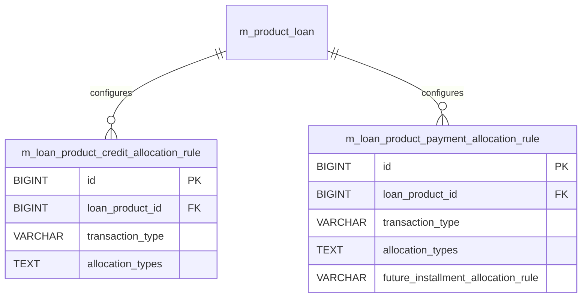

# [PDL] DB명세서

> 화면 1개 롤업(중분류 PDL, 대분류 PD). 화면 단위 원본은 `specs/<화면>/data-model.md`.

## PDL-001 대출상품관리

> 원본: `PDL-001-대출상품관리/data-model.md`

## [PDL-001] DB 명세서

### 테이블 목록

| 테이블명 | 역할 |
| :--- | :--- |
| `m_loan_product_credit_allocation_rule` | 대출 상품 수준의 크레딧(입금액) 배분 규칙 정의 |
| `m_loan_product_payment_allocation_rule` | 대출 상품 수준의 상환금(원금/이자/수수료) 충당 배분 순서 규칙 정의 |

### `m_loan_product_credit_allocation_rule` - 대출 상품 수준의 크레딧(입금액) 배분 규칙 정의

| 컬럼명 | 타입 | 제약 | 설명 |
| :--- | :--- | :--- | :--- |
| `id` | BIGINT | AUTO_INCREMENT, PK, NOT NULL | `m_loan_product_credit_allocation_rule`의 고유 식별자 (PK) |
| `loan_product_id` | BIGINT | NOT NULL | 연계된 loan_product 식별자 (FK) |
| `transaction_type` | VARCHAR(255) | NOT NULL | 트랜잭션/거래 유형 구분 |
| `allocation_types` | TEXT | NOT NULL | 충당/배분 유형 |
| `created_by` | BIGINT | NOT NULL, FK -> m_appuser(id), RESTRICT | 레코드 생성자 ID |
| `last_modified_by` | BIGINT | NOT NULL, FK -> m_appuser(id), RESTRICT | 레코드 최종 수정자 ID |
| `created_on_utc` | TIMESTAMP WITH TIME ZONE | NOT NULL | 레코드 생성 일시 |
| `last_modified_on_utc` | TIMESTAMP WITH TIME ZONE | NOT NULL | 레코드 최종 수정 일시 |

### `m_loan_product_payment_allocation_rule` - 대출 상품 수준의 상환금(원금/이자/수수료) 충당 배분 순서 규칙 정의

| 컬럼명 | 타입 | 제약 | 설명 |
| :--- | :--- | :--- | :--- |
| `id` | BIGINT | AUTO_INCREMENT, PK, NOT NULL | `m_loan_product_payment_allocation_rule`의 고유 식별자 (PK) |
| `loan_product_id` | BIGINT | NOT NULL | 연계된 loan_product 식별자 (FK) |
| `transaction_type` | VARCHAR(255) | NOT NULL | 트랜잭션/거래 유형 구분 |
| `allocation_types` | TEXT | NOT NULL | 충당/배분 유형 |
| `future_installment_allocation_rule` | VARCHAR(255) | NOT NULL | 상환 회차 번호 |
| `created_by` | BIGINT | NOT NULL, FK -> m_appuser(id), RESTRICT | 레코드 생성자 ID |
| `last_modified_by` | BIGINT | NOT NULL, FK -> m_appuser(id), RESTRICT | 레코드 최종 수정자 ID |
| `created_on_utc` | TIMESTAMP WITH TIME ZONE | NOT NULL | 레코드 생성 일시 |
| `last_modified_on_utc` | TIMESTAMP WITH TIME ZONE | NOT NULL | 레코드 최종 수정 일시 |

### 관계도

### 근거
* `fineract-loan/src/main/resources/db/changelog/tenant/module/loan/parts/1002_add_payment_allocation_rule.xml`
* `fineract-loan/src/main/resources/db/changelog/tenant/module/loan/parts/1016_add_credit_allocation_rule.xml`
