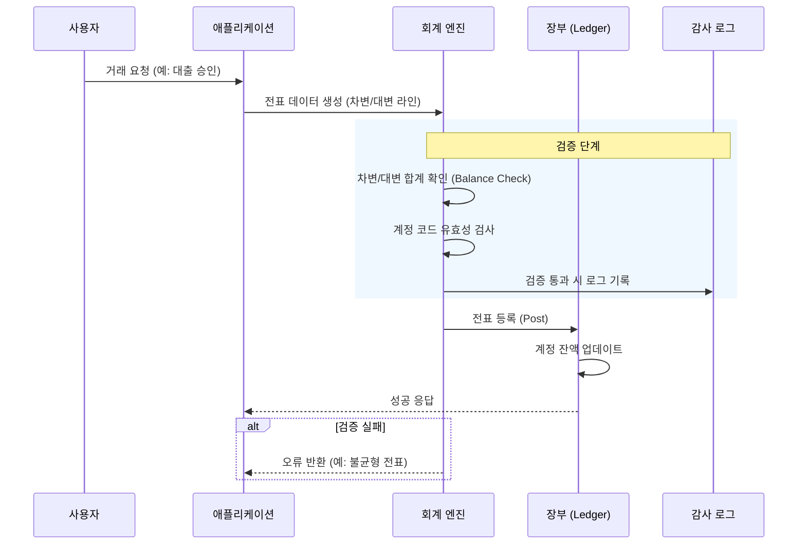
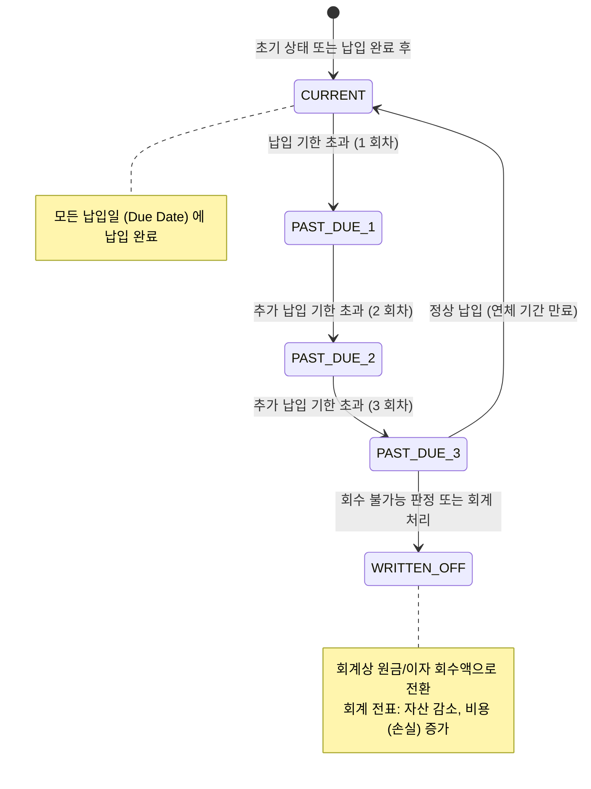

# 회계 및 연체/리스크 관리

Apache Fineract 는 금융 서비스 제공 기관 (FSP) 에게 복식부기 회계 원칙에 기반한 강력한 회계 엔진과, 대출 건의 연체 상태 및 충당금 (Provisioning) 을 관리하는 리스크 관리 모듈을 제공합니다. 이 모듈은 `fineract-core` 모듈의 핵심 컴포넌트로, 거래의 무결성과 재무 보고의 정확성을 보장합니다.

## 1. 복식부기 회계 엔진 (Double-Entry Accounting Engine)

Fineract 의 회계 엔진은 모든 금융 거래가 **차변 (Debit)**과 **대변 (Credit)**으로 균형을 이루도록 설계된 복식부기 시스템을 따릅니다. 이 원칙은 자산, 부채, 자본, 수익, 비용 계정 간의 관계를 수학적으로 보장합니다.

### 1.1. 계정 구조 및 코드 체계

계정은 계층 구조를 가지며, 각 계정은 `accountCode` (코드) 와 `accountType` (유형) 으로 정의됩니다.

*   **계정 코드 (Account Code):** 계정을 고유하게 식별하는 문자열입니다. 예: `1000` (현금), `2000` (대출 자산), `3000` (차입금 부채).
*   **계정 유형 (Account Type):**
    *   **자산 (Asset):** 현금, 대출 원금, 회수된 원금 등. (일반적으로 차변 증가)
    *   **부채 (Liability):** 차입금, 납입금, 미지급금 등. (일반적으로 대변 증가)
    *   **수익 (Income):** 이자 수익, 수수료 수익 등. (일반적으로 대변 증가)
    *   **비용 (Expense):** 이자 비용, 수수료 비용, 운영 비용 등. (일반적으로 차변 증가)
    *   **자본 (Equity):** 자본금, 잉여금 등.

### 1.2. 전표 분개 (Journal Entry) 로직

Fineract 는 `JournalEntry` 엔티티를 사용하여 거래를 기록합니다. 각 거래는 하나 이상의 `JournalEntryLine` 로 구성되며, 각 라인에는 계정 코드, 금액, 그리고 해당 라인의 역할 (차변/대변) 이 명시됩니다.

#### 핵심 비즈니스 규칙:
1.  **균형 원칙:** 하나의 전표 내 모든 차변 금액의 합계는 대변 금액의 합계와 반드시 일치해야 합니다. ($\sum Debit = \sum Credit$)
2.  **계정 식별:** 각 라인은 `accountCode` 를 통해 특정 계정으로 매핑됩니다.
3.  **거래 유형:**
    *   **대출 승인:** 자산 (대출 원금) 증가, 부채 (차입금) 증가.
    *   **원금 상환:** 자산 (현금) 감소, 자산 (대출 원금) 감소.
    *   **이자 지급:** 자산 (현금) 감소, 수익 (이자) 증가 또는 비용 (이자 비용) 증가.

### 1.3. 시스템 흐름: 전표 생성 및 검증

다음은 전표 생성 및 검증 과정의 흐름도입니다.



### 1.4. 주요 클래스 및 엔티티 (`fineract-core`)

*   **`JournalEntry`**: 전체 전표의 컨테이너입니다. `id`, `status` (DRAFT, POSTED, CANCELLED), `currency`, `totalDebit`, `totalCredit` 속성을 가집니다.
*   **`JournalEntryLine`**: 전포 내의 개별 항목입니다. `id`, `accountCode`, `amount` (실제 금액), `debitAmount` (차변 금액), `creditAmount` (대변 금액) 속성을 가집니다.
    *   *주의:* `debitAmount` 와 `creditAmount` 중 하나는 0 이어야 하며, 합계는 `amount` 와 일치합니다.
*   **`Account`**: 계정 마스터 데이터입니다. `accountCode`, `accountType`, `parentAccountCode` 등을 포함합니다.
*   **`Ledger`**: 특정 기관 (Branch/Institution) 의 장부입니다. 모든 전표는 특정 장부에 할당됩니다.

## 2. 연체 (Delinquency) 관리

연체 관리는 대출 건이 정해진 납기일에 원금 또는 이자를 납부하지 않았을 때 발생하는 상태를 추적하는 기능입니다.

### 2.1. 연체 상태 정의

Fineract 는 대출 건의 연체 상태를 `DelinquencyStatus` 에 따라 분류합니다.

*   **CURRENT (현재):** 모든 납입 일정이 정상적으로 이행된 경우.
*   **PAST_DUE_1 (1 일 연체):** 납입 기한이 지났으나 아직 1 회차 이상 연체되지 않은 상태.
*   **PAST_DUE_2 (2 일 연체):** 2 회차 이상 연체된 상태.
*   **PAST_DUE_3 (3 일 연체):** 3 회차 이상 연체된 상태 (일반적으로 '연체'로 간주).
*   **WRITTEN_OFF (채권 포기):** 채권이 회수 불가능하다고 판단되어 회계상 회수액으로 처리된 상태.

### 2.2. 연체 상태 전이 로직

시스템은 매일 (또는 설정된 주기로) 백그라운드 작업 (`DelinquencyCalculationJob`) 을 실행하여 각 대출 건의 연체 상태를 재평가합니다.

#### 상태 전이 흐름도:



### 2.3. 연체 계산 규칙

*   **Due Date (납입 기한):** 대출 상품 (Loan Product) 의 `interestInArrears` 및 `principalInArrears` 설정에 따라 계산됩니다.
*   **Grace Period (寬限 기간):** 일부 상품은 납입 기한 후 일정 기간 (예: 5 일) 을 허용할 수 있습니다. 이 기간 내 납입 시 연체 상태로 전이되지 않습니다.
*   **Partial Payment (부분 납입):** 원금과 이자 중 일부만 납입된 경우, 미납된 금액에 대한 연체 일수가 누적됩니다.

## 3. 충당금 (Provisioning) 관리

충당금 관리는 연체된 대출에 대해 예상되는 손실을 회계적으로 반영하기 위한 비용 (충당금 비용) 과 자산 감소를 기록하는 프로세스입니다.

### 3.1. 충당금 분류 (Provisioning Classification)

Fineract 는 일반적으로 국제 회계 기준 (IFRS 9) 또는 현지 회계 기준에 따라 대출 건을 위험 등급에 따라 분류합니다.

*   **Stage 1 (초기):** 연체가 없거나, 신용 위험이 유의하게 증가하지 않은 경우. (미래 12 개월 예상 손실)
*   **Stage 2 (연체 초기):** 신용 위험이 유의하게 증가했으나, 계약상 연체 상태에 도달하지 않은 경우. (수명 주기 예상 손실)
*   **Stage 3 (심각한 연체):** 계약상 연체 상태 (예: 3 회차 이상 연체) 에 도달한 경우. (수명 주기 예상 손실)
*   **Stage 4 (채권 포기):** WRITTEN_OFF 상태인 경우.

### 3.2. 충당금 계산 및 전표 생성

충당금 계산을 위해 `ProvisioningCalculationJob` 이 실행됩니다. 이 작업은 각 대출 건의 위험 등급을 결정하고, 해당 등급에 따른 충당금 비율 (Provisioning Rate) 을 적용하여 총 충당금 금액을 산출합니다.

#### 충당금 전표 생성 로직:

충당금 비용은 회계적으로 **비용 (Expense)**으로 처리되며, 대출 자산은 **감소 (Contra Asset)**됩니다.

1.  **충당금 금액 산출:** `Loan Amount` × `Provisioning Rate` (등급별)
2.  **전표 생성:**
    *   **차변 (Debit):** `Provisioning Expense` 계정 (비용 증가)
    *   **대변 (Credit):** `Provisioning Reserve` 계정 (부채/충당금 준비금 증가) 또는 `Loan Asset` 직접 감소 (기준에 따라 다름).
    *   *Fineract 의 일반적인 처리:* 충당금 비용은 비용 계정으로, 충당금 자산은 대출 자산 계정의 대변으로 처리되어 자산 가치를 낮춥니다.

```mermaid
flowchart LR
    subgraph Provisioning Process [충당금 프로세스]
        A[위험 등급 평가 (Stage 1/2/3)] --> B[충당금 비율 적용]
        B --> C[충당금 금액 계산]
        C --> D{회계 처리}
        
        D -->|IFRS 9 기준| E[전표 생성]
        E --> F[차변: 충당금 비용 계정]
        E --> G[대변: 충당금 준비금 계정]
        
        D -->|현금 흐름 기준| H[전표 생성]
        H --> I[차변: 충당금 비용 계정]
        H --> J[대변: 대출 자산 감소]
    end
```

### 3.3. 충당금 설정값

시스템은 `ProvisioningConfiguration` 을 통해 충당금 규칙을 정의합니다.

*   **`provisioningEnabled`**: 충당금 계산 기능 활성화 여부.
*   **`provisioningClassificationRules`**: 연체 일수 (예: 30 일, 60 일, 90 일) 에 따른 위험 등급 (Stage) 매핑 규칙.
*   **`provisioningRates`**: 각 위험 등급별 충당금 비율 (예: Stage 1: 1%, Stage 2: 5%, Stage 3: 100%).

## 4. 아키텍처 패턴 및 데이터 모델

Finerack 의 회계 및 리스크 모듈은 **Domain-Driven Design (DDD)** 패턴을 따르며, 핵심 도메인 (Accounting, Risk) 을 명확히 분리합니다.

### 4.1. 주요 도메인 엔티티

| 엔티티명 | 설명 | 주요 속성 |
| :--- | :--- | :--- |
| **`JournalEntry`** | 회계 전표 | `id`, `status`, `currency`, `totalDebit`, `totalCredit` |
| **`JournalEntryLine`** | 전포 라인 | `id`, `accountCode`, `debitAmount`, `creditAmount` |
| **`DelinquencyStatus`** | 연체 상태 열거형 | `CURRENT`, `PAST_DUE_1`, `PAST_DUE_2`, `PAST_DUE_3`, `WRITTEN_OFF` |
| **`ProvisioningClassification`** | 충당금 분류 | `stage` (1, 2, 3), `provisioningRate` |
| **`ProvisioningConfiguration`** | 충당금 설정 | `classificationRules`, `rates` |
| **`LoanAccount`** | 대출 계정 | `delinquencyStatus`, `provisioningStage`, `provisioningAmount` |

### 4.2. 서비스 계층 구조

1.  **Accounting Service:** 전표 생성, 검증, 장부 등록을 담당합니다. `JournalEntryService` 가 핵심입니다.
2.  **Risk Management Service:**
    *   `DelinquencyCalculationService`: 납입 이력을 분석하여 연체 상태를 결정합니다.
    *   `ProvisioningCalculationService`: 연체 상태에 따라 위험 등급을 매기고 충당금 금액을 계산합니다.
    *   `ProvisioningPostingService`: 계산된 충당금 금액을 회계 전표로 변환하여 등록합니다.

### 4.3. 데이터베이스 스키마 (개요)

*   **`jentry`**: 전표 테이블.
*   **`jentry_line`**: 전포 라인 테이블.
*   **`delinquency_status`**: 연체 상태 마스터.
*   **`provisioning_classification`**: 충당금 분류 규칙 마스터.
*   **`provisioning_configuration`**: 기관별 충당금 설정.

## 5. 요약 및 주의사항

*   **무결성:** 모든 회계 거래는 복식부기 원칙을 준수해야 하며, 시스템은 이를 강제로 검증합니다.
*   **자동화:** 연체 상태와 충당금 계산은 백그라운드 작업에 의해 자동 수행되므로, 수동 개입이 최소화됩니다.
*   **유연성:** 충당금 비율과 분류 규칙은 기관의 회계 정책 (IFRS, GAAP 등) 에 따라 커스터마이징할 수 있습니다.
*   **감사:** 모든 전포 등록과 상태 전이는 감사 로그에 기록되어 추후 검증이 가능합니다.

이 문서는 Apache Fineract 의 회계 및 리스크 관리 엔진을 이해하고 구현하는 데 필요한 핵심 개념과 기술적 세부 사항을 제공합니다.
