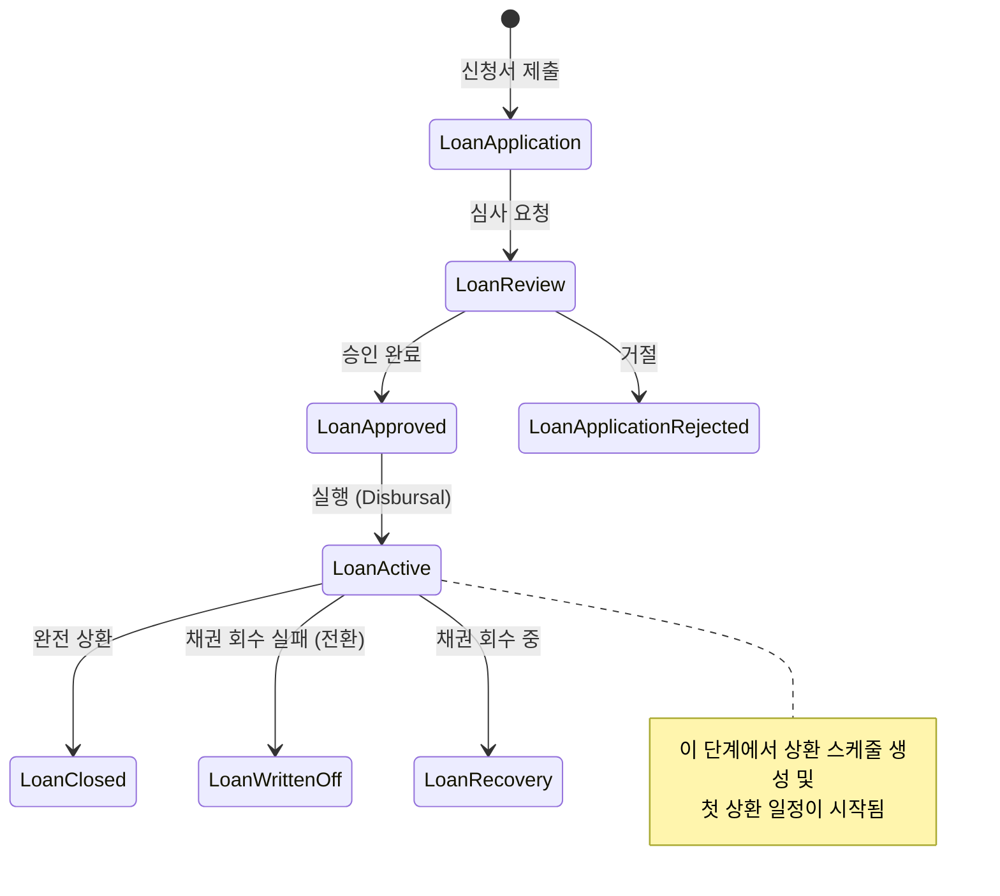

# 대출 (Loan) 관리 및 상환 엔진

Apache Fineract의 대출 모듈은 금융 기관의 대출 포트폴리오를 관리하기 위한 핵심 엔진으로, 대출 상품 정의부터 대출 승인, 실행, 그리고 최종 상환까지의 전체 라이프사이클을 관리합니다. 이 엔진은 `fineract-loan` 모듈에 구현되어 있으며, 복잡한 이자 계산 알고리즘, 다양한 상환 방법론, 그리고 동적 수수료 처리를 지원하여 유연한 금융 상품 관리를 가능하게 합니다.

## 1. 아키텍처 개요

Fineract 대출 엔진은 **도메인 주도 설계 (DDD)** 원칙에 기반하여 설계되었습니다. 주요 구성 요소는 다음과 같습니다.

### 1.1 주요 엔티티 (Entities) 및 클래스

*   **Loan Product (대출 상품):** 대출의 기본 템플릿입니다. 원금, 이자율, 상환 기간, 상환 방법 (원금 균등, 이자 균등 등), 수수료 구조 등을 정의합니다.
*   **Loan (대출):** 실제 고객에게 발급된 대출 인스턴스입니다. `LoanProduct`을 참조하며, 승인 상태, 실행 상태, 현재 잔고 등을 관리합니다.
*   **Repayment Schedule (상환 스케줄):** 대출 기간 동안 발생할 것으로 예상되는 각 상환 회차의 상세 내역입니다. 원금, 이자, 수수료, 잔여 원금, 잔여 이자, 잔여 기간 등을 포함합니다.
*   **Repayment (상환):** 실제 고객에서 시스템으로 들어온 상환 거래입니다. 이 데이터는 `Repayment Schedule`과 매칭되어 잔고와 상태를 업데이트합니다.
*   **Loan Application (대출 신청):** 고객이 대출을 요청하는 초기 단계의 데이터입니다.

### 1.2 핵심 인터페이스 및 서비스

*   **LoanLifecycleService:** 대출의 상태 전이 (예: 신청 -> 심사 -> 승인 -> 실행) 를 관리하고, 상태 변경 시 발생하는 비즈니스 규칙 (예: 승인 시 이자율 고정) 을 처리합니다.
*   **RepaymentScheduleGenerationService:** 대출 실행 시 미래의 상환 일정을 계산하여 `Repayment Schedule` 엔티티를 생성합니다.
*   **RepaymentProcessingService:** 실제 상환 거래를 처리하고, 스케줄과 매칭하여 원금/이자 차감, 수수료 부과, 잔여 기간 조정 등을 수행합니다.
*   **LoanCalculationEngine:** 이자 계산 (단리/복리), 연체 이자, 조기 상환 페널티 등을 계산하는 핵심 수학 엔진입니다.

## 2. 대출 포트폴리오 라이프사이클

대출은 명확한 상태 머신 (State Machine) 을 따릅니다. 각 상태 전이는 특정 조건과 작업을 수행합니다.

### 2.1 상태 전이 흐름

### 2.2 상태 전이 규칙 및 작업

1.  **신청 (Application):**
    *   고객 정보, 신청 금액, 희망 상품 ID, 신청 날짜가 저장됩니다.
    *   상태: `APPLICATION_SUBMITTED`

2.  **심사 (Review):**
    *   심사자가 신청서를 검토합니다.
    *   승인 시: `APPROVAL_DATE` 설정, `APPROVAL_AMOUNT` 확정, `APPROVAL_INTEREST_RATE` 확정 (상품 기준 또는 협상 기준).
    *   거절 시: `REJECTION_REASON` 저장, 상태 `APPLICATION_REJECTED`로 이동.
    *   상태: `UNDER_REVIEW` 또는 `APPROVED`

3.  **실행 (Disbursal):**
    *   승인된 대출을 실제 자금으로 전환하는 단계입니다.
    *   **핵심 작업:**
        *   `DISBURSAL_DATE` 설정.
        *   **상환 스케줄 생성:** `RepaymentScheduleGenerationService`가 실행되어 향후 모든 상환 회차의 데이터를 생성합니다.
        *   **초기 수수료 처리:** 승인 수수료, 실행 수수료 등이 차감됩니다.
    *   상태: `ACTIVE`

4.  **상환 (Repayment):**
    *   고객이 상환 거래를 제출하면, `RepaymentProcessingService`가 이를 처리합니다.
    *   **매칭 로직:** 제출된 금액이 현재 남은 스케줄의 첫 번째 회차와 매칭됩니다.
    *   **차감 로직:** 원금과 이자를 비율에 따라 분할 차감하거나, 우선순위에 따라 차감합니다.
    *   **잔여 기간 조정:** 조기 상환 시 남은 회차 수를 줄이고, 연체 시 남은 기간을 늘립니다.
    *   상태: `ACTIVE` (잔액 > 0) 또는 `CLOSED` (잔액 = 0)

5.  **종료 (Closed):**
    *   모든 상환 스케줄이 완료되고 잔액이 0이 되었을 때 상태가 `CLOSED`로 변경됩니다.

## 3. 상환 스케줄 엔진 (Repayment Schedule Engine)

상환 스케줄 엔진은 대출 실행 시 미래의 상환 일정을 계산하는 핵심 모듈입니다. 이 엔진은 `LoanProduct`의 설정과 `Loan`의 조건 (예: 조기 상환) 을 기반으로 합니다.

### 3.1 계산 파라미터

*   **Principal (원금):** 대출 금액.
*   **Interest Rate (이자율):** 연 이자율 (Annual Interest Rate).
*   **Repayment Method (상환 방법):**
    *   `EQUATED_PRINCIPAL`: 원금 균등 상환 (각 회차 원금 동일).
    *   `EQUATED_INTEREST`: 이자 균등 상환 (각 회차 이자 동일).
    *   `DUE_DATE`: 만기일 기준 (특정 날짜까지 원금+이자 상환).
    *   `INTEREST_ONLY`: 이자만 상환 (마지막 회차 원금 상환).
    *   `INTEREST_FIRST`: 이자 먼저 상환 후 원금 상환.
*   **Frequency (빈도):** 월, 분기, 반기, 연도 등.
*   **Grace Period (유예 기간):** 이자 계산이 시작되지 않는 기간.
*   **Penalty (페널티):** 조기 상환 시 부과되는 수수료.

### 3.2 계산 알고리즘 (예시: 원금 균등 상환)

Fineract는 표준 금융 공식을 사용하여 각 회차의 원금, 이자, 잔여 원금을 계산합니다.

$$
\text{Monthly Payment} = P \times \frac{r(1+r)^n}{(1+r)^n - 1}
$$

*   $P$: 원금
*   $r$: 월 이자율 (연 이자율 / 12)
*   $n$: 총 상환 회차 수

각 스케줄 항목은 다음과 같이 계산됩니다:

1.  **Interest Payment:** $\text{Current Principal} \times r$
2.  **Principal Payment:** $\text{Total Monthly Payment} - \text{Interest Payment}$
3.  **Remaining Principal:** $\text{Previous Remaining Principal} - \text{Principal Payment}$
4.  **Remaining Interest:** $\text{Total Interest} - \text{Interest Payment}$
5.  **Remaining Term:** $\text{Total Term} - \text{Completed Term}$

### 3.3 특수 처리 로직

*   **Grace Period 처리:** 유예 기간 동안은 이자가 발생하지 않으며, 원금만 차감됩니다.
*   **Early Repayment (조기 상환):**
    *   사용자가 조기 상환을 요청하면, 남은 원금에 대해 **조기 상환 페널티**를 계산합니다.
    *   페널티는 `LoanProduct`의 설정 (예: 원금의 2%, 또는 고정 금액) 에 따라 결정됩니다.
    *   상환 스케줄의 남은 회차 수를 줄이고, 남은 기간을 조정합니다.
*   **Arrears (연체) 처리:**
    *   상환 기한을 넘긴 경우, 연체 이자가 추가 계산됩니다.
    *   연체 이자율은 `LoanProduct`의 설정 또는 시스템 기본값을 따릅니다.
    *   연체 기간이 길어지면, 남은 원금에 대한 이자 계산 기간이 연장됩니다.

## 4. 수수료 처리 (Fee Processing)

Fineract는 대출 수명 주기 전반에 걸쳐 다양한 수수료를 지원하며, 각 수수료는 별도의 엔티티 (`FeeCharges`) 로 관리됩니다.

### 4.1 수수료 유형

*   **Application Fee:** 신청 시 부과.
*   **Approval Fee:** 승인 시 부과.
*   **Disbursement Fee:** 실행 시 부과.
*   **Repayment Fee:** 각 상환 회차마다 부과.
*   **Penalty Fee:** 연체 또는 조기 상환 시 부과.

### 4.2 수수료 계산 및 적용

*   **계산 방식:**
    *   `Flat`: 고정 금액.
    *   `Percentage`: 원금의 비율.
    *   `Percentage of Principal`: 원금의 비율 (상환 방식에 따라 적용).
    *   `Percentage of Interest`: 이자의 비율.
*   **적용 시점:**
    *   **Pre-disbursement:** 실행 전, 대출 금액에서 수수료만큼 차감하여 실제 지급 금액을 조정합니다.
    *   **Post-disbursement:** 상환 스케줄 생성 후, 각 상환 회차에 수수료 항목을 추가합니다.
*   **처리 로직:**
    *   `LoanLifecycleService`는 상태 전이 (예: 승인 -> 실행) 시 해당 수수료들을 생성합니다.
    *   `RepaymentProcessingService`는 상환 거래 처리 시, 해당 회차의 수수료 항목을 차감합니다.
    *   수수료는 원금과 이자보다 우선적으로 차감됩니다.

## 5. 상환 처리 엔진 (Repayment Processing Engine)

실제 고객이 상환을 제출했을 때 실행되는 로직입니다.

### 5.1 매칭 및 차감 알고리즘

1.  **매칭:** 제출된 상환 거래 (`Repayment`) 의 날짜와 금액을 기준으로, 현재 남은 `Repayment Schedule` 중 가장 먼저 도래한 회차와 매칭합니다.
2.  **차감 우선순위:**
    *   **Standard:** 이자 -> 원금 -> 수수료 순으로 차감합니다.
    *   **Custom:** 상품 설정에 따라 차감 우선순위를 변경할 수 있습니다.
3.  **잔여 처리:**
    *   상환 금액이 스케줄 금액보다 작으면, 해당 회차의 잔여 금액을 다음 회차로 이관합니다.
    *   상환 금액이 스케줄 금액보다 크면, 현재 회차를 완료하고 다음 회차로 넘어갑니다.

### 5.2 상태 업데이트

*   **Completed:** 해당 스케줄 회차가 완전히 처리되면, `Repayment Schedule`의 상태가 `COMPLETED`로 변경됩니다.
*   **Partial:** 상환 금액이 부족하면, 해당 회차의 상태는 `PARTIAL`로 유지됩니다.
*   **Loan Status Update:**
    *   모든 스케줄이 `COMPLETED`가 되면, 대출 상태가 `CLOSED`로 변경됩니다.
    *   연체 기간이 설정되어 있다면, 연체 기간이 지나면 상태가 `WRITTEN_OFF` 또는 `RECOVERY`로 변경될 수 있습니다.

## 6. 데이터 모델 요약

| 엔티티 | 설명 | 주요 필드 |
| :--- | :--- | :--- |
| **LoanProduct** | 대출 상품 템플릿 | `interestRate`, `repaymentMethod`, `frequency`, `feeCharges` |
| **Loan** | 실제 대출 인스턴스 | `loanProductId`, `principal`, `interestRate`, `status`, `disbursalDate` |
| **RepaymentSchedule** | 상환 일정 | `scheduleId`, `principal`, `interest`, `fee`, `principalWriteOff`, `interestWriteOff`, `termRemaining`, `status` |
| **FeeCharge** | 수수료 정의 | `feeType`, `feePercentage`, `feeAmount`, `feeFrequency` |
| **Repayment** | 상환 거래 | `repaymentId`, `loanId`, `amount`, `repaymentDate`, `status` |

## 7. 결론

Apache Fineract의 대출 엔진은 모듈화되고 확장 가능한 아키텍처를 통해 다양한 금융 상품의 요구 사항을 충족합니다. 상태 머신 기반의 라이프사이클 관리, 정교한 상환 스케줄 계산 엔진, 그리고 유연한 수수료 처리 로직은 금융 기관이 대출 포트폴리오를 효율적으로 관리하고 리스크를 통제하는 데 필수적인 기능을 제공합니다. 개발자는 이 엔진의 핵심 로직을 이해함으로써, 새로운 상품 기능을 추가하거나 기존 로직을 커스터마이징할 수 있습니다.
