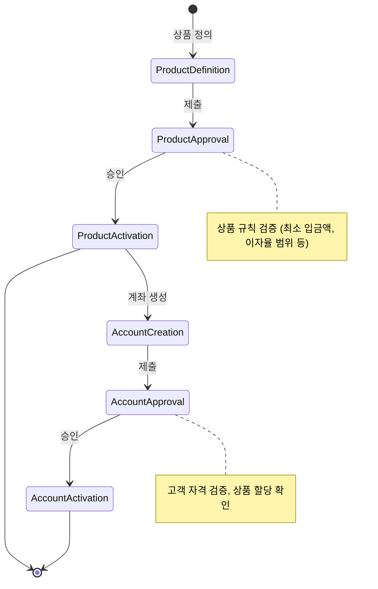
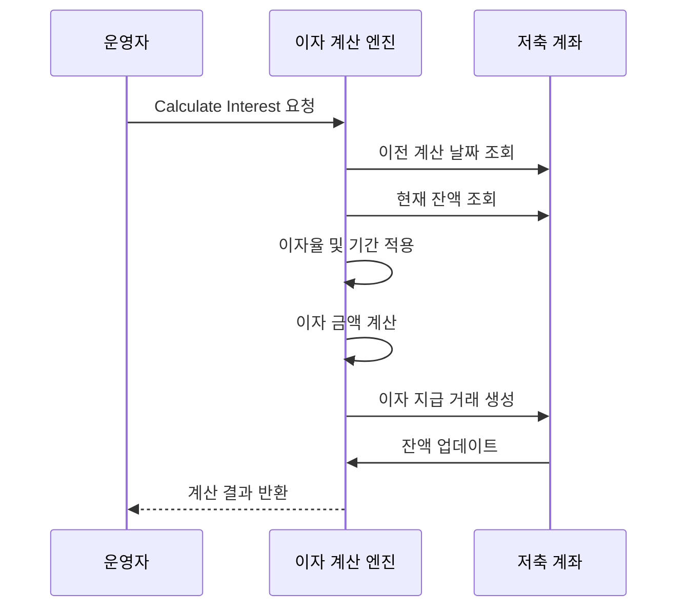

# 예금 및 적금 관리 (Savings Deposits Management)

Apache Fineract는 오픈소스 금융 소프트웨어 플랫폼으로, 예금 (Savings) 과 적금 (Deposits) 을 포함한 다양한 저축 상품과 계좌를 관리할 수 있는 강력한 기능을 제공합니다. 본 문서는 `fineract-savings` 모듈의 아키텍처, 핵심 엔티티, 비즈니스 규칙 및 이자 계산 수명주기에 대해 상세히 설명합니다.

## 1. 아키텍처 개요

Fineract의 예금 및 적금 관리 시스템은 계층형 아키텍처를 따르며, 데이터 모델링과 비즈니스 로직이 명확하게 분리되어 있습니다. 주요 구성 요소는 다음과 같습니다.

### 1.1 핵심 엔티티 (Core Entities)

시스템은 다음 주요 엔티티들을 통해 예금 및 적금의 전체 수명주기를 관리합니다.

*   **Savings Product (저축 상품):** 예금이나 적금 상품의 정의입니다. 이자율, 만기 기간, 최소 입금액, 수수료 구조, 상품 코드 등을 포함합니다.
*   **Savings Account (저축 계좌):** 특정 고객에게 할당된 실제 계좌입니다. 상품 ID, 고객 ID, 계좌 번호, 잔액, 상태 등을 관리합니다.
*   **Savings Transaction (저축 거래):** 계좌에 대한 모든 금융 거래 (입금, 출금, 이자 지급, 수수료 징수) 를 기록합니다.
*   **Savings Activity (저축 활동):** 계좌의 상태 변경, 상품 변경, 이자 계산 주기 변경 등 계좌의 상태 전이를 나타냅니다.
*   **Savings Interest Calculation (저축 이자 계산):** 특정 기간 동안 발생한 이자를 계산하고 적용하는 프로세스입니다.

### 1.2 주요 클래스 구조

`fineract-savings` 모듈은 다음과 같은 주요 클래스들을 통해 기능을 구현합니다.

```java
// 상품 관리
SavingsProductDefinition
SavingsProductApproval
SavingsProductActivation

// 계좌 관리
SavingsAccount
SavingsAccountApproval
SavingsAccountActivation

// 거래 관리
SavingsTransaction
SavingsTransactionApproval
SavingsTransactionActivation

// 이자 계산 및 활동
SavingsInterestCalculation
SavingsActivity
```

## 2. 상품 및 계좌 생성 수명주기

예금이나 적금 상품을 정의하고, 이를 기반으로 계좌를 생성하는 과정은 엄격한 승인 및 활성화 워크플로우를 따릅니다.

### 2.1 상품 정의 및 승인

1.  **상품 정의 (Definition):** 금융 기관의 상품 관리자가 상품의 세부 사항 (이름, 상품 코드, 이자율, 만기 등) 을 정의합니다.
2.  **상품 승인 (Approval):** 정의된 상품은 승인 대기 상태로 넘어갑니다. 승인 권한이 있는 사용자가 상품의 유효성을 검토하고 승인합니다.
3.  **상품 활성화 (Activation):** 승인된 상품은 활성화 상태로 전환되어, 이제 이를 기반으로 계좌를 생성할 수 있습니다.

### 2.2 계좌 생성 및 승인

1.  **계좌 생성 (Creation):** 활성화된 상품을 선택하여 신규 계좌를 생성합니다. 이때 초기 입금이 필요한 경우 (예: 적금) 즉시 수행됩니다.
2.  **계좌 승인 (Approval):** 생성된 계좌는 승인 대기 상태로 넘어갑니다. 승인 권한이 있는 사용자가 계좌 정보를 확인하고 승인합니다.
3.  **계좌 활성화 (Activation):** 승인된 계좌는 활성화 상태로 전환되어, 입출금 거래를 수행할 수 있게 됩니다.

### 2.3 상태 전이 다이어그램



## 3. 예금 및 적금 상품 유형

Fineract는 다양한 저축 상품 유형을 지원하며, 각 유형은 고유한 이자 계산 규칙과 만기 조건을 가집니다.

### 3.1 예금 (Savings)

*   **고정예금 (Fixed Savings):**
    *   **특징:** 특정 기간 (예: 1 년) 동안 자금을 예치하고, 만기 시 원금과 이자를 한 번에 수령합니다.
    *   **이자 계산:** 만기 시점 (End Date) 에 한 번만 이자가 계산되어 지급됩니다.
    *   **특이사항:** 만기 전에 출금할 경우, 보통 이자 없이 원금만 반환되거나 페널티가 적용될 수 있습니다.
*   **불정예금 (Flexible Savings):**
    *   **특징:** 언제든지 입출금이 가능하며, 이자는 매월 또는 지정된 주기로 계산되어 지급됩니다.
    *   **이자 계산:** 매 기간 (예: 매월) 마다 잔액에 대해 이자가 계산되어 계좌 잔액에 추가됩니다.
    *   **특이사항:** 만기 개념이 없으며, 언제든지 출금이 가능합니다.

### 3.2 적금 (Deposits)

*   **정기적금 (Recurring Deposit):**
    *   **특징:** 매월 (또는 지정된 주기) 에 고정된 금액을 입금해야 합니다.
    *   **이자 계산:** 매 입금 시점에 해당 금액에 대해 이자가 계산되며, 만기 시 모든 이자가 한 번에 지급됩니다.
    *   **특이사항:** 입금 주기를 놓치면 해당 기간의 이자가 손실되거나 계좌가 비활성화될 수 있습니다.
*   **불정적금 (Flexible Deposit):**
    *   **특징:** 매월 고정 금액을 입금하지만, 만기 전까지 자유롭게 출금이 가능합니다.
    *   **이자 계산:** 매 입금 시점에 이자가 계산되어 누적됩니다.
    *   **특이사항:** 만기 전 출금 시 페널티 이자가 적용될 수 있습니다.

## 4. 이자 계산 수명주기 (Interest Calculation Lifecycle)

Fineract의 이자 계산 엔진은 상품 설정에 따라 복잡한 로직을 수행합니다. 이자 계산은 주로 `SavingsInterestCalculation` 엔티티를 통해 관리됩니다.

### 4.1 이자 계산 트리거

이자 계산은 다음 상황 중 하나에서 트리거됩니다.

1.  **수동 계산 (Manual Calculation):** 운영자가 시스템에서 "Calculate Interest" 버튼을 클릭하여 즉시 계산합니다.
2.  **자동 계산 (Automatic Calculation):** `SavingsInterestCalculation` 설정에서 "Automatic"으로 설정된 경우, 특정 이벤트 (예: 매월 1 일, 만기 도달) 발생 시 자동으로 계산됩니다.
3.  **계산 주기 (Calculation Frequency):** 상품 설정에 따라 `Monthly`, `Quarterly`, `Yearly` 등으로 계산 주기가 정의됩니다.

### 4.2 이자 계산 로직

이자 계산은 다음과 같은 단계로 수행됩니다.

1.  **기간 확인:** 현재 날짜와 이전 계산 날짜 사이의 기간을 확인합니다.
2.  **잔액 확인:** 해당 기간 동안의 평균 잔액 또는 특정 날짜의 잔액을 확인합니다. (상품 설정에 따라 다름)
3.  **이자 계산:** `Principal * Interest Rate * Time Factor` 공식을 적용합니다.
    *   `Time Factor`: 계산 기간이 1 년이 아닌 경우 (예: 1 개월) 조정됩니다.
4.  **이자 적용:** 계산된 이자는 다음 거래 (`SavingsTransaction`) 로 생성되어 계좌 잔액에 추가됩니다.

### 4.3 이자 계산 상태 전이



### 4.4 이자 계산 설정 (Configuration)

상품 정의 시 다음 설정값들이 이자 계산 방식에 영향을 미칩니다.

*   **Interest Calculation Frequency:** `Monthly`, `Quarterly`, `Yearly`
*   **Interest Calculation Day:** 매월 계산할 경우의 날짜 (예: 1 일)
*   **Interest Calculation Method:**
    *   `Simple Interest`: `Principal * Rate * Time`
    *   `Compound Interest`: `(1 + Rate)^Time` (복리)
*   **Grace Period:** 이자 계산이 지연되는 기간 (예: 만기 후 1 개월)
*   **Minimum Balance:** 이자 계산이 적용되기 위한 최소 잔액

## 5. 입출금 및 거래 관리

계좌가 활성화된 후에는 `SavingsTransaction` 을 통해 입출금 거래를 수행할 수 있습니다.

### 5.1 거래 승인 워크플로우

모든 거래는 승인 워크플로우를 거칩니다.

1.  **거래 생성:** 운영자가 입출금 거래를 생성합니다.
2.  **거래 승인:** 승인 권한이 있는 사용자가 거래를 승인합니다.
3.  **거래 활성화:** 승인된 거래는 활성화되어 계좌 잔액에 반영됩니다.

### 5.2 거래 유형

*   **Deposit (입금):** 계좌 잔액 증가.
*   **Withdrawal (출금):** 계좌 잔액 감소.
*   **Interest Payment (이자 지급):** 계산된 이자를 계좌 잔액에 추가.
*   **Fee Collection (수수료 징수):** 계좌 유지비, 출금 수수료 등을 차감.

### 5.3 거래 제한 및 규칙

*   **최소/최대 입금액:** 상품 설정에 따라 제한될 수 있습니다.
*   **최대 잔액:** 계좌의 최대 잔액 제한이 있을 수 있습니다.
*   **출금 제한:** 만기 전 출금 시 페널티 적용 또는 출금 불가.
*   **최소 유지 잔액:** 일정 금액 이상 유지해야 이자가 발생하거나 계좌가 유지됩니다.

## 6. 보고서 및 분석

Fineract는 예금 및 적금 관리에 대한 다양한 보고서를 제공합니다.

*   **Savings Account Report:** 특정 계좌의 상세 내역 (거래 이력, 잔액 변동).
*   **Savings Product Report:** 특정 상품에 대한 계좌 수, 총 잔액, 총 이자 등.
*   **Savings Transaction Report:** 특정 기간 내의 모든 거래 내역.
*   **Savings Interest Report:** 계산된 이자의 상세 내역.

## 7. API 참조

Fineract는 RESTful API 를 통해 예금 및 적금 관리 기능을 제공합니다. 주요 API 엔드포인트는 다음과 같습니다.

*   `POST /savings-products`: 상품 정의
*   `POST /savings-product-approvals`: 상품 승인
*   `POST /savings-accounts`: 계좌 생성
*   `POST /savings-account-approvals`: 계좌 승인
*   `POST /savings-transactions`: 거래 생성
*   `POST /savings-transaction-approvals`: 거래 승인
*   `POST /savings-interest-calculations`: 이자 계산
*   `GET /savings-accounts/{id}`: 계좌 상세 정보 조회

## 8. 결론

Apache Fineract 의 예금 및 적금 관리 시스템은 금융 기관의 저축 상품 관리 요구사항을 충족하기 위해 설계된 유연하고 확장 가능한 아키텍처를 제공합니다. 상품 정의부터 계좌 생성, 이자 계산, 거래 처리까지의 전체 수명주기를 체계적으로 관리할 수 있으며, 다양한 상품 유형과 이자 계산 방식을 지원하여 금융 기관의 비즈니스 로직에 맞게 커스터마이징할 수 있습니다.
