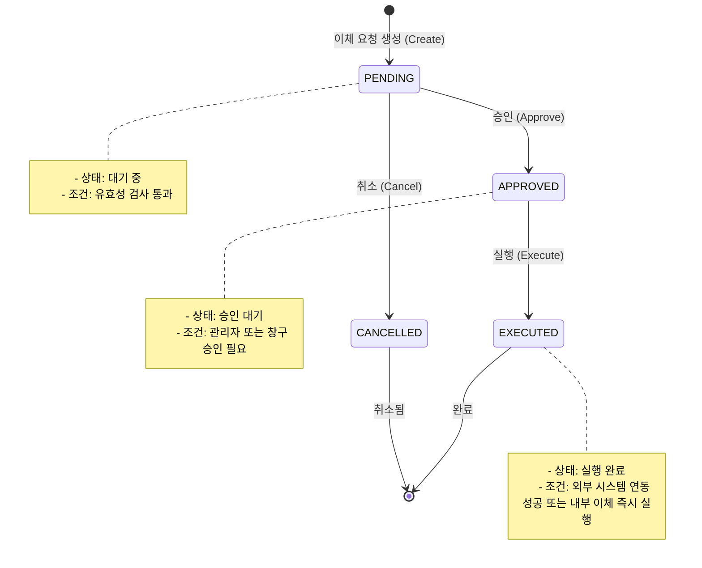
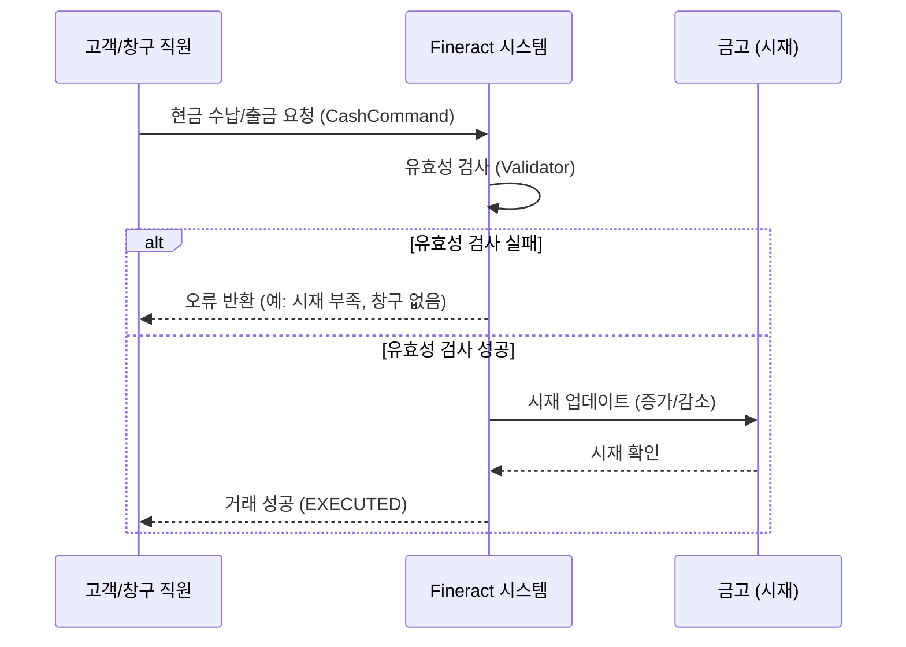

# 이체 및 창구 운영

Apache Fineract는 금융 기관의 핵심 업무인 자금 이체 (Transfer) 와 창구 (Teller) 를 통한 현금 관리 기능을 제공합니다. 이 모듈은 내부 계좌 간 이체, 타행 이체, 그리고 창구 직원의 현금 수납 및 출금 처리를 위한 통합 비즈니스 로직을 포함하고 있습니다.

## 1. 아키텍처 개요

Fineract의 이체 및 창구 기능은 `fineract-core` 모듈에 구현되어 있으며, Spring Framework 기반의 의존성 주입 (DI) 와 트랜잭션 관리 방식을 따릅니다. 주요 컴포넌트는 다음과 같은 계층 구조로 구성됩니다.

### 1.1 주요 클래스 및 인터페이스

*   **`TransferCommand`**: 이체 요청을 위한 데이터 전달 객체 (DTO). 이체 유형, 송금자, 수취인, 금액, 통화, 수수료 등을 정의합니다.
*   **`CashCommand`**: 창구 현금 처리 (수납/출금) 를 위한 명령 객체. 창구 ID, 현금 유형, 금액, 거래 유형 등을 포함합니다.
*   **`TransferService`**: 이체 비즈니스 로직을 담당하는 서비스 레이어. 이체 생성, 승인, 취소, 실행 및 상태 전이를 관리합니다.
*   **`CashService`**: 창구 현금 관리 로직을 담당하는 서비스 레이어. 창구 시재 (Cash-in-Custody) 증가/감소 및 현금 거래 내역을 관리합니다.
*   **`TransferValidator`**: 이체 요청의 유효성을 검증하는 유틸리티. 계좌 존재 여부, 잔고 확인, 통화 일치 여부 등을 검증합니다.
*   **`CashValidator`**: 현금 처리 요청의 유효성을 검증. 창구 권한, 현금 유형 제한 등을 검증합니다.

### 1.2 데이터베이스 엔티티

*   **`Transfer`**: 이체 거래의 영구 저장소. 상태 (PENDING, APPROVED, EXECUTED, CANCELLED), 수수료, 관련 계좌 ID 등을 저장합니다.
*   **`Cash`**: 창구 현금 거래 기록. 창구 ID, 현금 유형 (현금, 체크 등), 금액, 거래 유형 (수납, 출금) 을 저장합니다.
*   **`CashInCustody`**: 창구별 시재 (현금 보유량) 정보. 각 창구별 현재 보유 현금의 총합을 추적합니다.

## 2. 이체 (Transfer) 비즈니스 로직

Fineract는 내부 이체와 타행 이체를 지원하며, 각 유형마다 고유한 처리 절차와 비즈니스 규칙을 적용합니다.

### 2.1 이체 유형

1.  **내부 이체 (Internal Transfer)**: 같은 금융 기관 내의 서로 다른 계좌 간 이체입니다. 실시간 처리가 가능하며, 즉시 실행됩니다.
2.  **타행 이체 (External Transfer)**: 다른 금융 기관의 계좌로 이체하는 기능입니다. 외부 이체 시스템 (예: SWIFT, RTGS, 또는 제 3 자 이체 게이트웨이) 과 연동되어 처리됩니다.

### 2.2 이체 상태 전이 (State Transition)

이체 거래는 생성부터 완료까지 명확한 상태 전이를 거칩니다. 다음 다이어그램은 이체 프로세스의 흐름을 보여줍니다.

### 2.3 내부 이체 처리

*   **프로세스**: 송금자가 이체 요청을 생성하면, 시스템은 즉시 잔고 확인을 수행하고 거래를 `EXECUTED` 상태로 변경합니다.
*   **비즈니스 규칙**:
    *   송금 계좌의 현재 잔고가 이체 금액과 수수료의 합보다 커야 합니다.
    *   송금자와 수취인이 같은 기관 내 계좌여야 합니다.
    *   통화 (Currency) 가 일치해야 합니다.

### 2.4 타행 이체 처리

*   **프로세스**: 이체 요청이 생성되면 `PENDING` 상태로 유지됩니다. 승인 (`APPROVED`) 단계에서 외부 이체 시스템 (Gateway) 에 요청이 전송됩니다. 외부 시스템이 성공적으로 처리하면 `EXECUTED` 상태로 전이됩니다. 실패할 경우 `CANCELLED` 또는 `FAILED` 상태로 전이됩니다.
*   **비즈니스 규칙**:
    *   타행 이체는 승인 절차가 필수일 수 있습니다.
    *   외부 시스템 연동 오류 발생 시, 거래는 취소되거나 오류 로그로 남습니다.
    *   수수료는 이체 금액에 따라 계산되며, 송금자 계좌에서 차감됩니다.

## 3. 창구 (Teller) 및 현금 관리

창구 기능은 창구 직원 (Teller) 이 고객에게 현금 수납 (Deposit) 또는 출금 (Withdrawal) 을 처리하는 것을 의미합니다. 이는 창구의 시재 (Cash-in-Custody) 와 밀접하게 연관되어 있습니다.

### 3.1 창구 (Teller) 엔티티

*   **Teller**: 금융 기관 내 특정 지점 (Branch) 에 할당된 창구 직원을 나타냅니다.
*   **속성**: 창구 ID, 직원 ID, 현재 시재 금액 (Cash-in-Custody), 할당된 지점 ID 등.

### 3.2 현금 처리 (Cash Operations)

창구 직원은 `CashCommand` 를 통해 현금 거래를 수행합니다.

*   **현금 수납 (Cash Deposit)**: 고객이 창구에 현금을 맡길 때, 창구 직원이 수납합니다.
    *   **결과**: 창구 시재 금액 증가, 고객 계좌 잔고 증가.
*   **현금 출금 (Cash Withdrawal)**: 고객이 창구에서 현금을 인출할 때, 창구 직원이 출금합니다.
    *   **결과**: 창구 시재 금액 감소, 고객 계좌 잔고 감소.

### 3.3 시재 (Cash-in-Custody) 관리

창구 직원은 특정 금액의 현금을 물리적으로 보유하고 있습니다. Fineract는 이 물리적 보유량을 논리적으로 추적합니다.

*   **시재 증가**: 현금 수납 거래 발생 시, 해당 창구의 시재 금액이 증가합니다.
*   **시재 감소**: 현금 출금 거래 발생 시, 해당 창구의 시재 금액이 감소합니다.
*   **최소 시재 제한**: 출금 요청 시, 창구의 현재 시재 금액이 출금 금액보다 작으면 거래가 거부됩니다.

### 3.4 창구 현금 처리 상태 전이

현금 처리는 주로 실행 단계로 즉시 진행되지만, 시재 관리의 관점에서 상태 변화가 발생합니다.

## 4. 주요 비즈니스 규칙 및 제약 조건

Fineract의 이체 및 창구 기능은 다음과 같은 엄격한 비즈니스 규칙을 준수합니다.

### 4.1 이체 관련 규칙

1.  **잔고 확인**: 이체 실행 전, 송금 계좌의 가용 잔고가 충분해야 합니다.
2.  **통화 일치**: 송금 계좌와 수취인 계좌의 통화는 일치해야 합니다.
3.  **최소/최대 금액**: 설정된 최소 및 최대 이체 금액을 초과하거나 미만일 수 없습니다.
4.  **승인 절차**: 타행 이체 또는 특정 금액 이상의 이체는 승인자가 있어야 실행됩니다.
5.  **이중 지불 방지**: 같은 계좌에 대해 중복 이체 요청이 처리되지 않도록 트랜잭션 관리를 통해 보장합니다.

### 4.2 창구 및 현금 관련 규칙

1.  **창구 권한**: 현금 처리 요청은 해당 창구에 할당된 직원만 수행할 수 있습니다.
2.  **시재 부족 방지**: 현금 출금 시, 창구의 현재 시재 금액이 출금 금액보다 작으면 거래가 거부됩니다.
3.  **현금 유형 제한**: 특정 창구에서는 특정 현금 유형 (예: 지폐만, 동전만) 만 처리할 수 있습니다.
4.  **시재 한도**: 창구별 최대 시재 한도가 설정되어 있을 수 있으며, 이를 초과하면 추가 수납이 제한될 수 있습니다.

## 5. API 엔드포인트 개요

Fineract는 RESTful API 를 통해 이체 및 창구 기능을 노출합니다. 주요 엔드포인트는 다음과 같습니다.

### 5.1 이체 API

*   `POST /transfers`: 이체 요청 생성.
*   `GET /transfers/{id}`: 특정 이체 조회.
*   `POST /transfers/{id}/approve`: 이체 승인.
*   `POST /transfers/{id}/cancel`: 이체 취소.
*   `POST /transfers/{id}/execute`: 이체 실행 (승인된 경우).

### 5.2 창구 API

*   `POST /cash`: 현금 수납/출금 요청.
*   `GET /cash/{id}`: 특정 현금 거래 조회.
*   `GET /cash-in-custody/{tellerId}`: 특정 창구의 현재 시재 조회.

## 6. 결론

Apache Fineract의 이체 및 창구 운영 모듈은 금융 기관의 자금 이체와 현금 관리 요구 사항을 충족하기 위해 설계되었습니다. 내부 이체의 실시간 처리와 타행 이체의 외부 시스템 연동, 그리고 창구 직원의 현금 처리를 통한 시재 관리 기능을 통합적으로 제공함으로써, 신뢰할 수 있는 금융 거래 환경을 구축합니다. 개발자는 `TransferService`, `CashService` 및 관련 유틸리티 클래스를 활용하여 이러한 비즈니스 로직을 확장하거나 커스터마이징할 수 있습니다.
