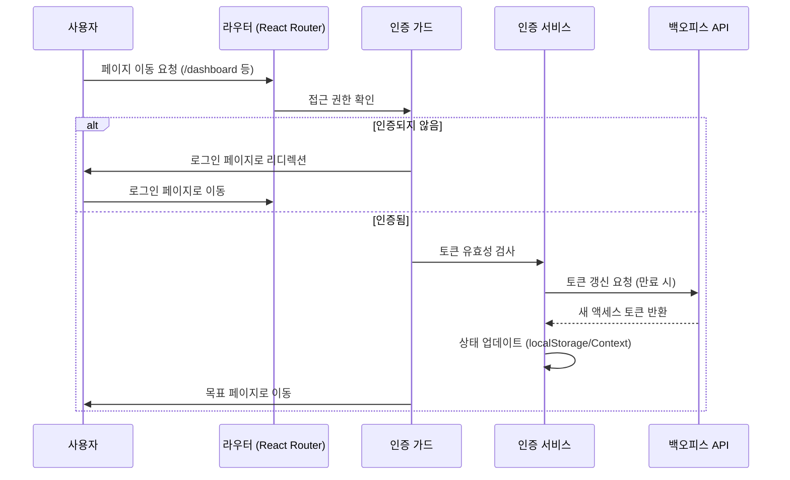

# 프론트엔드 코어 모듈

Apache Fineract 프론트엔드 애플리케이션의 근간을 이루는 **코어 모듈**은 애플리케이션의 전반적인 동작, 보안 정책, 네비게이션 구조 및 UI 일관성을 담당합니다. 이 모듈은 주로 `fineract-backoffice-ui` 또는 `fineract-mobile-app`의 `src/app` 디렉토리 구조에 위치하며, React 생태계를 기반으로 한 모놀리식 혹은 모듈형 아키텍처를 따릅니다.

## 1. 아키텍처 개요

프론트엔드 코어 모듈은 애플리케이션의 생명주기를 관리하고, 외부 API(Backoffice API)과의 통신을 중재하며, 사용자 인증 상태를 전역적으로 관리하는 역할을 합니다. 주요 구성 요소는 다음과 같습니다.

*   **인증 서비스 (Authentication Service):** 로그인, 로그아웃, 토큰 갱신, 세션 관리.
*   **HTTP 인터셉터 (HTTP Interceptor):** 요청/응답 헤더 관리, 에러 처리, 로딩 상태 동기화.
*   **라우팅 가드 (Routing Guard):** 권한 기반 라우팅, 인증 상태에 따른 접근 제어.
*   **공유 컴포넌트 라이브러리:** 재사용 가능한 UI 컴포넌트 (버튼, 입력 필드, 테이블 등).

이러한 구성 요소들은 서로 긴밀하게 연결되어 사용자가 로그인한 후 특정 기능에 접근할 수 있는 흐름을 보장합니다.

## 2. 시스템 흐름 및 상태 전이

사용자가 애플리케이션에 접근하여 기능을 사용할 때 발생하는 인증 및 라우팅 흐름은 다음과 같은 순서로 진행됩니다.



### 상태 전이 다이어그램

애플리케이션의 인증 상태와 라우트 접근성에 따른 상태 전이는 다음과 같습니다.

```mermaid
stateDiagram-v2
    [*] --> Unauthenticated: 초기 진입
    
    state Unauthenticated {
        [*] --> Login: 로그인 화면
        Login --> Loading: 인증 중
        Loading --> Authenticated: 성공
        Loading --> Unauthenticated: 실패 (재시도)
        Loading --> [*]: 세션 만료
    }

    state Authenticated {
        [*] --> Dashboard: 대시보드
        Dashboard --> ProtectedPage: 기능 접근
        ProtectedPage --> Logout: 로그아웃
        Logout --> Unauthenticated: 세션 종료
    }

    note right of Unauthenticated
        - 로그인 화면 표시
        - 토큰 없음 또는 만료됨
    end note

    note right of Authenticated
        - 토큰 보유
        - 라우트 가드 통과 가능
    end note
```

## 3. 주요 구성 요소 상세 설명

### 3.1 인증 서비스 (Authentication Service)

인증 서비스는 Fineract 백오피스 API 와의 통신을 통해 사용자의 인증 상태를 관리하는 핵심 모듈입니다.

*   **기능:**
    *   **로그인:** 사용자 ID, 비밀번호, 기관 코드 (Tenant) 를 기반으로 액세스 토큰을 발급받습니다.
    *   **로그아웃:** 서버의 세션을 종료하고 클라이언트 측의 저장된 토큰을 삭제합니다.
    *   **토큰 갱신:** 액세스 토큰이 만료되었을 때, 리프레시 토큰을 사용하여 새로운 액세스 토큰을 발급받습니다.
    *   **사용자 정보 조회:** 현재 로그인된 사용자의 상세 정보를 가져옵니다.
*   **저장소:** 인증 토큰은 일반적으로 `localStorage` 또는 `HttpOnly` 쿠키에 저장됩니다. Fineract 의 보안 정책 (CORS 설정 등) 에 따라 저장 방식이 결정됩니다.
*   **구현 패턴:** React Context API 또는 Zustand 와 같은 상태 관리 라이브러리를 사용하여 전역 인증 상태를 공유합니다.

### 3.2 HTTP 인터셉터 (HTTP Interceptor)

Axios 또는 Fetch API 와 같은 HTTP 클라이언트 라이브러리에 적용되는 인터셉터는 모든 API 호출의 진입점과 출구점을 제어합니다.

*   **요청 인터셉터 (Request Interceptor):**
    *   **인증 헤더 추가:** 각 요청에 인증 토큰 (`Authorization: Bearer <token>`) 을 자동으로 첨부합니다.
    *   **로딩 상태 설정:** API 호출 시작 시 전역 로딩 상태를 `true`로 변경합니다.
    *   **파라미터 변환:** 요청 본문이나 URL 파라미터를 백오피스 API 규격에 맞게 변환합니다.
*   **응답 인터셉터 (Response Interceptor):**
    *   **에러 처리:** HTTP 401 (인증 실패), 403 (권한 없음), 500 (서버 오류) 등의 에러를 감지합니다.
    *   **토큰 갱신 로직:** 401 에러가 발생하면 자동으로 토큰 갱신 API 를 호출하고, 성공 시 원래 요청을 재시도합니다.
    *   **로딩 상태 해제:** 응답 수신 시 전역 로딩 상태를 `false`로 변경합니다.
    *   **에러 메시지 포맷팅:** Fineract 의 에러 코드를 한국어로 변환된 사용자 친화적인 메시지로 매핑합니다.

### 3.3 라우팅 가드 (Routing Guard)

React Router 의 `ProtectedRoute` 컴포넌트와 커스텀 가드 로직은 사용자가 권한 없는 페이지에 접근하는 것을 방지합니다.

*   **인증 가드 (Auth Guard):**
    *   사용자가 로그인되지 않았을 경우, 해당 페이지 대신 로그인 화면으로 리디렉션합니다.
    *   예: `/dashboard`, `/loans` 등 주요 기능 페이지.
*   **권한 가드 (Permission Guard):**
    *   사용자가 특정 역할 (Role) 을 보유하고 있지 않을 경우 접근을 차단합니다.
    *   예: 관리자만 접근 가능한 `/admin/settings` 페이지.
    *   Fineract 의 역할 계층 구조 (Role Hierarchy) 를 고려하여 하위 역할의 사용자도 상위 역할 페이지에 접근할 수 있도록 처리합니다.
*   **로딩 가드 (Loading Guard):**
    *   인증 상태 확인 중 (예: 토큰 갱신 대기 중) 에는 로딩 화면을 표시하고, 인증이 완료될 때까지 라우트 변경을 막습니다.

### 3.4 공유 컴포넌트 라이브러리

`src/components` 또는 `src/ui` 디렉토리에 위치하는 컴포넌트들은 애플리케이션 전반의 UI 일관성을 유지합니다.

*   **기본 컴포넌트:** 버튼, 입력 필드, 선택지, 알림 바 (Toast), 모달 등.
*   **Fineract 특화 컴포넌트:**
    *   **데이터 테이블:** Fineract 의 복잡한 데이터 구조 (分页, 정렬, 필터링, 행 선택) 를 처리하는 테이블 컴포넌트.
    *   **폼 컴포넌트:** 대출 신청, 계좌 개설 등 복잡한 폼 입력을 위한 컴포넌트.
    *   **차트 컴포넌트:** 재무 데이터 시각화를 위한 차트 (Chart.js 또는 Recharts 등).
*   **스타일링:** Tailwind CSS 또는 SCSS 를 사용하여 일관된 디자인 시스템을 제공합니다.

## 4. 비즈니스 규칙 및 제약 사항

프론트엔드 코어 모듈은 백오피스 API 의 비즈니스 규칙을 클라이언트 측에서 준수해야 합니다.

*   **기관 (Tenant) 분리:** 모든 요청은 현재 로그인한 사용자가 속한 기관 (Tenant) 에 따라 API 엔드포인트가 달라집니다. (`/api/v1/{tenantId}/...`)
*   **역할 기반 접근 제어 (RBAC):** UI 에서 특정 버튼이나 메뉴를 숨기는 것은 백엔드의 RBAC 로직과 동기화되어야 합니다. 프론트엔드에서는 단순히 접근을 차단하는 것뿐만 아니라, UI 요소의 가시성을 제어해야 합니다.
*   **데이터 동기화:** 클라이언트 측 캐시 (React Query 등) 와 서버 측 데이터의 일관성을 유지하기 위해 최적화된 캐싱 전략이 필요합니다.
*   **오류 처리:** 네트워크 오류, 서버 오류, 유효성 검사 오류 등을 구분하여 사용자에게 명확한 피드백을 제공합니다.

## 5. 확장성 및 유지보수

*   **모듈화:** 코어 모듈은 기능별로 분리되어 있어, 새로운 기능 (예: 모바일 앱, 새로운 리포트) 을 추가할 때 충돌을 최소화할 수 있습니다.
*   **테스트:** 인증 흐름, 라우트 가드, 에러 처리 등에 대한 유닛 테스트와 E2E 테스트가 필수적입니다.
*   **로케일 지원:** Fineract 는 다국어 지원을 중요시하므로, 코어 모듈은 국제화 (i18n) 구조를 기본적으로 갖춰야 합니다.

## 6. 결론

프론트엔드 코어 모듈은 Apache Fineract 의 안정적인 운영을 위한 필수 인프라입니다. 인증, 보안, 네비게이션, UI 일관성을 하나의 통합된 구조로 관리함으로써, 복잡한 금융 애플리케이션을 사용자에게 직관적이고 안전하게 제공합니다. 개발 시에는 백오피스 API 의 변경 사항과 보안 정책의 업데이트를 지속적으로 모니터링하여 코어 모듈을 동기화해야 합니다.
