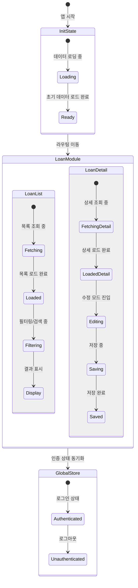

# 프론트엔드 콘솔 개요

Apache Fineract의 프론트엔드 웹 콘솔은 **Angular** 프레임워크를 기반으로 구축된 단일 페이지 애플리케이션 (SPA) 입니다. 이 콘솔은 금융 기관의 운영자가 대출, 예금, 카드, 보험 등 다양한 금융 상품을 관리하고, 고객 데이터를 처리하며, 리포트를 생성할 수 있는 강력한 관리자 인터페이스를 제공합니다.

본 문서는 `fineract-backoffice-ui` 시드 모듈을 중심으로, 전체 프론트엔드 아키텍처의 설계 철학, 상태 관리 전략, 컴포넌트 계층 구조, 및 핵심 기능 흐름을 기술합니다.

## 1. 아키텍처 개요

Fineract 프론트엔드는 **모듈 기반 (Module-based)** 및 **컴포넌트 기반 (Component-based)** 설계 원칙을 따릅니다. 각 기능 영역 (예: 대출 관리, 고객 관리, 보고서 등) 은 독립적인 Angular 모듈로 구현되어 재사용성과 유지보수성을 극대화합니다.

### 1.1 기술 스택
*   **프레임워크**: Angular (최신 버전)
*   **상태 관리**: NgRx (Redux 패턴)
*   **라우팅**: Angular Router
*   **UI 컴포넌트 라이브러리**: Angular Material, PrimeNG (일부), Custom Components
*   **HTTP 통신**: Angular HttpClient (REST API 호출)
*   **빌드 도구**: Angular CLI

### 1.2 프로젝트 구조
프론트엔드 소스 코드는 일반적으로 다음과 같은 계층 구조로 조직됩니다.

```text
src/
├── app/
│   ├── core/                 # 전역 공통 기능 (Auth, Guards, Interceptors)
│   ├── features/             # 기능별 모듈 (features/loans, features/customers 등)
│   ├── shared/               # 공유 컴포넌트, 파이프, 유틸리티
│   ├── shell/                # 앱 레이아웃, 네비게이션 바, 사이드바
│   └── app.component.ts      # 앱 루트 컴포넌트
├── assets/                  # 정적 리소스 (이미지, 폰트, i18n)
├── environments/            # 환경 변수 설정 (dev, prod)
└── main.ts                  # 앱 진입점
```

## 2. 상태 관리 구조 (NgRx)

Finerack 프론트엔드는 **NgRx**를 사용하여 예측 가능하고 디버깅하기 쉬운 상태 관리 패턴을 적용합니다. 각 기능 모듈은 독립적인 상태 스토어를 가지며, 필요한 경우 공유 상태는 전역 스토어에서 관리합니다.

### 2.1 상태 관리 원칙
1.  **단일 진실 원천 (Single Source of Truth)**: 애플리케이션의 모든 상태는 상태 스토어 (Store) 에 저장됩니다.
2.  **불변성 (Immutability)**: 상태 업데이트는 기존 상태를 변경하지 않고 새로운 상태를 생성하는 방식으로 수행됩니다.
3.  **예측 가능한 상태 변화**: 모든 상태 변경은 명시적인 액션 (Action) 을 통해 발생하며, 리듀서 (Reducer) 가 이를 처리합니다.

### 2.2 상태 스토어 계층
각 기능 영역은 별도의 스토어 모듈을 가집니다.

*   **`LoanStore`**: 대출 관련 데이터 (대출 상품, 대출 신청, 승인, 회수 등)
*   **`CustomerStore`**: 고객 관련 데이터 (개인, 법인 고객 정보)
*   **`ProductStore`**: 금융 상품 정의 (대출 상품, 예금 상품 등)
*   **`InstitutionStore`**: 기관 내 부서 및 직원 정보
*   **`ReportStore`**: 보고서 생성 및 조회 상태
*   **`GlobalStore`**: 인증 토큰, 사용자 세션, 글로벌 설정 등 전역 상태

### 2.3 상태 흐름 다이어그램

다음은 특정 기능 (예: 대출 관리) 에서 상태가 어떻게 흐르는지 보여주는 다이어그램입니다.



### 2.4 액션 및 리듀서 패턴
각 스토어는 다음과 같은 패턴을 따릅니다.

*   **Actions**: 컴포넌트에서 발생하는 이벤트 (예: `LOAD_LOANS`, `CREATE_LOAN`, `DELETE_LOAN`).
*   **Reducers**: 액션에 따라 상태가 어떻게 변하는지 정의하는 함수.
*   **Selectors**: 상태 스토어에서 특정 데이터를 추출하는 함수 (RxJS Observable 반환).

```typescript
// 예시: Loan Store 구조
export class LoanStore {
  // 상태 인터페이스
  state: LoanState = initialState;

  // 액션 타입
  readonly LOAD_LOANS = 'LOAN_LOAD_LOANS';
  readonly CREATE_LOAN = 'LOAN_CREATE_LOAN';

  // 액션 생성기
  loadLoans() { return new LoadLoans(); }
  createLoan(payload: Loan) { return new CreateLoan(payload); }

  // 리듀서
  _reducer(state: LoanState, action: Action): LoanState {
    switch (action.type) {
      case this.LOAD_LOANS:
        return { ...state, loans: action.payload, loading: false };
      case this.CREATE_LOAN:
        return { ...state, loans: [...state.loans, action.payload], loading: false };
      default:
        return state;
    }
  }
}
```

## 3. 컴포넌트 계층 구조

Angular 컴포넌트는 계층 구조에 따라 명확하게 분류되어 재사용성을 높였습니다.

### 3.1 핵심 계층 (Core)
전체 애플리케이션에 공통적으로 적용되는 기능들을 제공합니다.

*   **Authentication & Authorization**:
    *   `AuthService`: 로그인, 로그아웃, 토큰 관리.
    *   `AuthGuard`: 라우트 접근 권한 보호 (예: 관리자만 접근 가능).
    *   `PermissionGuard`: 특정 기능 (예: 'LOAN_CREATE') 에 대한 권한 확인.
*   **UI Utilities**:
    *   `LoadingSpinner`: 로딩 중 표시.
    *   `ToastNotification`: 알림 메시지 표시.
    *   `DatePipe`: 날짜 포맷팅 (지역 설정에 따라 자동 변환).
    *   `CurrencyPipe`: 통화 포맷팅.

### 3.2 기능 계층 (Features)
비즈니스 로직에 특화된 모듈입니다. 각 모듈은 독립적으로 개발 및 테스트될 수 있습니다.

*   **Loans Module**:
    *   `LoanListComponent`: 대출 목록 조회 및 필터링.
    *   `LoanDetailComponent`: 대출 상세 정보 조회, 수정, 회수.
    *   `LoanApplicationComponent`: 대출 신청서 작성.
    *   `LoanProductComponent`: 대출 상품 정의 및 관리.
*   **Customers Module**:
    *   `CustomerListComponent`: 고객 목록 관리.
    *   `CustomerDetailComponent`: 고객 상세 정보 관리.
*   **Products Module**:
    *   `ProductListComponent`: 금융 상품 목록.
    *   `ProductDetailComponent`: 상품 상세 설정.
*   **Reports Module**:
    *   `ReportBuilderComponent`: 보고서 템플릿 생성 및 커스터마이징.
    *   `ReportPreviewComponent`: 보고서 미리보기.

### 3.3 공유 계층 (Shared)
모든 모듈에서 공통으로 사용하는 컴포넌트와 유틸리티입니다.

*   **Common Components**:
    *   `DataTable`: 데이터 그리드 표시 (Pagination, Sorting, Filtering 지원).
    *   `FormBuilder`: 동적 폼 생성 및 유효성 검사.
    *   `Modal/Dialog`: 모달 창 및 다이얼로그 컴포넌트.
    *   `Breadcrumb`: 페이지 내비게이션 경로 표시.
*   **Shared Services**:
    *   `ApiService`: HTTP 요청/응답의 추상화.
    *   `TranslationService`: 다국어 지원 (i18n).
    *   `ThemeService`: 테마 변경 (다크/라이트 모드).

## 4. 라우팅 및 네비게이션

Fineract 콘솔은 **Lazy Loading** 전략을 사용하여 초기 로딩 속도를 최적화하고, 불필요한 코드를 브라우저에 로드하지 않도록 합니다.

### 4.1 라우팅 구조 예시
```typescript
const routes: Routes = [
  {
    path: '',
    component: ShellComponent,
    children: [
      {
        path: 'loans',
        loadChildren: () => import('./features/loans/loans.module')
          .then(m => m.LoansModule),
        canActivate: [AuthGuard, LoanPermissionGuard]
      },
      {
        path: 'customers',
        loadChildren: () => import('./features/customers/customers.module')
          .then(m => m.CustomersModule)
      },
      {
        path: 'reports',
        loadChildren: () => import('./features/reports/reports.module')
          .then(m => m.ReportsModule)
      }
    ]
  },
  { path: '**', redirectTo: '' }
];
```

### 4.2 네비게이션 패턴
*   **Sidebar Navigation**: 왼쪽 사이드바에 주요 메뉴 (Loans, Customers 등) 를 표시.
*   **Top Navigation**: 상단 바에 현재 위치, 사용자 정보, 설정, 로그아웃 버튼 표시.
*   **Dynamic Menu**: 권한에 따라 사이드바 메뉴가 동적으로 필터링되어 표시됨.

## 5. 비즈니스 규칙 및 검증

프론트엔드 컴포넌트는 백엔드 API 와 상호작용하며, 비즈니스 규칙을 클라이언트 측에서 일부 검증하거나 UI 를 제어합니다.

### 5.1 폼 유효성 검사 (Form Validation)
Angular Forms 또는 Reactive Forms 를 사용하여 입력값의 유효성을 실시간으로 검사합니다.
*   **필수 항목**: 빈 값 체크.
*   **형식 검증**: 이메일 형식, 전화번호 형식, 날짜 범위 등.
*   **비즈니스 로직 검증**:
    *   대출 금액이 잔여 한도를 초과하는지 확인.
    *   만기일이 현재 날짜보다 과거인지 확인.
    *   고객 ID 가 유효한지 확인.

### 5.2 권한 기반 UI 렌더링
사용자의 권한 (Permission) 에 따라 UI 요소가 숨겨지거나 표시됩니다.
*   **조건부 렌더링**: `*ngIf="hasPermission('LOAN_EDIT')"`
*   **메뉴 숨기기**: 권한이 없는 메뉴 항목은 사이드바에서 제거.

### 5.3 데이터 로딩 전략
*   **Optimistic UI**: 사용자가 액션을 취하면 즉시 UI 를 업데이트하고, 백엔드 응답이 오면 동기화하거나 롤백.
*   **Loading States**: 데이터 조회 중에는 로딩 인디케이터 표시.
*   **Error Handling**: API 에러 발생 시 에러 메시지를 토스트로 표시하고, 재시도 버튼 제공.

## 6. 성능 최적화

대규모 금융 데이터를 처리하기 위해 다음과 같은 최적화 기법이 적용됩니다.

*   **OnPush Change Detection**: 각 컴포넌트에서 `ChangeDetectionStrategy.OnPush` 을 사용하여 불필요한 리렌더링 방지.
*   **RxJS Operators**: `takeUntilDestroyed`, `debounceTime`, `switchMap` 등을 사용하여 메모리 누수 방지 및 불필요한 요청 차단.
*   **Virtual Scrolling**: 매우 긴 목록 (예: 수천 건의 거래 내역) 을 렌더링할 때 가상 스크롤 적용.
*   **Tree Shaking**: 사용하지 않는 코드 제거를 통해 번들 크기 축소.

## 7. 요약

Apache Fineract 의 프론트엔드 콘솔은 **Angular** 생태계의 최신 모범 사례를 따르고, **NgRx** 를 통한 강력한 상태 관리, **모듈 기반** 아키텍처, 그리고 **권한 기반**의 보안 전략을 통해 확장 가능하고 안정적인 금융 관리 플랫폼을 제공합니다. 개발자들은 이 구조를 바탕으로 새로운 기능을 추가하거나 기존 기능을 개선할 때, 기존 아키텍처의 일관성을 유지하는 것이 중요합니다.
