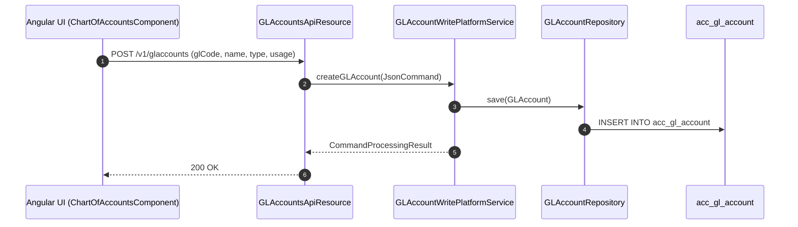
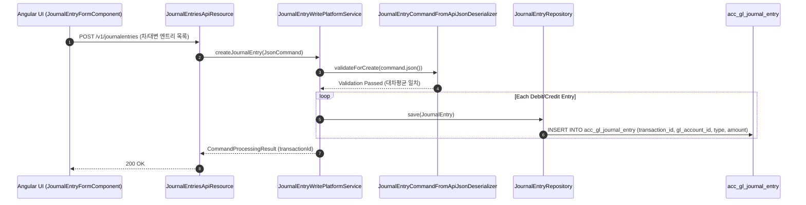
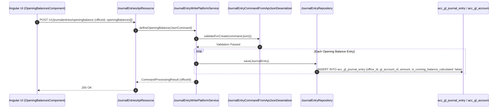
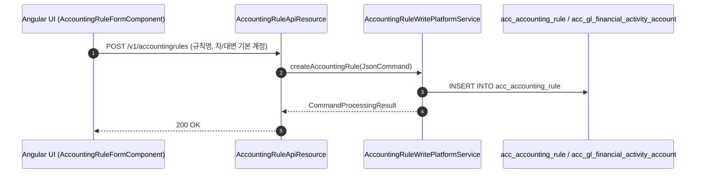
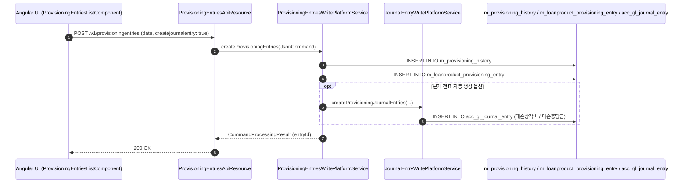

# [AC] 콜그래프 (회계결산)

> 소분류 3개 롤업.

---

## [ACC] 콜그래프

> 화면 3개 롤업(소분류 ACC, 대분류 AC - 계정과목 및 분개장).

### ACC-001 계정과목표(COA) 관리

> 원본: `fineract-accounting/src/main/java/org/apache/fineract/accounting/glaccount/`

#### 총계정원장(COA) 계정과목 등록 흐름
> 공유: ACR, ACP

### ACC-002 분개 전표 조회 및 입력

> 원본: `fineract-provider/src/main/java/org/apache/fineract/accounting/journalentry/`

#### 수기 분개 전표 기표 및 대차평균 검증 흐름
> 공유: ACR, LNR, TRT

### ACC-003 기초잔액 등록

> 원본: `fineract-provider/src/main/java/org/apache/fineract/accounting/journalentry/`

#### 기초잔액 등록(Opening Balances) 처리 흐름
> 공유: ACP

### 근거
- `fineract-accounting/src/main/java/org/apache/fineract/accounting/glaccount/api/GLAccountsApiResource.java`
- `fineract-accounting/src/main/java/org/apache/fineract/accounting/glaccount/service/GLAccountWritePlatformService.java`
- `fineract-core/src/main/java/org/apache/fineract/accounting/glaccount/domain/GLAccount.java`
- `fineract-core/src/main/java/org/apache/fineract/accounting/glaccount/domain/GLAccountRepository.java`
- `fineract-provider/src/main/java/org/apache/fineract/accounting/journalentry/api/JournalEntriesApiResource.java`
- `fineract-provider/src/main/java/org/apache/fineract/accounting/journalentry/service/JournalEntryWritePlatformService.java`
- `fineract-accounting/src/main/java/org/apache/fineract/accounting/journalentry/serialization/JournalEntryCommandFromApiJsonDeserializer.java`
- `fineract-accounting/src/main/java/org/apache/fineract/accounting/journalentry/domain/JournalEntryRepository.java`

---

## [ACR] 콜그래프

> 화면 1개 롤업(소분류 ACR, 대분류 AC - 회계 규칙 및 매핑).

### ACR-001 회계 분개 규칙 및 매핑

> 원본: `fineract-provider/src/main/java/org/apache/fineract/accounting/rule/`

#### 회계 분개 규칙 및 금융활동 매핑 흐름
> 공유: ACC, PDL, PDS

### 근거
- `fineract-provider/src/main/java/org/apache/fineract/accounting/rule/`

---

## [ACP] 콜그래프

> 화면 1개 롤업(소분류 ACP, 대분류 AC - 회계 결산 및 대손충당금).

### ACP-001 회계 결산 및 대손충당금

> 원본: `fineract-provider/src/main/java/org/apache/fineract/accounting/provisioning/`

#### 대손충당금 자동 산출 및 분개 전표 기표 흐름

> 공유: ACC, PDL

### 근거
- `fineract-provider/src/main/java/org/apache/fineract/accounting/provisioning/`
