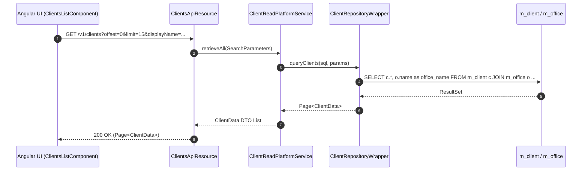
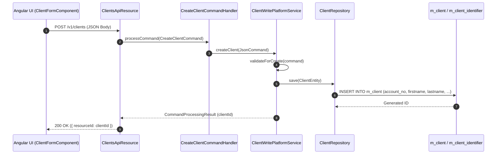
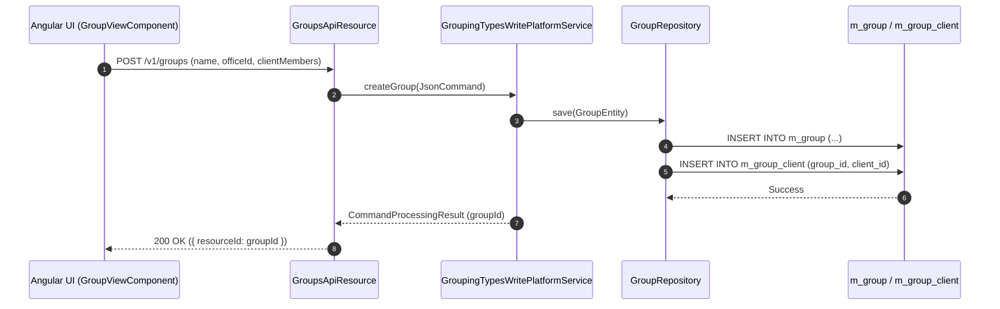
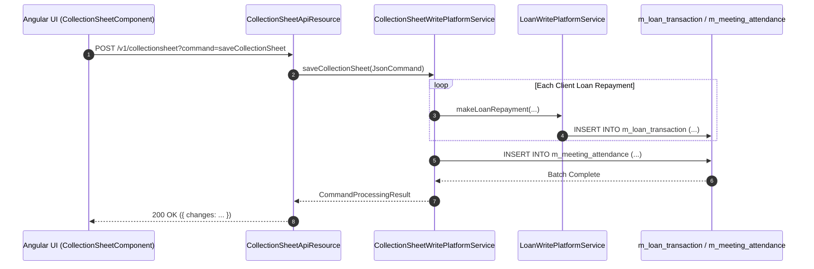

# [CL] 콜그래프 (고객관리)

> 소분류 3개 롤업.

---

## [CLA] 콜그래프

> 화면 2개 롤업(소분류 CLA, 대분류 CL - 고객 관리).

### CLA-001 고객 목록 및 검색

> 원본: `fineract-provider/src/main/java/org/apache/fineract/portfolio/client/`

#### 고객 목록 조회 및 검색 흐름
> 공유: CLG, CLS, LNA, SVA

### CLA-002 고객 등록 및 상세정보

> 원본: `fineract-provider/src/main/java/org/apache/fineract/portfolio/client/`

#### 신규 고객 등록 및 유효성 검증 흐름
> 공유: CLG, SYI

### 근거
- `fineract-provider/src/main/java/org/apache/fineract/portfolio/client/`

---

## [CLG] 콜그래프

> 화면 1개 롤업(소분류 CLG, 대분류 CL - 그룹 및 센터 관리).

### CLG-001 그룹 및 센터 관리

> 원본: `fineract-provider/src/main/java/org/apache/fineract/portfolio/group/`

#### 그룹 생성 및 구성원 등록 흐름
> 공유: CLA, CLS

### 근거
- `fineract-provider/src/main/java/org/apache/fineract/portfolio/group/`

---

## [CLS] 콜그래프

> 화면 1개 롤업(소분류 CLS, 대분류 CL - 일괄 수납 집계표).

### CLS-001 일괄 수납 집계표

> 원본: `fineract-provider/src/main/java/org/apache/fineract/portfolio/collectionsheet/`

#### 일괄 수납 데이터 생성 및 전표 처리 흐름
> 공유: CLA, CLG, LNR, SVA

### 근거
- `fineract-provider/src/main/java/org/apache/fineract/portfolio/collectionsheet/`
