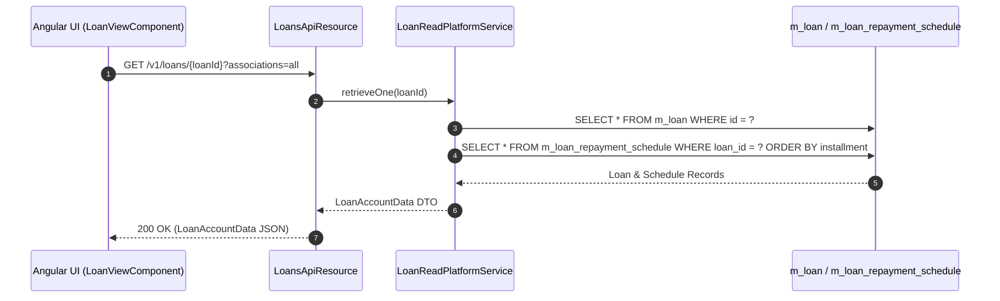
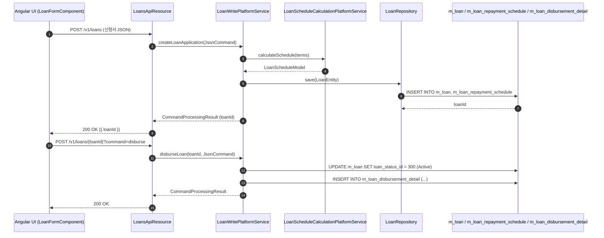
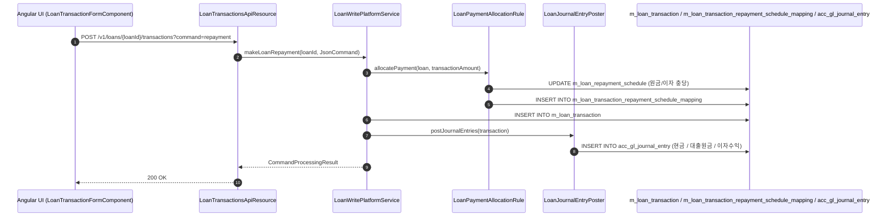
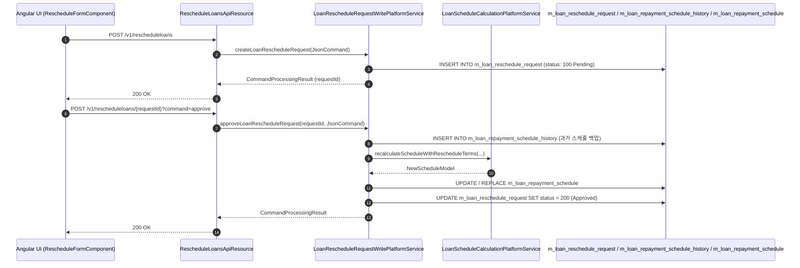
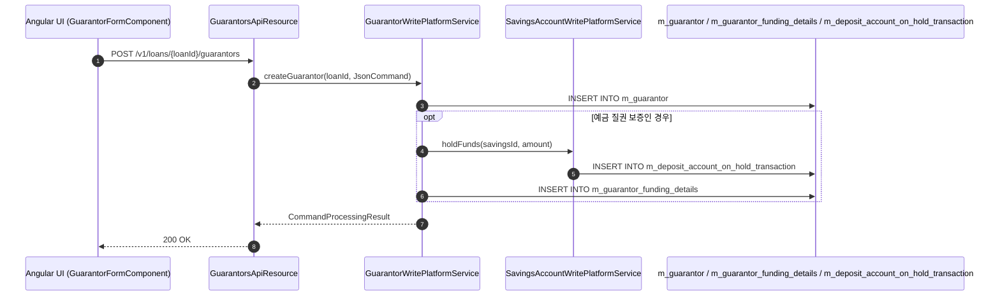
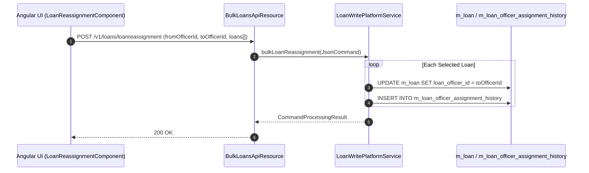

# [LN] 콜그래프 (여신관리)

> 소분류 3개 롤업.

---

## [LNA] 콜그래프

> 화면 2개 롤업(소분류 LNA, 대분류 LN - 대출 계좌 관리).

### LNA-001 대출 계좌 목록 및 상세

> 원본: `fineract-provider/src/main/java/org/apache/fineract/portfolio/loanaccount/`

#### 대출 계좌 원장 및 상환 스케줄 조회
> 공유: LNR, LNO, WCL

### LNA-002 대출 신청 및 실행

> 원본: `fineract-provider/src/main/java/org/apache/fineract/portfolio/loanaccount/`

#### 대출 신청, 승인 및 지급 실행 흐름
> 공유: LNR, LNO, PDL, WCL

### 근거
- `fineract-provider/src/main/java/org/apache/fineract/portfolio/loanaccount/`

---

## [LNR] 콜그래프

> 화면 2개 롤업(소분류 LNR, 대분류 LN - 대출 상환 및 재조정).

### LNR-001 대출 상환 및 거래 처리

> 원본: `fineract-provider/src/main/java/org/apache/fineract/portfolio/loanaccount/`

#### 대출 상환(Repayment) 및 충당 분개 흐름
> 공유: LNA, ACC, CLS

### LNR-002 대출 상환일정 재조정

> 원본: `fineract-provider/src/main/java/org/apache/fineract/portfolio/loanaccount/rescheduleloan/`

#### 대출 재조정(Reschedule) 신청 및 스케줄 재계산 승인 흐름
> 공유: LNA

### 근거
- `fineract-provider/src/main/java/org/apache/fineract/portfolio/loanaccount/`
- `fineract-provider/src/main/java/org/apache/fineract/portfolio/loanaccount/rescheduleloan/`

---

## [LNO] 콜그래프

> 화면 2개 롤업(소분류 LNO, 대분류 LN - 대출 부속 및 운영).

### LNO-001 대출 담보 및 보증인 관리

> 원본: `fineract-provider/src/main/java/org/apache/fineract/portfolio/loanaccount/guarantor/`

#### 보증인 등록 및 예금 질권 설정 흐름
> 공유: LNA, SVA

### LNO-002 대출 일괄 재배정 및 시점조회

> 원본: `fineract-provider/src/main/java/org/apache/fineract/portfolio/loanaccount/`

#### 대출 담당자 일괄 재배정 흐름
> 공유: LNA, OGB

### 근거
- `fineract-provider/src/main/java/org/apache/fineract/portfolio/loanaccount/`
- `fineract-provider/src/main/java/org/apache/fineract/portfolio/loanaccount/guarantor/`
