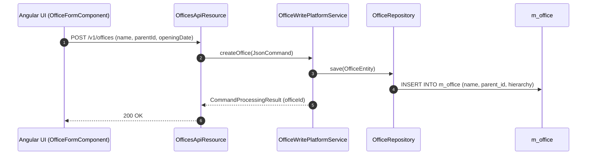
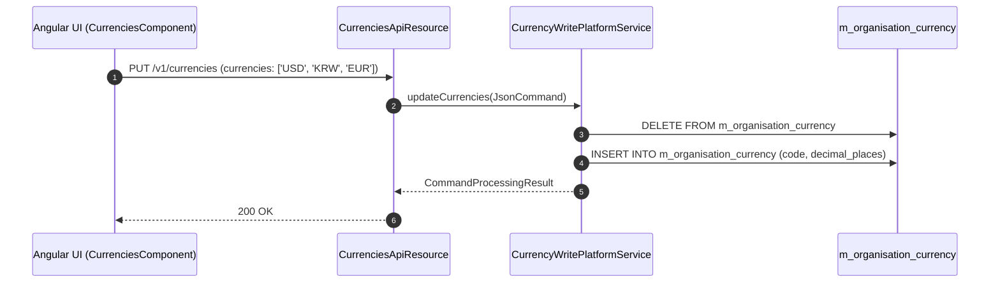

# [OG] 콜그래프 (조직관리)

> 소분류 2개 롤업.

---

## [OGB] 콜그래프

> 화면 1개 롤업(소분류 OGB, 대분류 OG - 지점 및 직원 관리).

### OGB-001 지점(Office) 관리

> 원본: `fineract-provider/src/main/java/org/apache/fineract/organisation/office/`

#### 신규 지점 등록 및 계층 생성 흐름

> 공유: SCU, TRT

### 근거
- `fineract-provider/src/main/java/org/apache/fineract/organisation/office/`

---

## [OGC] 콜그래프

> 화면 1개 롤업(소분류 OGC, 대분류 OG - 통화 및 조직 공통설정).

### OGC-001 통화·자금원·계좌체계

> 원본: `fineract-provider/src/main/java/org/apache/fineract/organisation/monetary/`

#### 조직 통화 및 결제수단 설정 흐름

> 공유: ACC, PDL, PDS

### 근거
- `fineract-provider/src/main/java/org/apache/fineract/organisation/monetary/`
