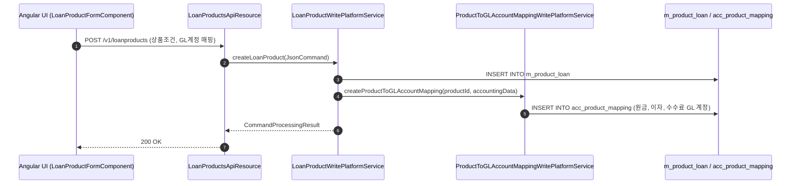
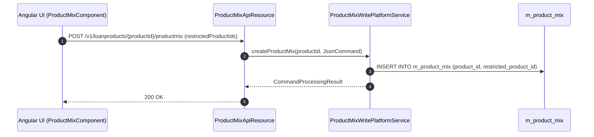
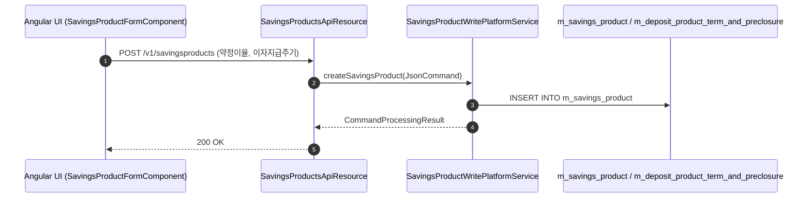
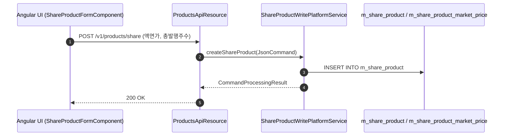
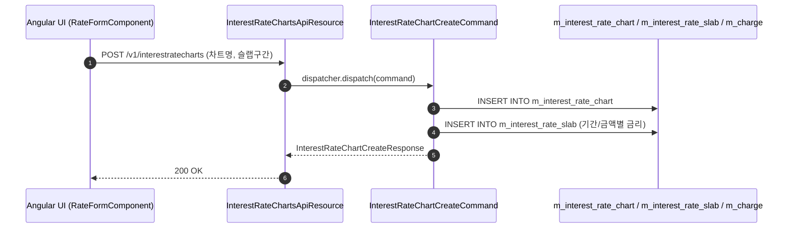

# [PD] 콜그래프 (상품설정)

> 소분류 3개 롤업.

---

## [PDL] 콜그래프

> 화면 2개 롤업(소분류 PDL, 대분류 PD - 대출 상품 설정).

### PDL-001 대출 상품 관리

> 원본: `fineract-provider/src/main/java/org/apache/fineract/portfolio/loanproduct/`

#### 대출 상품 생성 및 회계 매핑 등록 흐름
> 공유: ACR, ACC, WCP

### PDL-002 대출 상품 믹스 및 모집인

> 원본: `fineract-provider/src/main/java/org/apache/fineract/portfolio/loanproduct/productmix/`

#### 대출 상품 믹스 규칙 정의 흐름
> 공유: LNA

### 근거
- `fineract-provider/src/main/java/org/apache/fineract/portfolio/loanproduct/`
- `fineract-provider/src/main/java/org/apache/fineract/portfolio/loanproduct/productmix/`

---

## [PDS] 콜그래프

> 화면 2개 롤업(소분류 PDS, 대분류 PD - 수신 및 주식 상품 설정).

### PDS-001 예적금 상품 관리

> 원본: `fineract-provider/src/main/java/org/apache/fineract/portfolio/savings/product/`

#### 예적금 상품 생성 흐름
> 공유: SVF, SVR, PDR

### PDS-002 주식 상품 관리

> 원본: `fineract-provider/src/main/java/org/apache/fineract/portfolio/shareproducts/`

#### 주식 상품 및 시가 등록 흐름
> 공유: SVS

### 근거
- `fineract-provider/src/main/java/org/apache/fineract/portfolio/savings/product/`
- `fineract-provider/src/main/java/org/apache/fineract/portfolio/shareproducts/`

---

## [PDR] 콜그래프

> 화면 1개 롤업(소분류 PDR, 대분류 PD - 금리·수수료·세무 설정).

### PDR-001 금리·수수료·세무 설정

> 원본: `fineract-provider/src/main/java/org/apache/fineract/portfolio/rate/`

#### 금리 차트 및 수수료 규정 등록 흐름
> 공유: PDL, PDS, LNA, SVA

### 근거
- `fineract-provider/src/main/java/org/apache/fineract/portfolio/rate/`
