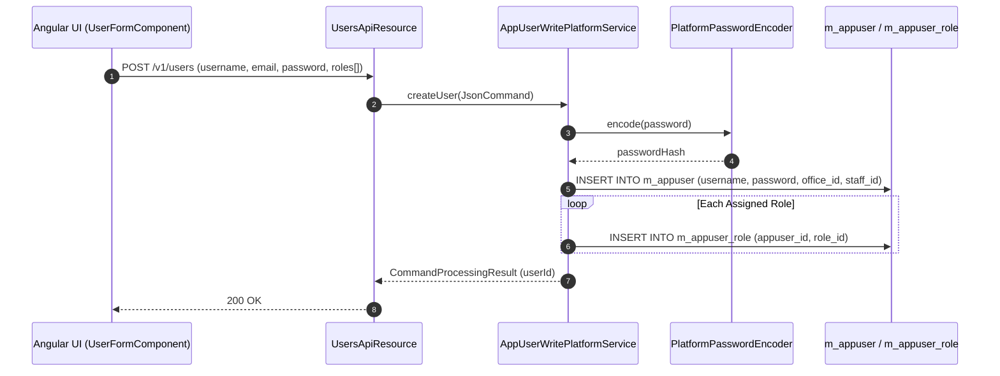
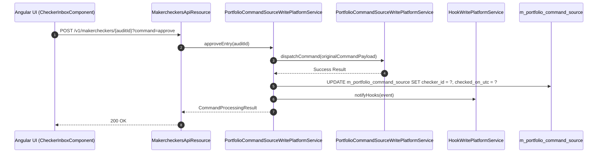

# [SC] 콜그래프 (보안승인)

> 소분류 2개 롤업.

---

## [SCU] 콜그래프

> 화면 1개 롤업(소분류 SCU, 대분류 SC - 사용자 및 권한 관리).

### SCU-001 사용자 계정 관리

> 원본: `fineract-provider/src/main/java/org/apache/fineract/useradministration/`

#### 백오피스 사용자 계정 생성 및 역할 부여 흐름

> 공유: OGB, SCA

### 근거
- `fineract-provider/src/main/java/org/apache/fineract/useradministration/`

---

## [SCA] 콜그래프

> 화면 1개 롤업(소분류 SCA, 대분류 SC - 감사 로그 및 결재 수신함).

### SCA-001 감사 로그 및 결재 수신함

> 원본: `fineract-provider/src/main/java/org/apache/fineract/commands/`

#### Maker-Checker 결재 승인 및 감사 로그 기록 흐름

> 공유: SCU, SYI

### 근거
- `fineract-provider/src/main/java/org/apache/fineract/commands/`
