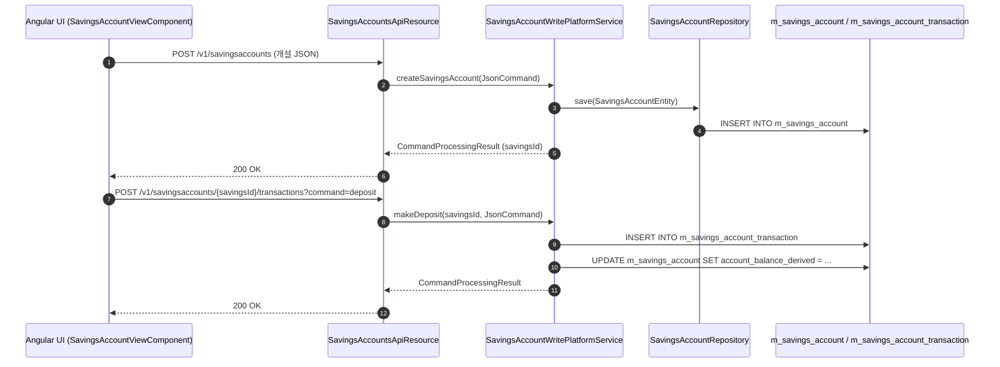
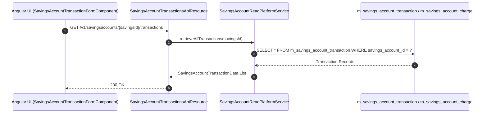
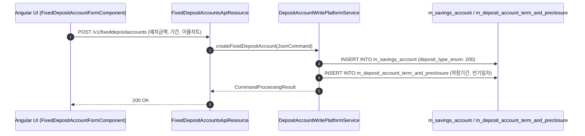
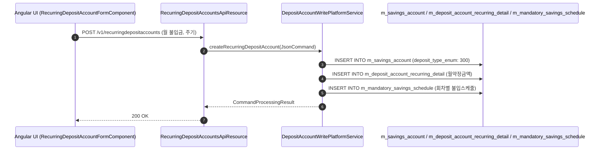
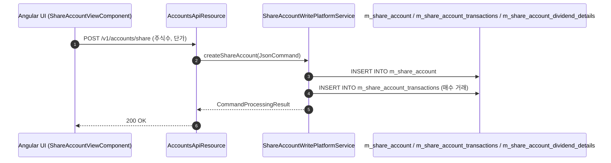

# [SV] 콜그래프 (수신관리)

> 소분류 4개 롤업.

---

## [SVA] 콜그래프

> 화면 2개 롤업(소분류 SVA, 대분류 SV - 보통예금 계좌).

### SVA-001 보통예금 계좌 관리

> 원본: `fineract-provider/src/main/java/org/apache/fineract/portfolio/savings/`

#### 보통예금 계좌 개설 및 입출금 거래 흐름
> 공유: SVF, SVR, TRA

### SVA-002 예금 수수료 및 거래 이력

> 원본: `fineract-provider/src/main/java/org/apache/fineract/portfolio/savings/`

#### 예금 거래 내역 조회 및 수수료 부과 흐름
> 공유: PDR, TRA

### 근거
- `fineract-provider/src/main/java/org/apache/fineract/portfolio/savings/`

---

## [SVF] 콜그래프

> 화면 1개 롤업(소분류 SVF, 대분류 SV - 정기예금 계좌).

### SVF-001 정기예금 계좌 관리

> 원본: `fineract-provider/src/main/java/org/apache/fineract/portfolio/savings/`

#### 정기예금 계좌 개설 및 만기 약정 처리 흐름
> 공유: SVA, PDS

### 근거
- `fineract-provider/src/main/java/org/apache/fineract/portfolio/savings/`

---

## [SVR] 콜그래프

> 화면 1개 롤업(소분류 SVR, 대분류 SV - 정기적금 계좌).

### SVR-001 정기적금 계좌 관리

> 원본: `fineract-provider/src/main/java/org/apache/fineract/portfolio/savings/`

#### 정기적금 계좌 개설 및 월 불입금 처리 흐름
> 공유: SVA, PDS

### 근거
- `fineract-provider/src/main/java/org/apache/fineract/portfolio/savings/`

---

## [SVS] 콜그래프

> 화면 1개 롤업(소분류 SVS, 대분류 SV - 주식 계좌).

### SVS-001 주식 계좌 및 배당 관리

> 원본: `fineract-provider/src/main/java/org/apache/fineract/portfolio/shareaccounts/`

#### 주식(출자금) 계좌 개설 및 배당금 지급 흐름
> 공유: PDS, SVA

### 근거
- `fineract-provider/src/main/java/org/apache/fineract/portfolio/shareaccounts/`
