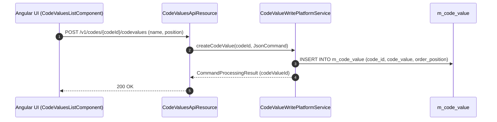
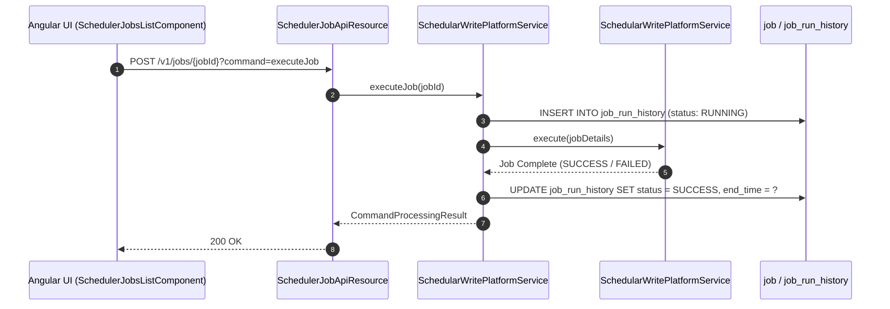
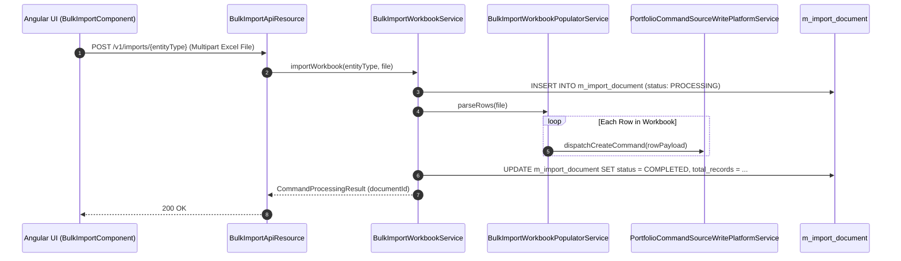

# [SY] 콜그래프 (시스템운영)

> 소분류 3개 롤업.

---

## [SYC] 콜그래프

> 화면 1개 롤업(소분류 SYC, 대분류 SY - 공통코드 및 환경설정).

### SYC-001 공통 코드 및 확장 데이터

> 원본: `fineract-provider/src/main/java/org/apache/fineract/infrastructure/codes/`

#### 공통 코드값(Code Value) 추가 및 캐시 갱신 흐름

> 공유: CLA, LNA, SVA

### 근거
- `fineract-provider/src/main/java/org/apache/fineract/infrastructure/codes/`

---

## [SYB] 콜그래프

> 화면 1개 롤업(소분류 SYB, 대분류 SY - 스케줄러 및 배치 작업).

### SYB-001 스케줄러 배치 작업 관리

> 원본: `fineract-provider/src/main/java/org/apache/fineract/infrastructure/jobs/`

#### 배치 작업 즉시 실행(Run Job) 및 이력 기록 흐름

> 공유: LNA, SVA, ACP, WCO

### 근거
- `fineract-provider/src/main/java/org/apache/fineract/infrastructure/jobs/`

---

## [SYI] 콜그래프

> 화면 1개 롤업(소분류 SYI, 대분류 SY - 대외연계 및 알림/부가서비스).

### SYI-001 대외연계 및 알림 설정

> 원본: `fineract-provider/src/main/java/org/apache/fineract/infrastructure/bulkimport/`

#### 엑셀 일괄 업로드(Bulk Import) 파싱 및 비동기 임포트 흐름

> 공유: CLA, LNA, SVA, ACC

### 근거
- `fineract-provider/src/main/java/org/apache/fineract/infrastructure/bulkimport/`
