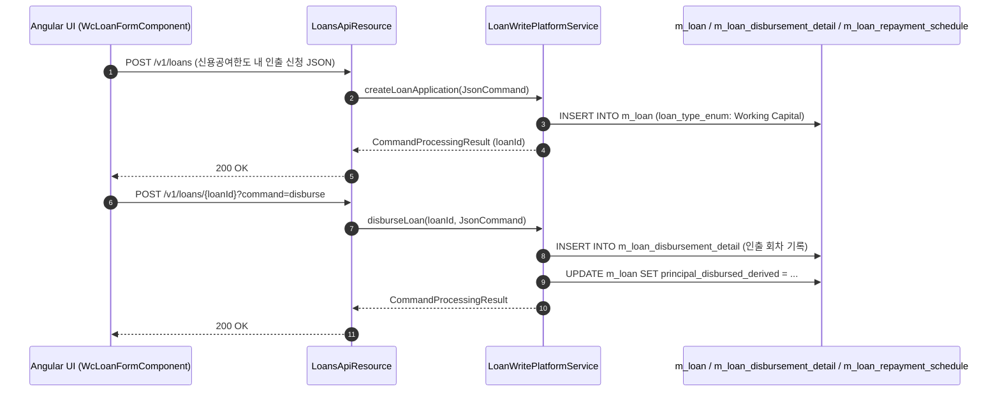
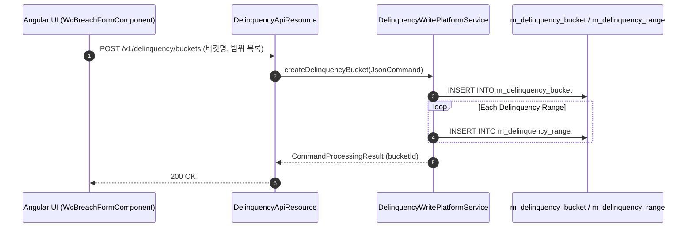
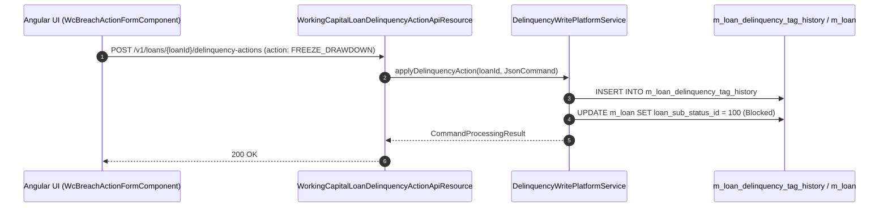
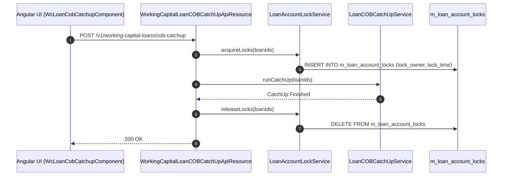

# [WC] 콜그래프 (운전자금)

> 소분류 3개 롤업.

---

## [WCL] 콜그래프

> 화면 1개 롤업(소분류 WCL, 대분류 WC - 운전자금 대출 관리).

### WCL-001 운전자금 대출 관리

> 원본: `fineract-provider/src/main/java/org/apache/fineract/portfolio/loanaccount/`

#### 운전자금 대출 신청 및 분할 인출(Drawdown) 흐름

> 공유: LNA, WCP

### 근거
- `fineract-provider/src/main/java/org/apache/fineract/portfolio/loanaccount/`

---

## [WCP] 콜그래프

> 화면 1개 롤업(소분류 WCP, 대분류 WC - 운전자금 상품 및 한도위반 설정).

### WCP-001 운전자금 상품 및 한도위반 설정

> 원본: `fineract-provider/src/main/java/org/apache/fineract/portfolio/delinquency/`

#### 한도위반(Breach) 감지 버킷 설정 흐름

> 공유: PDL, SYB

### 근거
- `fineract-provider/src/main/java/org/apache/fineract/portfolio/delinquency/`

---

## [WCO] 콜그래프

> 화면 2개 롤업(소분류 WCO, 대분류 WC - 운전자금 사후조치 및 운영).

### WCO-001 운전자금 위반 조치 관리

> 원본: `fineract-provider/src/main/java/org/apache/fineract/portfolio/delinquency/`

#### 운전자금 한도위반 계좌 사후조치 실행 흐름

> 공유: WCL, SYB

### WCO-002 운전자금 마감처리 및 계좌잠금

> 원본: `fineract-provider/src/main/java/org/apache/fineract/cob/`

#### 운전자금 COB 마감 Catch-up 및 계좌 락 해제 흐름

> 공유: SYB, WCL

### 근거
- `fineract-provider/src/main/java/org/apache/fineract/cob/`
- `fineract-provider/src/main/java/org/apache/fineract/portfolio/delinquency/`
