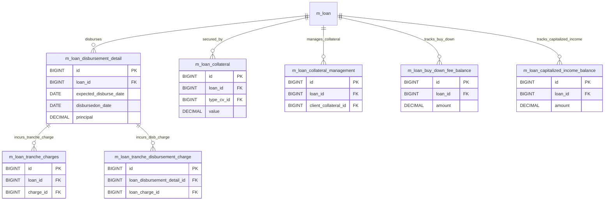

# [FN-003] DB 명세서

## 테이블 목록

| 테이블명 | 역할 |
| :--- | :--- |
| `m_loan_disbursement_detail` | 대출금 분할 지급(트랜치) 및 실행 상세 정보 |
| `m_loan_tranche_charges` | 분할 실행(트랜치) 대출에 부과되는 수수료 |
| `m_loan_tranche_disbursement_charge` | 특정 트랜치 실행 시점에 발생하는 지급 수수료 |
| `m_loan_collateral` | 대출에 설정된 담보물 정보 |
| `m_loan_collateral_management` | 대출 담보 관리 및 담보 평가 연계 정보 |
| `m_loan_buy_down_fee_balance` | 금리 인하(Buy-Down) 수수료 잔액 관리 |
| `m_loan_capitalized_income_balance` | 원금에 가산(자본화)된 수익 잔액 관리 |

## `m_loan_disbursement_detail` - 대출금 분할 지급(트랜치) 및 실행 상세 정보

| 컬럼명 | 타입 | 제약 | 설명 |
| :--- | :--- | :--- | :--- |
| `id` | BIGINT | AUTO_INCREMENT, PK, NOT NULL | `m_loan_disbursement_detail`의 고유 식별자 (PK) |
| `loan_id` | BIGINT | NOT NULL, FK -> m_loan(id), RESTRICT | 연계된 loan 식별자 (FK) |
| `expected_disburse_date` | datetime | NOT NULL | 지급 예정 일자 |
| `disbursedon_date` | datetime | DEFAULT NULL | 지급/실행 일자 |
| `principal` | DECIMAL(19, 6) | NOT NULL | 대출 원금 관련 금액 |
| `net_disbursal_amount` | DECIMAL(19, 6) | DEFAULT NULL | 해당 항목 금액/잔액 |
| `is_reversed` | boolean | DEFAULT false, NOT NULL | 거래 취소(Reversal) 여부 |

## `m_loan_tranche_charges` - 분할 실행(트랜치) 대출에 부과되는 수수료

| 컬럼명 | 타입 | 제약 | 설명 |
| :--- | :--- | :--- | :--- |
| `id` | BIGINT | AUTO_INCREMENT, PK, NOT NULL | `m_loan_tranche_charges`의 고유 식별자 (PK) |
| `loan_id` | BIGINT | NOT NULL, FK -> m_loan(id), RESTRICT | 연계된 loan 식별자 (FK) |
| `charge_id` | BIGINT | NOT NULL, FK -> m_charge(id), RESTRICT | 연계된 charge 식별자 (FK) |

## `m_loan_tranche_disbursement_charge` - 특정 트랜치 실행 시점에 발생하는 지급 수수료

| 컬럼명 | 타입 | 제약 | 설명 |
| :--- | :--- | :--- | :--- |
| `id` | BIGINT | AUTO_INCREMENT, PK, NOT NULL | `m_loan_tranche_disbursement_charge`의 고유 식별자 (PK) |
| `loan_charge_id` | BIGINT | NOT NULL, FK -> m_loan_charge(id), RESTRICT | 연계된 loan_charge 식별자 (FK) |
| `disbursement_detail_id` | BIGINT | DEFAULT NULL, FK -> m_loan_disbursement_detail(id), RESTRICT | 연계된 disbursement_detail 식별자 (FK) |

## `m_loan_collateral` - 대출에 설정된 담보물 정보

| 컬럼명 | 타입 | 제약 | 설명 |
| :--- | :--- | :--- | :--- |
| `id` | BIGINT | AUTO_INCREMENT, PK, NOT NULL | `m_loan_collateral`의 고유 식별자 (PK) |
| `loan_id` | BIGINT | NOT NULL, FK -> m_loan(id), RESTRICT | 연계된 loan 식별자 (FK) |
| `type_cv_id` | INT | NOT NULL, FK -> m_code_value(id), RESTRICT | 연계된 type_cv 식별자 (FK) |
| `value` | DECIMAL(19, 6) | DEFAULT NULL | value 속성값 |
| `description` | VARCHAR(500) | NULL | 설명/비고 |

## `m_loan_collateral_management` - 대출 담보 관리 및 담보 평가 연계 정보

| 컬럼명 | 타입 | 제약 | 설명 |
| :--- | :--- | :--- | :--- |
| `id` | BIGINT | AUTO_INCREMENT, PK, NOT NULL | `m_loan_collateral_management`의 고유 식별자 (PK) |
| `quantity` | DECIMAL(20, 5) | NOT NULL | quantity 속성값 |
| `loan_id` | BIGINT | DEFAULT NULL, FK -> m_loan(id), CASCADE | 연계된 loan 식별자 (FK) |
| `client_collateral_id` | BIGINT | DEFAULT NULL, FK -> m_client_collateral_management(id), CASCADE | 연계된 client_collateral 식별자 (FK) |
| `is_released` | boolean | DEFAULT false | is_released 속성값 |
| `transaction_id` | BIGINT | DEFAULT NULL, FK -> m_loan_transaction(id), CASCADE | 연계된 transaction 식별자 (FK) |
| `id` | BIGINT | AUTO_INCREMENT, PK, NOT NULL | `m_loan_collateral_management`의 고유 식별자 (PK) |
| `quantity` | DECIMAL(20, 5) | NOT NULL | quantity 속성값 |
| `loan_id` | BIGINT | DEFAULT NULL, FK -> m_loan(id), CASCADE | 연계된 loan 식별자 (FK) |
| `client_collateral_id` | BIGINT | DEFAULT NULL, FK -> m_client_collateral_management(id), CASCADE | 연계된 client_collateral 식별자 (FK) |
| `is_released` | boolean | DEFAULT false | is_released 속성값 |
| `transaction_id` | BIGINT | DEFAULT NULL, FK -> m_loan_transaction(id), CASCADE | 연계된 transaction 식별자 (FK) |

## `m_loan_buy_down_fee_balance` - 금리 인하(Buy-Down) 수수료 잔액 관리

| 컬럼명 | 타입 | 제약 | 설명 |
| :--- | :--- | :--- | :--- |
| `id` | BIGINT | AUTO_INCREMENT, PK, NOT NULL | `m_loan_buy_down_fee_balance`의 고유 식별자 (PK) |
| `version` | BIGINT | NOT NULL | 낙관적 락 엔티티 버전 번호 |
| `loan_id` | BIGINT | NOT NULL, FK -> m_loan(id), RESTRICT | 연계된 loan 식별자 (FK) |
| `loan_transaction_id` | BIGINT | NOT NULL, FK -> m_loan_transaction(id), RESTRICT | 연계된 loan_transaction 식별자 (FK) |
| `amount` | DECIMAL(19, 6) | NOT NULL | 해당 항목 금액/잔액 |
| `date` | DATE | NOT NULL | date 속성값 |
| `unrecognized_amount` | DECIMAL(19, 6) | NOT NULL | 해당 항목 금액/잔액 |
| `charged_off_amount` | DECIMAL(19, 6) | NULL | 해당 항목 금액/잔액 |
| `amount_adjustment` | DECIMAL(19, 6) | NULL | 해당 항목 금액/잔액 |
| `created_by` | BIGINT | FK -> m_appuser(id), RESTRICT | 레코드 생성자 ID |
| `created_on_utc` | timestamp with time zone | NULL | 레코드 생성 일시 |
| `last_modified_by` | BIGINT | FK -> m_appuser(id), RESTRICT | 레코드 최종 수정자 ID |
| `last_modified_on_utc` | timestamp with time zone | NULL | 레코드 최종 수정 일시 |
| `id` | BIGINT | AUTO_INCREMENT, PK, NOT NULL | `m_loan_buy_down_fee_balance`의 고유 식별자 (PK) |
| `version` | BIGINT | NOT NULL | 낙관적 락 엔티티 버전 번호 |
| `loan_id` | BIGINT | NOT NULL, FK -> m_loan(id), RESTRICT | 연계된 loan 식별자 (FK) |
| `loan_transaction_id` | BIGINT | NOT NULL, FK -> m_loan_transaction(id), RESTRICT | 연계된 loan_transaction 식별자 (FK) |
| `amount` | DECIMAL(19, 6) | NOT NULL | 해당 항목 금액/잔액 |
| `date` | DATE | NOT NULL | date 속성값 |
| `unrecognized_amount` | DECIMAL(19, 6) | NOT NULL | 해당 항목 금액/잔액 |
| `charged_off_amount` | DECIMAL(19, 6) | NULL | 해당 항목 금액/잔액 |
| `amount_adjustment` | DECIMAL(19, 6) | NULL | 해당 항목 금액/잔액 |
| `created_by` | BIGINT | FK -> m_appuser(id), RESTRICT | 레코드 생성자 ID |
| `created_on_utc` | DATETIME | NULL | 레코드 생성 일시 |
| `last_modified_by` | BIGINT | FK -> m_appuser(id), RESTRICT | 레코드 최종 수정자 ID |
| `last_modified_on_utc` | DATETIME | NULL | 레코드 최종 수정 일시 |
| `is_deleted` | boolean | DEFAULT false, NOT NULL | 삭제 여부 플래그 |
| `is_closed` | boolean | DEFAULT false, NOT NULL | is_closed 속성값 |

## `m_loan_capitalized_income_balance` - 원금에 가산(자본화)된 수익 잔액 관리

| 컬럼명 | 타입 | 제약 | 설명 |
| :--- | :--- | :--- | :--- |
| `id` | BIGINT | AUTO_INCREMENT, PK, NOT NULL | `m_loan_capitalized_income_balance`의 고유 식별자 (PK) |
| `version` | BIGINT | NOT NULL | 낙관적 락 엔티티 버전 번호 |
| `loan_id` | BIGINT | NOT NULL, FK -> m_loan(id), RESTRICT | 연계된 loan 식별자 (FK) |
| `loan_transaction_id` | BIGINT | NOT NULL, FK -> m_loan_transaction(id), RESTRICT | 연계된 loan_transaction 식별자 (FK) |
| `amount` | DECIMAL(19, 6) | NOT NULL | 해당 항목 금액/잔액 |
| `date` | DATE | NOT NULL | date 속성값 |
| `unrecognized_amount` | DECIMAL(19, 6) | NOT NULL | 해당 항목 금액/잔액 |
| `charged_off_amount` | DECIMAL(19, 6) | NULL | 해당 항목 금액/잔액 |
| `amount_adjustment` | DECIMAL(19, 6) | NULL | 해당 항목 금액/잔액 |
| `created_by` | BIGINT | FK -> m_appuser(id), RESTRICT | 레코드 생성자 ID |
| `created_on_utc` | timestamp with time zone | NULL | 레코드 생성 일시 |
| `last_modified_by` | BIGINT | FK -> m_appuser(id), RESTRICT | 레코드 최종 수정자 ID |
| `last_modified_on_utc` | timestamp with time zone | NULL | 레코드 최종 수정 일시 |
| `id` | BIGINT | AUTO_INCREMENT, PK, NOT NULL | `m_loan_capitalized_income_balance`의 고유 식별자 (PK) |
| `version` | BIGINT | NOT NULL | 낙관적 락 엔티티 버전 번호 |
| `loan_id` | BIGINT | NOT NULL, FK -> m_loan(id), RESTRICT | 연계된 loan 식별자 (FK) |
| `loan_transaction_id` | BIGINT | NOT NULL, FK -> m_loan_transaction(id), RESTRICT | 연계된 loan_transaction 식별자 (FK) |
| `amount` | DECIMAL(19, 6) | NOT NULL | 해당 항목 금액/잔액 |
| `date` | DATE | NOT NULL | date 속성값 |
| `unrecognized_amount` | DECIMAL(19, 6) | NOT NULL | 해당 항목 금액/잔액 |
| `charged_off_amount` | DECIMAL(19, 6) | NULL | 해당 항목 금액/잔액 |
| `amount_adjustment` | DECIMAL(19, 6) | NULL | 해당 항목 금액/잔액 |
| `created_by` | BIGINT | FK -> m_appuser(id), RESTRICT | 레코드 생성자 ID |
| `created_on_utc` | DATETIME | NULL | 레코드 생성 일시 |
| `last_modified_by` | BIGINT | FK -> m_appuser(id), RESTRICT | 레코드 최종 수정자 ID |
| `last_modified_on_utc` | DATETIME | NULL | 레코드 최종 수정 일시 |
| `is_deleted` | boolean | DEFAULT false, NOT NULL | 삭제 여부 플래그 |
| `is_closed` | boolean | DEFAULT false, NOT NULL | is_closed 속성값 |

## 관계도

## 근거
* `fineract-provider/src/main/resources/db/changelog/tenant/parts/0001_initial_schema.xml`
* `fineract-provider/src/main/resources/db/changelog/tenant/parts/0050_add_reverse_flag_disbursement_details.xml`
* `fineract-provider/src/main/resources/db/changelog/tenant/parts/0172_create_loan_capitalized_income_balance.xml`
* `fineract-provider/src/main/resources/db/changelog/tenant/parts/0188_create_loan_buy_down_fee_balance.xml`
* `fineract-provider/src/main/resources/db/changelog/tenant/parts/0196_add_deleted_and_closed_to_buy_down_fee_balance.xml`
* `fineract-provider/src/main/resources/db/changelog/tenant/parts/0197_add_deleted_and_closed_to_capitalized_income_balance.xml`
* `fineract-provider/src/main/resources/db/changelog/tenant/upgrades/0000_upgrade_to_1.6.xml`
