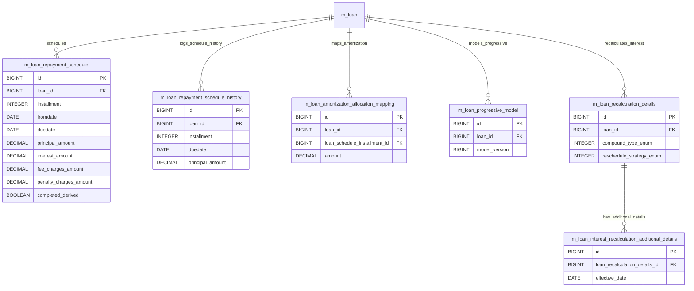

# [FN-004] DB 명세서

## 테이블 목록

| 테이블명 | 역할 |
| :--- | :--- |
| `m_loan_repayment_schedule` | 회차별 원금, 이자, 수수료 등의 상환 계획 스케줄 |
| `m_loan_repayment_schedule_history` | 스케줄 재생성/변경 전 과거 상환 스케줄 이력 보관 |
| `m_loan_amortization_allocation_mapping` | 원리금 상환/상각 방식에 따른 배분 매핑 정보 |
| `m_loan_progressive_model` | 점진적/진행형 상환 모델(Progressive Loan) 산출 데이터 |
| `m_loan_recalculation_details` | 조기상환 등에 따른 이자 재계산 정책 및 상세 설정 |
| `m_loan_interest_recalculation_additional_details` | 이자 재계산 시 추가 반영되는 상세 파라미터 |

## `m_loan_repayment_schedule` - 회차별 원금, 이자, 수수료 등의 상환 계획 스케줄

| 컬럼명 | 타입 | 제약 | 설명 |
| :--- | :--- | :--- | :--- |
| `id` | BIGINT | AUTO_INCREMENT, PK, NOT NULL | `m_loan_repayment_schedule`의 고유 식별자 (PK) |
| `loan_id` | BIGINT | NOT NULL, FK -> m_loan(id), RESTRICT | 연계된 loan 식별자 (FK) |
| `fromdate` | date | DEFAULT NULL | 시작 일자 |
| `duedate` | date | NOT NULL | 만기/납기 일자 |
| `installment` | SMALLINT | NOT NULL | 상환 회차 번호 |
| `principal_amount` | DECIMAL(19, 6) | DEFAULT NULL | 대출 원금 관련 금액 |
| `principal_completed_derived` | DECIMAL(19, 6) | DEFAULT NULL | principal_completed_derived 속성값 |
| `principal_writtenoff_derived` | DECIMAL(19, 6) | DEFAULT NULL | principal_writtenoff_derived 속성값 |
| `interest_amount` | DECIMAL(19, 6) | DEFAULT NULL | 이자 관련 금액 |
| `interest_completed_derived` | DECIMAL(19, 6) | DEFAULT NULL | interest_completed_derived 속성값 |
| `interest_writtenoff_derived` | DECIMAL(19, 6) | DEFAULT NULL | interest_writtenoff_derived 속성값 |
| `interest_waived_derived` | DECIMAL(19, 6) | DEFAULT NULL | interest_waived_derived 속성값 |
| `accrual_interest_derived` | DECIMAL(19, 6) | DEFAULT NULL | accrual_interest_derived 속성값 |
| `reschedule_interest_portion` | DECIMAL(19, 6) | DEFAULT NULL | 이자 관련 금액 |
| `fee_charges_amount` | DECIMAL(19, 6) | DEFAULT NULL | 수수료 관련 금액 |
| `fee_charges_completed_derived` | DECIMAL(19, 6) | DEFAULT NULL | 수수료 관련 금액 |
| `fee_charges_writtenoff_derived` | DECIMAL(19, 6) | DEFAULT NULL | 수수료 관련 금액 |
| `fee_charges_waived_derived` | DECIMAL(19, 6) | DEFAULT NULL | 수수료 관련 금액 |
| `accrual_fee_charges_derived` | DECIMAL(19, 6) | DEFAULT NULL | 수수료 관련 금액 |
| `penalty_charges_amount` | DECIMAL(19, 6) | DEFAULT NULL | 연체료/과징금 금액 |
| `penalty_charges_completed_derived` | DECIMAL(19, 6) | DEFAULT NULL | 연체료/과징금 금액 |
| `penalty_charges_writtenoff_derived` | DECIMAL(19, 6) | DEFAULT NULL | 연체료/과징금 금액 |
| `penalty_charges_waived_derived` | DECIMAL(19, 6) | DEFAULT NULL | 연체료/과징금 금액 |
| `accrual_penalty_charges_derived` | DECIMAL(19, 6) | DEFAULT NULL | 연체료/과징금 금액 |
| `total_paid_in_advance_derived` | DECIMAL(19, 6) | DEFAULT NULL | total_paid_in_advance_derived 속성값 |
| `total_paid_late_derived` | DECIMAL(19, 6) | DEFAULT NULL | total_paid_late_derived 속성값 |
| `completed_derived` | boolean | NOT NULL | completed_derived 속성값 |
| `obligations_met_on_date` | date | DEFAULT NULL | obligations_met_on_date 속성값 |
| `createdby_id` | BIGINT | DEFAULT NULL | 연계된 createdby 식별자 (FK) |
| `created_date` | datetime | DEFAULT NULL | 레코드 생성 일시 |
| `lastmodified_date` | datetime | DEFAULT NULL | 레코드 최종 수정 일시 |
| `lastmodifiedby_id` | BIGINT | DEFAULT NULL | 연계된 lastmodifiedby 식별자 (FK) |
| `recalculated_interest_component` | boolean | DEFAULT false, NOT NULL | recalculated_interest_component 속성값 |
| `credited_fee` | DECIMAL(19, 6) | DEFAULT NULL | credited_fee 속성값 |
| `credited_penalty` | DECIMAL(19, 6) | DEFAULT NULL | credited_penalty 속성값 |
| `is_re_aged` | boolean | DEFAULT false, NOT NULL | is_re_aged 속성값 |
| `created_on_utc` | TIMESTAMP WITH TIME ZONE | NULL | 레코드 생성 일시 |
| `last_modified_on_utc` | TIMESTAMP WITH TIME ZONE | NULL | 레코드 최종 수정 일시 |
| `is_additional` | boolean | DEFAULT false, NOT NULL | is_additional 속성값 |
| `credits_amount` | DECIMAL(19, 6) | DEFAULT NULL | 해당 항목 금액/잔액 |
| `is_down_payment` | boolean | DEFAULT false, NOT NULL | is_down_payment 속성값 |
| `credited_interest` | DECIMAL(19, 6) | NULL | credited_interest 속성값 |

## `m_loan_repayment_schedule_history` - 스케줄 재생성/변경 전 과거 상환 스케줄 이력 보관

| 컬럼명 | 타입 | 제약 | 설명 |
| :--- | :--- | :--- | :--- |
| `id` | BIGINT | AUTO_INCREMENT, PK, NOT NULL | `m_loan_repayment_schedule_history`의 고유 식별자 (PK) |
| `loan_id` | BIGINT | NOT NULL, FK -> m_loan(id), RESTRICT | 연계된 loan 식별자 (FK) |
| `loan_reschedule_request_id` | BIGINT | DEFAULT NULL, FK -> m_loan_reschedule_request(id), RESTRICT | 연계된 loan_reschedule_request 식별자 (FK) |
| `fromdate` | date | DEFAULT NULL | 시작 일자 |
| `duedate` | date | NOT NULL | 만기/납기 일자 |
| `installment` | SMALLINT | NOT NULL | 상환 회차 번호 |
| `principal_amount` | DECIMAL(19, 6) | DEFAULT NULL | 대출 원금 관련 금액 |
| `interest_amount` | DECIMAL(19, 6) | DEFAULT NULL | 이자 관련 금액 |
| `fee_charges_amount` | DECIMAL(19, 6) | DEFAULT NULL | 수수료 관련 금액 |
| `penalty_charges_amount` | DECIMAL(19, 6) | DEFAULT NULL | 연체료/과징금 금액 |
| `createdby_id` | BIGINT | DEFAULT NULL | 연계된 createdby 식별자 (FK) |
| `created_date` | datetime | DEFAULT NULL | 레코드 생성 일시 |
| `lastmodified_date` | datetime | DEFAULT NULL | 레코드 최종 수정 일시 |
| `lastmodifiedby_id` | BIGINT | DEFAULT NULL | 연계된 lastmodifiedby 식별자 (FK) |
| `version` | INT | NOT NULL | 낙관적 락 엔티티 버전 번호 |
| `created_on_utc` | TIMESTAMP WITH TIME ZONE | NULL | 레코드 생성 일시 |
| `last_modified_on_utc` | TIMESTAMP WITH TIME ZONE | NULL | 레코드 최종 수정 일시 |

## `m_loan_amortization_allocation_mapping` - 원리금 상환/상각 방식에 따른 배분 매핑 정보

| 컬럼명 | 타입 | 제약 | 설명 |
| :--- | :--- | :--- | :--- |
| `id` | BIGINT | AUTO_INCREMENT, PK, NOT NULL | `m_loan_amortization_allocation_mapping`의 고유 식별자 (PK) |
| `loan_id` | BIGINT | NOT NULL, FK -> m_loan(id), RESTRICT | 연계된 loan 식별자 (FK) |
| `base_loan_transaction_id` | BIGINT | NOT NULL, FK -> m_loan_transaction(id), RESTRICT | 연계된 base_loan_transaction 식별자 (FK) |
| `date` | DATE | NOT NULL | date 속성값 |
| `amortization_loan_transaction_id` | BIGINT | NOT NULL, FK -> m_loan_transaction(id), RESTRICT | 연계된 amortization_loan_transaction 식별자 (FK) |
| `amortization_type` | VARCHAR(20) | NOT NULL | amortization_type 속성값 |
| `amount` | DECIMAL(19, 6) | NOT NULL | 해당 항목 금액/잔액 |
| `created_by` | BIGINT | FK -> m_appuser(id), RESTRICT | 레코드 생성자 ID |
| `created_on_utc` | timestamp with time zone | NULL | 레코드 생성 일시 |
| `last_modified_by` | BIGINT | FK -> m_appuser(id), RESTRICT | 레코드 최종 수정자 ID |
| `last_modified_on_utc` | timestamp with time zone | NULL | 레코드 최종 수정 일시 |
| `id` | BIGINT | AUTO_INCREMENT, PK, NOT NULL | `m_loan_amortization_allocation_mapping`의 고유 식별자 (PK) |
| `loan_id` | BIGINT | NOT NULL, FK -> m_loan(id), RESTRICT | 연계된 loan 식별자 (FK) |
| `base_loan_transaction_id` | BIGINT | NOT NULL, FK -> m_loan_transaction(id), RESTRICT | 연계된 base_loan_transaction 식별자 (FK) |
| `date` | DATE | NOT NULL | date 속성값 |
| `amortization_loan_transaction_id` | BIGINT | NOT NULL, FK -> m_loan_transaction(id), RESTRICT | 연계된 amortization_loan_transaction 식별자 (FK) |
| `amortization_type` | VARCHAR(20) | NOT NULL | amortization_type 속성값 |
| `amount` | DECIMAL(19, 6) | NOT NULL | 해당 항목 금액/잔액 |
| `created_by` | BIGINT | FK -> m_appuser(id), RESTRICT | 레코드 생성자 ID |
| `created_on_utc` | DATETIME | NULL | 레코드 생성 일시 |
| `last_modified_by` | BIGINT | FK -> m_appuser(id), RESTRICT | 레코드 최종 수정자 ID |
| `last_modified_on_utc` | DATETIME | NULL | 레코드 최종 수정 일시 |

## `m_loan_progressive_model` - 점진적/진행형 상환 모델(Progressive Loan) 산출 데이터

| 컬럼명 | 타입 | 제약 | 설명 |
| :--- | :--- | :--- | :--- |
| `id` | BIGINT | AUTO_INCREMENT, PK, NOT NULL | `m_loan_progressive_model`의 고유 식별자 (PK) |
| `version` | INT | NOT NULL | 낙관적 락 엔티티 버전 번호 |
| `loan_id` | BIGINT | NOT NULL, FK -> m_loan(id), RESTRICT | 연계된 loan 식별자 (FK) |
| `json_model` | TEXT | NOT NULL | json_model 속성값 |
| `business_date` | DATE | NOT NULL | business_date 속성값 |
| `last_modified_on_utc` | TIMESTAMP WITH TIME ZONE | NOT NULL | 레코드 최종 수정 일시 |
| `json_model_version` | VARCHAR(100) | DEFAULT 1, NOT NULL | 낙관적 락 엔티티 버전 번호 |

## `m_loan_recalculation_details` - 조기상환 등에 따른 이자 재계산 정책 및 상세 설정

| 컬럼명 | 타입 | 제약 | 설명 |
| :--- | :--- | :--- | :--- |
| `id` | BIGINT | AUTO_INCREMENT, PK, NOT NULL | `m_loan_recalculation_details`의 고유 식별자 (PK) |
| `loan_id` | BIGINT | NOT NULL, FK -> m_loan(id), RESTRICT | 연계된 loan 식별자 (FK) |
| `compound_type_enum` | SMALLINT | NOT NULL | compound_type_enum 속성값 |
| `reschedule_strategy_enum` | SMALLINT | NOT NULL | reschedule_strategy_enum 속성값 |
| `rest_frequency_type_enum` | SMALLINT | NOT NULL | rest_frequency_type_enum 속성값 |
| `rest_frequency_interval` | SMALLINT | DEFAULT 0, NOT NULL | rest_frequency_interval 속성값 |
| `compounding_frequency_type_enum` | SMALLINT | DEFAULT NULL | compounding_frequency_type_enum 속성값 |
| `compounding_frequency_interval` | SMALLINT | DEFAULT NULL | compounding_frequency_interval 속성값 |
| `rest_frequency_nth_day_enum` | INT | DEFAULT NULL | rest_frequency_nth_day_enum 속성값 |
| `rest_frequency_on_day` | INT | DEFAULT NULL | rest_frequency_on_day 속성값 |
| `rest_frequency_weekday_enum` | INT | DEFAULT NULL | rest_frequency_weekday_enum 속성값 |
| `compounding_frequency_nth_day_enum` | INT | DEFAULT NULL | compounding_frequency_nth_day_enum 속성값 |
| `compounding_frequency_on_day` | INT | DEFAULT NULL | compounding_frequency_on_day 속성값 |
| `is_compounding_to_be_posted_as_transaction` | boolean | DEFAULT false, NOT NULL | is_compounding_to_be_posted_as_transaction 속성값 |
| `compounding_frequency_weekday_enum` | INT | DEFAULT NULL | compounding_frequency_weekday_enum 속성값 |
| `allow_compounding_on_eod` | boolean | DEFAULT false, NOT NULL | allow_compounding_on_eod 속성값 |
| `pre_close_interest_calculation_strategy` | SMALLINT | DEFAULT 1, NOT NULL | pre_close_interest_calculation_strategy 속성값 |
| `disallow_interest_calc_on_past_due` | boolean | DEFAULT false, NOT NULL | disallow_interest_calc_on_past_due 속성값 |

## `m_loan_interest_recalculation_additional_details` - 이자 재계산 시 추가 반영되는 상세 파라미터

| 컬럼명 | 타입 | 제약 | 설명 |
| :--- | :--- | :--- | :--- |
| `id` | BIGINT | AUTO_INCREMENT, PK, NOT NULL | `m_loan_interest_recalculation_additional_details`의 고유 식별자 (PK) |
| `loan_repayment_schedule_id` | BIGINT | NOT NULL, FK -> m_loan_repayment_schedule(id), RESTRICT | 연계된 loan_repayment_schedule 식별자 (FK) |
| `effective_date` | date | NOT NULL | effective_date 속성값 |
| `amount` | DECIMAL(19, 6) | NOT NULL | 해당 항목 금액/잔액 |

## 관계도

## 근거
* `fineract-loan/src/main/resources/db/changelog/tenant/module/loan/parts/1017_add_fee_and_penalty_adjustments_to_loan.xml`
* `fineract-loan/src/main/resources/db/changelog/tenant/module/loan/parts/1020_add_re_aged_flag_to_loan_installment.xml`
* `fineract-loan/src/main/resources/db/changelog/tenant/module/loan/parts/1025_store_pre_closure_strategy_to_loan_level.xml`
* `fineract-progressive-loan/src/main/resources/db/changelog/tenant/module/progressiveloan/parts/5001_create_progressive_loan_model.xml`
* `fineract-progressive-loan/src/main/resources/db/changelog/tenant/module/progressiveloan/parts/5003_add_model_version.xml`
* `fineract-provider/src/main/resources/db/changelog/tenant/parts/0001_initial_schema.xml`
* `fineract-provider/src/main/resources/db/changelog/tenant/parts/0033_add_audit_entries_to_loan_repayment_schedule_installment.xml`
* `fineract-provider/src/main/resources/db/changelog/tenant/parts/0054_additional_fields_loan_repayment_schedule.xml`
* `fineract-provider/src/main/resources/db/changelog/tenant/parts/0123_add_is_down_payment_to_repayment_schedule.xml`
* `fineract-provider/src/main/resources/db/changelog/tenant/parts/0156_add_disallow_interest_calc_on_past_due_field.xml`
* `fineract-provider/src/main/resources/db/changelog/tenant/parts/0165_add_credited_interest_to_instalment.xml`
* `fineract-provider/src/main/resources/db/changelog/tenant/parts/0195_create_loan_amortization_allocation_mapping.xml`
* `fineract-provider/src/main/resources/db/changelog/tenant/upgrades/0000_upgrade_to_1.5.xml`
