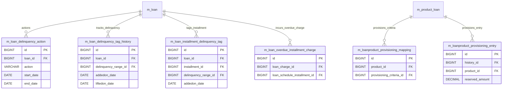

# [FN-006] DB 명세서

## 테이블 목록

| 테이블명 | 역할 |
| :--- | :--- |
| `m_loan_delinquency_action` | 대출 연체 발생 시 수행된 채권 관리 조치/활동 기록 |
| `m_loan_delinquency_tag_history` | 대출 연체 구간(Bucket/Range) 등급 및 태그 변경 이력 |
| `m_loan_installment_delinquency_tag` | 상환 회차별 연체 상태 태그 정보 |
| `m_loan_overdue_installment_charge` | 기일 경과(연체) 회차에 부과되는 연체 수수료/연체 가산금 |
| `m_loanproduct_provisioning_mapping` | 대출 상품과 대손충당금(Provisioning) 기준 간의 매핑 |
| `m_loanproduct_provisioning_entry` | 대출 상품별 대손충당금 적립 및 산출 분개 항목 |

## `m_loan_delinquency_action` - 대출 연체 발생 시 수행된 채권 관리 조치/활동 기록

| 컬럼명 | 타입 | 제약 | 설명 |
| :--- | :--- | :--- | :--- |
| `id` | BIGINT | AUTO_INCREMENT, PK, NOT NULL | `m_loan_delinquency_action`의 고유 식별자 (PK) |
| `loan_id` | BIGINT | NOT NULL, FK -> m_loan(id), RESTRICT | 연계된 loan 식별자 (FK) |
| `action` | VARCHAR(128) | NOT NULL | action 속성값 |
| `start_date` | date | NOT NULL | start_date 속성값 |
| `end_date` | date | NULL | end_date 속성값 |
| `created_by` | BIGINT | NOT NULL | 레코드 생성자 ID |
| `last_modified_by` | BIGINT | NOT NULL | 레코드 최종 수정자 ID |
| `created_on_utc` | TIMESTAMP WITH TIME ZONE | NOT NULL | 레코드 생성 일시 |
| `last_modified_on_utc` | TIMESTAMP WITH TIME ZONE | NOT NULL | 레코드 최종 수정 일시 |

## `m_loan_delinquency_tag_history` - 대출 연체 구간(Bucket/Range) 등급 및 태그 변경 이력

| 컬럼명 | 타입 | 제약 | 설명 |
| :--- | :--- | :--- | :--- |
| `id` | BIGINT | AUTO_INCREMENT, PK, NOT NULL | `m_loan_delinquency_tag_history`의 고유 식별자 (PK) |
| `delinquency_range_id` | BIGINT | NOT NULL, FK -> m_delinquency_range(id), RESTRICT | 연계된 delinquency_range 식별자 (FK) |
| `loan_id` | BIGINT | NOT NULL, FK -> m_loan(id), RESTRICT | 연계된 loan 식별자 (FK) |
| `addedon_date` | DATE | NOT NULL | addedon_date 속성값 |
| `liftedon_date` | DATE | DEFAULT NULL | liftedon_date 속성값 |
| `created_by` | BIGINT | NOT NULL | 레코드 생성자 ID |
| `created_on_utc` | DATETIME | NOT NULL | 레코드 생성 일시 |
| `version` | BIGINT | NOT NULL | 낙관적 락 엔티티 버전 번호 |
| `last_modified_by` | BIGINT | NOT NULL | 레코드 최종 수정자 ID |
| `last_modified_on_utc` | DATETIME | NOT NULL | 레코드 최종 수정 일시 |
| `id` | BIGINT | AUTO_INCREMENT, PK, NOT NULL | `m_loan_delinquency_tag_history`의 고유 식별자 (PK) |
| `delinquency_range_id` | BIGINT | NOT NULL, FK -> m_delinquency_range(id), RESTRICT | 연계된 delinquency_range 식별자 (FK) |
| `loan_id` | BIGINT | NOT NULL, FK -> m_loan(id), RESTRICT | 연계된 loan 식별자 (FK) |
| `addedon_date` | DATE | NOT NULL | addedon_date 속성값 |
| `liftedon_date` | DATE | DEFAULT NULL | liftedon_date 속성값 |
| `created_by` | BIGINT | NOT NULL | 레코드 생성자 ID |
| `created_on_utc` | TIMESTAMP WITH TIME ZONE | NOT NULL | 레코드 생성 일시 |
| `version` | BIGINT | NOT NULL | 낙관적 락 엔티티 버전 번호 |
| `last_modified_by` | BIGINT | NOT NULL | 레코드 최종 수정자 ID |
| `last_modified_on_utc` | TIMESTAMP WITH TIME ZONE | NOT NULL | 레코드 최종 수정 일시 |

## `m_loan_installment_delinquency_tag` - 상환 회차별 연체 상태 태그 정보

| 컬럼명 | 타입 | 제약 | 설명 |
| :--- | :--- | :--- | :--- |
| `id` | BIGINT | AUTO_INCREMENT, PK, NOT NULL | `m_loan_installment_delinquency_tag`의 고유 식별자 (PK) |
| `delinquency_range_id` | BIGINT | NOT NULL, FK -> m_delinquency_range(id), RESTRICT | 연계된 delinquency_range 식별자 (FK) |
| `loan_id` | BIGINT | NOT NULL, FK -> m_loan(id), RESTRICT | 연계된 loan 식별자 (FK) |
| `installment_id` | BIGINT | NOT NULL, FK -> m_loan_repayment_schedule(id), RESTRICT | 연계된 installment 식별자 (FK) |
| `addedon_date` | DATE | NOT NULL | addedon_date 속성값 |
| `first_overdue_date` | DATE | NOT NULL | 만기/납기 일자 |
| `outstanding_amount` | DECIMAL(19, 6) | NOT NULL | 해당 항목 금액/잔액 |
| `liftedon_date` | DATE | DEFAULT NULL | liftedon_date 속성값 |
| `created_by` | BIGINT | NOT NULL | 레코드 생성자 ID |
| `version` | BIGINT | NOT NULL | 낙관적 락 엔티티 버전 번호 |
| `last_modified_by` | BIGINT | NOT NULL | 레코드 최종 수정자 ID |
| `created_on_utc` | TIMESTAMP WITH TIME ZONE | NOT NULL | 레코드 생성 일시 |
| `last_modified_on_utc` | TIMESTAMP WITH TIME ZONE | NOT NULL | 레코드 최종 수정 일시 |

## `m_loan_overdue_installment_charge` - 기일 경과(연체) 회차에 부과되는 연체 수수료/연체 가산금

| 컬럼명 | 타입 | 제약 | 설명 |
| :--- | :--- | :--- | :--- |
| `id` | BIGINT | AUTO_INCREMENT, PK, NOT NULL | `m_loan_overdue_installment_charge`의 고유 식별자 (PK) |
| `loan_charge_id` | BIGINT | NOT NULL, FK -> m_loan_charge(id), RESTRICT | 연계된 loan_charge 식별자 (FK) |
| `loan_schedule_id` | BIGINT | NOT NULL, FK -> m_loan_repayment_schedule(id), RESTRICT | 연계된 loan_schedule 식별자 (FK) |
| `frequency_number` | INT | NOT NULL | frequency_number 속성값 |

## `m_loanproduct_provisioning_mapping` - 대출 상품과 대손충당금(Provisioning) 기준 간의 매핑

| 컬럼명 | 타입 | 제약 | 설명 |
| :--- | :--- | :--- | :--- |
| `id` | BIGINT | AUTO_INCREMENT, PK, NOT NULL | `m_loanproduct_provisioning_mapping`의 고유 식별자 (PK) |
| `product_id` | BIGINT | NOT NULL, UNIQUE, FK -> m_product_loan(id), RESTRICT | 연계된 product 식별자 (FK) |
| `criteria_id` | BIGINT | NOT NULL, FK -> m_provisioning_criteria(id), RESTRICT | 연계된 criteria 식별자 (FK) |

## `m_loanproduct_provisioning_entry` - 대출 상품별 대손충당금 적립 및 산출 분개 항목

| 컬럼명 | 타입 | 제약 | 설명 |
| :--- | :--- | :--- | :--- |
| `id` | BIGINT | AUTO_INCREMENT, PK, NOT NULL | `m_loanproduct_provisioning_entry`의 고유 식별자 (PK) |
| `history_id` | BIGINT | NOT NULL, FK -> m_provisioning_history(id), RESTRICT | 연계된 history 식별자 (FK) |
| `criteria_id` | BIGINT | NOT NULL, FK -> m_provisioning_criteria(id), RESTRICT | 연계된 criteria 식별자 (FK) |
| `currency_code` | VARCHAR(3) | NOT NULL | 통화 코드 |
| `office_id` | BIGINT | NOT NULL, FK -> m_office(id), RESTRICT | 연계된 office 식별자 (FK) |
| `product_id` | BIGINT | NOT NULL, FK -> m_product_loan(id), RESTRICT | 연계된 product 식별자 (FK) |
| `category_id` | BIGINT | NOT NULL, FK -> m_provision_category(id), RESTRICT | 연계된 category 식별자 (FK) |
| `overdue_in_days` | BIGINT | DEFAULT 0 | overdue_in_days 속성값 |
| `reseve_amount` | DECIMAL(20, 6) | DEFAULT 0.000000 | 해당 항목 금액/잔액 |
| `liability_account` | BIGINT | DEFAULT NULL, FK -> acc_gl_account(id), RESTRICT | liability_account 속성값 |
| `expense_account` | BIGINT | DEFAULT NULL, FK -> acc_gl_account(id), RESTRICT | expense_account 속성값 |

## 관계도

## 근거
* `fineract-loan/src/main/resources/db/changelog/tenant/module/loan/parts/1008_add_loan_installment_delinquency_tag.xml`
* `fineract-loan/src/main/resources/db/changelog/tenant/module/loan/parts/1011_add_delinquency_actions_table.xml`
* `fineract-provider/src/main/resources/db/changelog/tenant/parts/0001_initial_schema.xml`
* `fineract-provider/src/main/resources/db/changelog/tenant/parts/0029_add_delinquency_buckets.xml`
