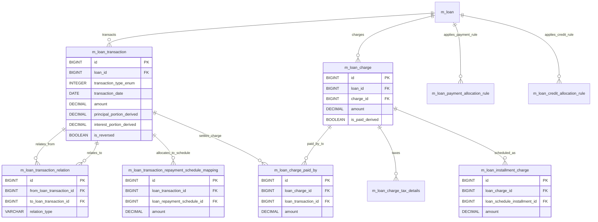

# [LNR-001] DB 명세서

## 테이블 목록

| 테이블명 | 역할 |
| :--- | :--- |
| `m_loan_transaction` | 대출 상환, 이자 납입, 실행, 취소 등의 금융 거래 원장 |
| `m_loan_transaction_relation` | 대출 거래 간의 연관 관계(원거래-취소거래 매핑 등) |
| `m_loan_transaction_repayment_schedule_mapping` | 개별 상환 거래 금액이 상환 스케줄의 어느 회차/항목에 충당되었는지 매핑 |
| `m_loan_payment_allocation_rule` | 개별 대출 계좌 수준의 상환금 충당/배분 규칙 |
| `m_loan_credit_allocation_rule` | 개별 대출 계좌 수준의 크레딧 배분 규칙 |
| `m_loan_charge` | 대출에 부과된 수수료(정액/정률) 및 납부 상태 |
| `m_loan_charge_paid_by` | 대출 수수료가 납부된 거래(Transaction) 매핑 |
| `m_loan_charge_tax_details` | 대출 수수료에 부과된 세금 상세 정보 |
| `m_loan_installment_charge` | 특정 상환 회차(Installment)에 부과된 수수료 |

## `m_loan_transaction` - 대출 상환, 이자 납입, 실행, 취소 등의 금융 거래 원장

| 컬럼명 | 타입 | 제약 | 설명 |
| :--- | :--- | :--- | :--- |
| `id` | BIGINT | AUTO_INCREMENT, PK, NOT NULL | `m_loan_transaction`의 고유 식별자 (PK) |
| `loan_id` | BIGINT | NOT NULL, FK -> m_loan(id), RESTRICT | 연계된 loan 식별자 (FK) |
| `office_id` | BIGINT | NOT NULL, FK -> m_office(id), RESTRICT | 연계된 office 식별자 (FK) |
| `payment_detail_id` | BIGINT | DEFAULT NULL, FK -> m_payment_detail(id), RESTRICT | 연계된 payment_detail 식별자 (FK) |
| `is_reversed` | boolean | NOT NULL | 거래 취소(Reversal) 여부 |
| `external_id` | VARCHAR(100) | UNIQUE | 연계된 external 식별자 (FK) |
| `transaction_type_enum` | SMALLINT | NOT NULL | 트랜잭션/거래 유형 구분 |
| `transaction_date` | date | NOT NULL | transaction_date 속성값 |
| `amount` | DECIMAL(19, 6) | NOT NULL | 해당 항목 금액/잔액 |
| `principal_portion_derived` | DECIMAL(19, 6) | DEFAULT NULL | 대출 원금 관련 금액 |
| `interest_portion_derived` | DECIMAL(19, 6) | DEFAULT NULL | 이자 관련 금액 |
| `fee_charges_portion_derived` | DECIMAL(19, 6) | DEFAULT NULL | 수수료 관련 금액 |
| `penalty_charges_portion_derived` | DECIMAL(19, 6) | DEFAULT NULL | 연체료/과징금 금액 |
| `overpayment_portion_derived` | DECIMAL(19, 6) | DEFAULT NULL | overpayment_portion_derived 속성값 |
| `unrecognized_income_portion` | DECIMAL(19, 6) | DEFAULT NULL | unrecognized_income_portion 속성값 |
| `outstanding_loan_balance_derived` | DECIMAL(19, 6) | DEFAULT NULL | 해당 항목 금액/잔액 |
| `submitted_on_date` | date | NOT NULL | 신청/접수 일자 |
| `manually_adjusted_or_reversed` | boolean | DEFAULT false | manually_adjusted_or_reversed 속성값 |
| `created_date` | datetime | DEFAULT NULL | 레코드 생성 일시 |
| `appuser_id` | BIGINT | DEFAULT NULL | 연계된 appuser 식별자 (FK) |
| `classification_cv_id` | BIGINT | DEFAULT NULL | 연계된 classification_cv 식별자 (FK) |
| `createdby_id` | BIGINT | NULL | 연계된 createdby 식별자 (FK) |
| `lastmodifiedby_id` | BIGINT | NULL | 연계된 lastmodifiedby 식별자 (FK) |
| `created_on_utc` | TIMESTAMP WITH TIME ZONE | NULL | 레코드 생성 일시 |
| `last_modified_on_utc` | TIMESTAMP WITH TIME ZONE | NULL | 레코드 최종 수정 일시 |
| `charge_refund_charge_type` | VARCHAR(1) | NULL | charge_refund_charge_type 속성값 |
| `reversal_external_id` | VARCHAR(100) | DEFAULT NULL | 연계된 reversal_external 식별자 (FK) |
| `reversed_on_date` | date | DEFAULT NULL | reversed_on_date 속성값 |
| `version` | BIGINT | DEFAULT 1, NOT NULL | 낙관적 락 엔티티 버전 번호 |

## `m_loan_transaction_relation` - 대출 거래 간의 연관 관계(원거래-취소거래 매핑 등)

| 컬럼명 | 타입 | 제약 | 설명 |
| :--- | :--- | :--- | :--- |
| `id` | BIGINT | AUTO_INCREMENT, PK, NOT NULL | `m_loan_transaction_relation`의 고유 식별자 (PK) |
| `from_loan_transaction_id` | BIGINT | NOT NULL, FK -> m_loan_transaction(id), RESTRICT | 연계된 from_loan_transaction 식별자 (FK) |
| `to_loan_transaction_id` | BIGINT | NOT NULL, FK -> m_loan_transaction(id), RESTRICT | 연계된 to_loan_transaction 식별자 (FK) |
| `relation_type_enum` | INT | NOT NULL | relation_type_enum 속성값 |
| `created_by` | BIGINT | NOT NULL | 레코드 생성자 ID |
| `created_on_utc` | DATETIME | NOT NULL | 레코드 생성 일시 |
| `version` | BIGINT | NOT NULL | 낙관적 락 엔티티 버전 번호 |
| `last_modified_by` | BIGINT | NOT NULL | 레코드 최종 수정자 ID |
| `last_modified_on_utc` | DATETIME | NOT NULL | 레코드 최종 수정 일시 |
| `id` | BIGINT | AUTO_INCREMENT, PK, NOT NULL | `m_loan_transaction_relation`의 고유 식별자 (PK) |
| `from_loan_transaction_id` | BIGINT | NOT NULL, FK -> m_loan_transaction(id), RESTRICT | 연계된 from_loan_transaction 식별자 (FK) |
| `to_loan_transaction_id` | BIGINT | NOT NULL, FK -> m_loan_transaction(id), RESTRICT | 연계된 to_loan_transaction 식별자 (FK) |
| `relation_type_enum` | INT | NOT NULL | relation_type_enum 속성값 |
| `created_by` | BIGINT | NOT NULL | 레코드 생성자 ID |
| `created_on_utc` | TIMESTAMP WITH TIME ZONE | NOT NULL | 레코드 생성 일시 |
| `version` | BIGINT | NOT NULL | 낙관적 락 엔티티 버전 번호 |
| `last_modified_by` | BIGINT | NOT NULL | 레코드 최종 수정자 ID |
| `last_modified_on_utc` | TIMESTAMP WITH TIME ZONE | NOT NULL | 레코드 최종 수정 일시 |
| `to_loan_charge_id` | BIGINT | FK -> m_loan_charge(id), RESTRICT | 연계된 to_loan_charge 식별자 (FK) |

## `m_loan_transaction_repayment_schedule_mapping` - 개별 상환 거래 금액이 상환 스케줄의 어느 회차/항목에 충당되었는지 매핑

| 컬럼명 | 타입 | 제약 | 설명 |
| :--- | :--- | :--- | :--- |
| `id` | BIGINT | AUTO_INCREMENT, PK, NOT NULL | `m_loan_transaction_repayment_schedule_mapping`의 고유 식별자 (PK) |
| `loan_transaction_id` | BIGINT | NOT NULL, FK -> m_loan_transaction(id), RESTRICT | 연계된 loan_transaction 식별자 (FK) |
| `loan_repayment_schedule_id` | BIGINT | NOT NULL, FK -> m_loan_repayment_schedule(id), RESTRICT | 연계된 loan_repayment_schedule 식별자 (FK) |
| `amount` | DECIMAL(19, 6) | NOT NULL | 해당 항목 금액/잔액 |
| `principal_portion_derived` | DECIMAL(19, 6) | DEFAULT NULL | 대출 원금 관련 금액 |
| `interest_portion_derived` | DECIMAL(19, 6) | DEFAULT NULL | 이자 관련 금액 |
| `fee_charges_portion_derived` | DECIMAL(19, 6) | DEFAULT NULL | 수수료 관련 금액 |
| `penalty_charges_portion_derived` | DECIMAL(19, 6) | DEFAULT NULL | 연체료/과징금 금액 |

## `m_loan_payment_allocation_rule` - 개별 대출 계좌 수준의 상환금 충당/배분 규칙

| 컬럼명 | 타입 | 제약 | 설명 |
| :--- | :--- | :--- | :--- |
| `id` | BIGINT | AUTO_INCREMENT, PK, NOT NULL | `m_loan_payment_allocation_rule`의 고유 식별자 (PK) |
| `loan_id` | BIGINT | NOT NULL | 연계된 loan 식별자 (FK) |
| `transaction_type` | VARCHAR(255) | NOT NULL | 트랜잭션/거래 유형 구분 |
| `allocation_types` | TEXT | NOT NULL | 충당/배분 유형 |
| `future_installment_allocation_rule` | VARCHAR(255) | NOT NULL | 상환 회차 번호 |
| `created_by` | BIGINT | NOT NULL, FK -> m_appuser(id), RESTRICT | 레코드 생성자 ID |
| `last_modified_by` | BIGINT | NOT NULL, FK -> m_appuser(id), RESTRICT | 레코드 최종 수정자 ID |
| `created_on_utc` | TIMESTAMP WITH TIME ZONE | NOT NULL | 레코드 생성 일시 |
| `last_modified_on_utc` | TIMESTAMP WITH TIME ZONE | NOT NULL | 레코드 최종 수정 일시 |

## `m_loan_credit_allocation_rule` - 개별 대출 계좌 수준의 크레딧 배분 규칙

| 컬럼명 | 타입 | 제약 | 설명 |
| :--- | :--- | :--- | :--- |
| `id` | BIGINT | AUTO_INCREMENT, PK, NOT NULL | `m_loan_credit_allocation_rule`의 고유 식별자 (PK) |
| `loan_id` | BIGINT | NOT NULL | 연계된 loan 식별자 (FK) |
| `transaction_type` | VARCHAR(255) | NOT NULL | 트랜잭션/거래 유형 구분 |
| `allocation_types` | TEXT | NOT NULL | 충당/배분 유형 |
| `created_by` | BIGINT | NOT NULL, FK -> m_appuser(id), RESTRICT | 레코드 생성자 ID |
| `last_modified_by` | BIGINT | NOT NULL, FK -> m_appuser(id), RESTRICT | 레코드 최종 수정자 ID |
| `created_on_utc` | TIMESTAMP WITH TIME ZONE | NOT NULL | 레코드 생성 일시 |
| `last_modified_on_utc` | TIMESTAMP WITH TIME ZONE | NOT NULL | 레코드 최종 수정 일시 |

## `m_loan_charge` - 대출에 부과된 수수료(정액/정률) 및 납부 상태

| 컬럼명 | 타입 | 제약 | 설명 |
| :--- | :--- | :--- | :--- |
| `id` | BIGINT | AUTO_INCREMENT, PK, NOT NULL | `m_loan_charge`의 고유 식별자 (PK) |
| `loan_id` | BIGINT | NOT NULL, FK -> m_loan(id), RESTRICT | 연계된 loan 식별자 (FK) |
| `charge_id` | BIGINT | NOT NULL, FK -> m_charge(id), RESTRICT | 연계된 charge 식별자 (FK) |
| `is_penalty` | boolean | DEFAULT false, NOT NULL | is_penalty 속성값 |
| `charge_time_enum` | SMALLINT | NOT NULL | charge_time_enum 속성값 |
| `due_for_collection_as_of_date` | date | DEFAULT NULL | due_for_collection_as_of_date 속성값 |
| `charge_calculation_enum` | SMALLINT | NOT NULL | charge_calculation_enum 속성값 |
| `charge_payment_mode_enum` | SMALLINT | DEFAULT 0, NOT NULL | charge_payment_mode_enum 속성값 |
| `calculation_percentage` | DECIMAL(19, 6) | DEFAULT NULL | calculation_percentage 속성값 |
| `calculation_on_amount` | DECIMAL(19, 6) | DEFAULT NULL | 해당 항목 금액/잔액 |
| `charge_amount_or_percentage` | DECIMAL(19, 6) | DEFAULT NULL | 해당 항목 금액/잔액 |
| `amount` | DECIMAL(19, 6) | NOT NULL | 해당 항목 금액/잔액 |
| `amount_paid_derived` | DECIMAL(19, 6) | DEFAULT NULL | 해당 항목 금액/잔액 |
| `amount_waived_derived` | DECIMAL(19, 6) | DEFAULT NULL | 해당 항목 금액/잔액 |
| `amount_writtenoff_derived` | DECIMAL(19, 6) | DEFAULT NULL | 해당 항목 금액/잔액 |
| `amount_outstanding_derived` | DECIMAL(19, 6) | DEFAULT 0.000000, NOT NULL | 해당 항목 금액/잔액 |
| `is_paid_derived` | boolean | DEFAULT false, NOT NULL | is_paid_derived 속성값 |
| `waived` | boolean | DEFAULT false, NOT NULL | waived 속성값 |
| `min_cap` | DECIMAL(19, 6) | DEFAULT NULL | min_cap 속성값 |
| `max_cap` | DECIMAL(19, 6) | DEFAULT NULL | max_cap 속성값 |
| `is_active` | boolean | DEFAULT true, NOT NULL | 활성 상태 여부 플래그 |
| `created_on_utc` | TIMESTAMP WITH TIME ZONE | NULL | 레코드 생성 일시 |
| `last_modified_on_utc` | TIMESTAMP WITH TIME ZONE | NULL | 레코드 최종 수정 일시 |
| `created_by` | BIGINT | FK -> m_appuser(id), RESTRICT | 레코드 생성자 ID |
| `last_modified_by` | BIGINT | FK -> m_appuser(id), RESTRICT | 레코드 최종 수정자 ID |
| `tax_amount` | DECIMAL(19,6) | NULL | 해당 항목 금액/잔액 |
| `external_id` | VARCHAR(100) | UNIQUE | 연계된 external 식별자 (FK) |
| `submitted_on_date` | date | NULL | 신청/접수 일자 |

## `m_loan_charge_paid_by` - 대출 수수료가 납부된 거래(Transaction) 매핑

| 컬럼명 | 타입 | 제약 | 설명 |
| :--- | :--- | :--- | :--- |
| `id` | BIGINT | AUTO_INCREMENT, PK, NOT NULL | `m_loan_charge_paid_by`의 고유 식별자 (PK) |
| `loan_transaction_id` | BIGINT | NOT NULL, FK -> m_loan_transaction(id), RESTRICT | 연계된 loan_transaction 식별자 (FK) |
| `loan_charge_id` | BIGINT | NOT NULL, FK -> m_loan_charge(id), RESTRICT | 연계된 loan_charge 식별자 (FK) |
| `amount` | DECIMAL(19, 6) | NOT NULL | 해당 항목 금액/잔액 |
| `installment_number` | SMALLINT | DEFAULT NULL | 상환 회차 번호 |

## `m_loan_charge_tax_details` - 대출 수수료에 부과된 세금 상세 정보

| 컬럼명 | 타입 | 제약 | 설명 |
| :--- | :--- | :--- | :--- |
| `id` | BIGINT | AUTO_INCREMENT, PK, NOT NULL | `m_loan_charge_tax_details`의 고유 식별자 (PK) |
| `loan_charge_id` | BIGINT | NOT NULL, FK -> m_loan_charge(id), RESTRICT | 연계된 loan_charge 식별자 (FK) |
| `tax_component_id` | BIGINT | NOT NULL, FK -> m_tax_component(id), RESTRICT | 연계된 tax_component 식별자 (FK) |
| `amount` | DECIMAL(19,6) | NOT NULL | 해당 항목 금액/잔액 |

## `m_loan_installment_charge` - 특정 상환 회차(Installment)에 부과된 수수료

| 컬럼명 | 타입 | 제약 | 설명 |
| :--- | :--- | :--- | :--- |
| `id` | BIGINT | AUTO_INCREMENT, PK, NOT NULL | `m_loan_installment_charge`의 고유 식별자 (PK) |
| `loan_charge_id` | BIGINT | NOT NULL, FK -> m_loan_charge(id), RESTRICT | 연계된 loan_charge 식별자 (FK) |
| `loan_schedule_id` | BIGINT | NOT NULL, FK -> m_loan_repayment_schedule(id), RESTRICT | 연계된 loan_schedule 식별자 (FK) |
| `due_date` | date | DEFAULT NULL | 만기/납기 일자 |
| `amount` | DECIMAL(19, 6) | NOT NULL | 해당 항목 금액/잔액 |
| `amount_paid_derived` | DECIMAL(19, 6) | DEFAULT NULL | 해당 항목 금액/잔액 |
| `amount_waived_derived` | DECIMAL(19, 6) | DEFAULT NULL | 해당 항목 금액/잔액 |
| `amount_writtenoff_derived` | DECIMAL(19, 6) | DEFAULT NULL | 해당 항목 금액/잔액 |
| `amount_outstanding_derived` | DECIMAL(19, 6) | DEFAULT 0.000000, NOT NULL | 해당 항목 금액/잔액 |
| `is_paid_derived` | boolean | DEFAULT false, NOT NULL | is_paid_derived 속성값 |
| `waived` | boolean | DEFAULT false, NOT NULL | waived 속성값 |
| `amount_through_charge_payment` | DECIMAL(19, 6) | DEFAULT NULL | 해당 항목 금액/잔액 |

## 관계도

## 근거
* `fineract-loan/src/main/resources/db/changelog/tenant/module/loan/parts/1001_add_audit_fields_to_loan_charge.xml`
* `fineract-loan/src/main/resources/db/changelog/tenant/module/loan/parts/1002_add_payment_allocation_rule.xml`
* `fineract-loan/src/main/resources/db/changelog/tenant/module/loan/parts/1016_add_credit_allocation_rule.xml`
* `fineract-loan/src/main/resources/db/changelog/tenant/module/loan/parts/1032_add_classification_to_loan_transaction.xml`
* `fineract-loan/src/main/resources/db/changelog/tenant/module/loan/parts/1035_add_tax_to_loan_charge.xml`
* `fineract-provider/src/main/resources/db/changelog/tenant/parts/0001_initial_schema.xml`
* `fineract-provider/src/main/resources/db/changelog/tenant/parts/0008_loan_charge_add_external_id.xml`
* `fineract-provider/src/main/resources/db/changelog/tenant/parts/0019_refactor_loan_transaction.xml`
* `fineract-provider/src/main/resources/db/changelog/tenant/parts/0020_add_audit_entries.xml`
* `fineract-provider/src/main/resources/db/changelog/tenant/parts/0028_add_charge_refund_charge_type_to_loan_transaction.xml`
* `fineract-provider/src/main/resources/db/changelog/tenant/parts/0038_add_reversal_data_to_loan_transaction.xml`
* `fineract-provider/src/main/resources/db/changelog/tenant/parts/0052_loan_transaction_chargeback.xml`
* `fineract-provider/src/main/resources/db/changelog/tenant/parts/0055_add_submitted_on_date_to_loan_charge.xml`
* `fineract-provider/src/main/resources/db/changelog/tenant/parts/0068_loan_charge_adjustment.xml`
* `fineract-provider/src/main/resources/db/changelog/tenant/parts/0180_add_version_field_to_loan_transaction.xml`
