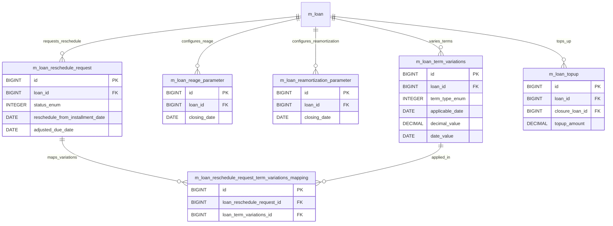

# [LNR-002] DB 명세서

## 테이블 목록

| 테이블명 | 역할 |
| :--- | :--- |
| `m_loan_reschedule_request` | 만기 연장, 유예 등 대출 상환일정 재조정(Reschedule) 신청 |
| `m_loan_reschedule_request_term_variations_mapping` | 재조정 신청과 조건 변경 내역(Term Variation) 간 매핑 |
| `m_loan_reage_parameter` | 연체 일수 초기화/정상화(Re-Age) 처리 파라미터 |
| `m_loan_reamortization_parameter` | 대출 잔액 재상각(Re-Amortization) 처리 파라미터 |
| `m_loan_term_variations` | 금리 변동, 납입 유예 등 대출 계약 조건 변경 내역 |
| `m_loan_topup` | 기존 대출 잔액 상환을 동반한 추가 대출(Top-up) 상세 |

## `m_loan_reschedule_request` - 만기 연장, 유예 등 대출 상환일정 재조정(Reschedule) 신청

| 컬럼명 | 타입 | 제약 | 설명 |
| :--- | :--- | :--- | :--- |
| `id` | BIGINT | AUTO_INCREMENT, PK, NOT NULL | `m_loan_reschedule_request`의 고유 식별자 (PK) |
| `loan_id` | BIGINT | NOT NULL, FK -> m_loan(id), RESTRICT | 연계된 loan 식별자 (FK) |
| `status_enum` | SMALLINT | NOT NULL | 상태 구분 코드 |
| `reschedule_from_installment` | SMALLINT | NOT NULL | 상환 회차 번호 |
| `reschedule_from_date` | date | NOT NULL | 시작 일자 |
| `recalculate_interest` | boolean | DEFAULT NULL | recalculate_interest 속성값 |
| `reschedule_reason_cv_id` | INT | DEFAULT NULL, FK -> m_code_value(id), RESTRICT | 연계된 reschedule_reason_cv 식별자 (FK) |
| `reschedule_reason_comment` | VARCHAR(500) | NULL | reschedule_reason_comment 속성값 |
| `submitted_on_date` | date | NOT NULL | 신청/접수 일자 |
| `submitted_by_user_id` | BIGINT | NOT NULL, FK -> m_appuser(id), RESTRICT | 연계된 submitted_by_user 식별자 (FK) |
| `approved_on_date` | date | DEFAULT NULL | 승인 일자 |
| `approved_by_user_id` | BIGINT | DEFAULT NULL, FK -> m_appuser(id), RESTRICT | 연계된 approved_by_user 식별자 (FK) |
| `rejected_on_date` | date | DEFAULT NULL | rejected_on_date 속성값 |
| `rejected_by_user_id` | BIGINT | DEFAULT NULL, FK -> m_appuser(id), RESTRICT | 연계된 rejected_by_user 식별자 (FK) |

## `m_loan_reschedule_request_term_variations_mapping` - 재조정 신청과 조건 변경 내역(Term Variation) 간 매핑

| 컬럼명 | 타입 | 제약 | 설명 |
| :--- | :--- | :--- | :--- |
| `id` | BIGINT | AUTO_INCREMENT, PK, NOT NULL | `m_loan_reschedule_request_term_variations_mapping`의 고유 식별자 (PK) |
| `loan_reschedule_request_id` | BIGINT | NOT NULL, FK -> m_loan_reschedule_request(id), RESTRICT | 연계된 loan_reschedule_request 식별자 (FK) |
| `loan_term_variations_id` | BIGINT | NOT NULL, FK -> m_loan_term_variations(id), RESTRICT | 연계된 loan_term_variations 식별자 (FK) |

## `m_loan_reage_parameter` - 연체 일수 초기화/정상화(Re-Age) 처리 파라미터

| 컬럼명 | 타입 | 제약 | 설명 |
| :--- | :--- | :--- | :--- |
| `interest_handling_type` | VARCHAR(40) | DEFAULT DEFAULT, NOT NULL | interest_handling_type 속성값 |
| `reage_reason_code_value_id` | INT | DEFAULT NULL, FK -> m_code_value(id), RESTRICT | 연계된 reage_reason_code_value 식별자 (FK) |
| `id` | BIGINT | AUTO_INCREMENT, PK, NOT NULL | `m_loan_reage_parameter`의 고유 식별자 (PK) |
| `frequency` | VARCHAR(100) | NOT NULL | frequency 속성값 |
| `number_of_installments` | SMALLINT | NOT NULL | 상환 회차 번호 |
| `start_date` | DATE | NOT NULL | start_date 속성값 |
| `created_by` | BIGINT | NOT NULL | 레코드 생성자 ID |
| `last_modified_by` | BIGINT | NOT NULL | 레코드 최종 수정자 ID |
| `created_on_utc` | TIMESTAMP WITH TIME ZONE | NOT NULL | 레코드 생성 일시 |
| `last_modified_on_utc` | TIMESTAMP WITH TIME ZONE | NOT NULL | 레코드 최종 수정 일시 |
| `loan_transaction_id` | BIGINT | NOT NULL | 연계된 loan_transaction 식별자 (FK) |
| `frequency_number` | SMALLINT | DEFAULT 1, NOT NULL | frequency_number 속성값 |

## `m_loan_reamortization_parameter` - 대출 잔액 재상각(Re-Amortization) 처리 파라미터

| 컬럼명 | 타입 | 제약 | 설명 |
| :--- | :--- | :--- | :--- |
| `id` | BIGINT | AUTO_INCREMENT, PK, NOT NULL | `m_loan_reamortization_parameter`의 고유 식별자 (PK) |
| `loan_transaction_id` | BIGINT | NOT NULL | 연계된 loan_transaction 식별자 (FK) |
| `interest_handling_type` | VARCHAR(40) | DEFAULT DEFAULT, NOT NULL | interest_handling_type 속성값 |
| `reamortization_reason_code_value_id` | INT | DEFAULT NULL, FK -> m_code_value(id), RESTRICT | 연계된 reamortization_reason_code_value 식별자 (FK) |
| `created_by` | BIGINT | NOT NULL | 레코드 생성자 ID |
| `last_modified_by` | BIGINT | NOT NULL | 레코드 최종 수정자 ID |
| `created_on_utc` | TIMESTAMP WITH TIME ZONE | NOT NULL | 레코드 생성 일시 |
| `last_modified_on_utc` | TIMESTAMP WITH TIME ZONE | NOT NULL | 레코드 최종 수정 일시 |

## `m_loan_term_variations` - 금리 변동, 납입 유예 등 대출 계약 조건 변경 내역

| 컬럼명 | 타입 | 제약 | 설명 |
| :--- | :--- | :--- | :--- |
| `id` | BIGINT | AUTO_INCREMENT, PK, NOT NULL | `m_loan_term_variations`의 고유 식별자 (PK) |
| `loan_id` | BIGINT | NOT NULL, FK -> m_loan(id), RESTRICT | 연계된 loan 식별자 (FK) |
| `term_type` | SMALLINT | NOT NULL | term_type 속성값 |
| `applicable_date` | date | NOT NULL | applicable_date 속성값 |
| `decimal_value` | DECIMAL(19, 6) | DEFAULT NULL | decimal_value 속성값 |
| `date_value` | date | DEFAULT NULL | date_value 속성값 |
| `is_specific_to_installment` | boolean | DEFAULT false, NOT NULL | 상환 회차 번호 |
| `applied_on_loan_status` | SMALLINT | NOT NULL | applied_on_loan_status 속성값 |
| `is_active` | boolean | DEFAULT true, NOT NULL | 활성 상태 여부 플래그 |
| `parent_id` | BIGINT | DEFAULT NULL | 연계된 parent 식별자 (FK) |
| `created_by` | BIGINT | FK -> m_appuser(id), RESTRICT | 레코드 생성자 ID |
| `created_on_date` | TIMESTAMP | NULL | 레코드 생성 일시 |
| `updated_by` | BIGINT | NULL | updated_by 속성값 |
| `updated_on_date` | TIMESTAMP | NULL | updated_on_date 속성값 |
| `created_on_utc` | TIMESTAMP WITH TIME ZONE | NULL | 레코드 생성 일시 |
| `last_modified_by` | BIGINT | FK -> m_appuser(id), RESTRICT | 레코드 최종 수정자 ID |
| `last_modified_on_utc` | TIMESTAMP WITH TIME ZONE | NULL | 레코드 최종 수정 일시 |

## `m_loan_topup` - 기존 대출 잔액 상환을 동반한 추가 대출(Top-up) 상세

| 컬럼명 | 타입 | 제약 | 설명 |
| :--- | :--- | :--- | :--- |
| `id` | BIGINT | AUTO_INCREMENT, PK, NOT NULL | `m_loan_topup`의 고유 식별자 (PK) |
| `loan_id` | BIGINT | NOT NULL, FK -> m_loan(id), RESTRICT | 연계된 loan 식별자 (FK) |
| `closure_loan_id` | BIGINT | NOT NULL, FK -> m_loan(id), RESTRICT | 연계된 closure_loan 식별자 (FK) |
| `account_transfer_details_id` | BIGINT | DEFAULT NULL, FK -> m_account_transfer_details(id), RESTRICT | 연계된 account_transfer_details 식별자 (FK) |
| `topup_amount` | DECIMAL(19, 6) | DEFAULT NULL | 해당 항목 금액/잔액 |

## 관계도

## 근거
* `fineract-loan/src/main/resources/db/changelog/tenant/module/loan/parts/1033_add_reage_reasons_for_loan.xml`
* `fineract-loan/src/main/resources/db/changelog/tenant/module/loan/parts/1034_loan_reamortization_parameters.xml`
* `fineract-provider/src/main/resources/db/changelog/tenant/parts/0001_initial_schema.xml`
* `fineract-provider/src/main/resources/db/changelog/tenant/parts/0136_loan_reaging_parameters.xml`
* `fineract-provider/src/main/resources/db/changelog/tenant/parts/0162_add_additional_audit_fields_to_term_variations.xml`
